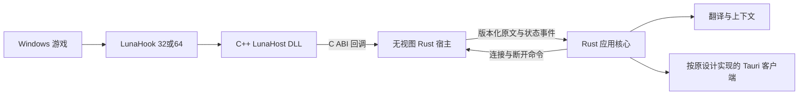

# ADR-001：保留 LunaHook，通过无视图宿主公开回调事件

状态：采用。日期：2026-10-18。范围：全新项目的技术边界；原 PRD 与设计原稿保持不变。

## 产品依据

继承 [`01-prd.md`](../product/original/docs/01-prd.md) v1.2 的 REQ-001～056，
以及 [`02-design-spec.md`](../product/original/docs/02-design-spec.md) 的 SCR-01～22 / DES-01～22。
来源与原始资源逐文件哈希见 [`source-manifest.json`](../product/source-manifest.json)。
新项目不继承旧 Rust/Swift 实现、旧开发任务及旧运行验收状态。
本次重新规划的里程碑替代原稿中的旧 D1/GE 开发顺序与门禁；产品功能、优先级及验收要求仍保留。

原设计的统一客户端路线继续采用 Tauri 2、React、TypeScript、Vite，共享 Rust 应用层和薄平台适配层。
本阶段只建立无视图 Hook 后端及契约，客户端尚不实现；未来客户端逐屏复用原设计。

## 决策

保留原版 C++ LunaHook 与 LunaHost DLL，先不修改 Hook 内核或创建另一套私有 Hook–Host RPC。
`lunahook-host` 是独立的 Windows x64 Rust 进程，通过 DLL 的 C/cdecl API 注册回调。
Host64 可接收 x86/x64 Hook，注入器和 Hook DLL 按目标游戏位数选择。

Windows 产品直接启动宿主；macOS 产品经选定 CrossOver bottle 启动同一 Windows 宿主。
Windows PID、创建时间和可执行路径均来自该 Windows 环境，不能使用 macOS PID 代替。
原生 macOS 游戏另设取字适配器，不能把本路线的验证推广到原生 macOS Hook。

上图右侧的应用核心、翻译和客户端是后续模块；本阶段代码不得把它们塞入宿主。

## “API 回调”的两层含义

1. 宿主进程内：直接调用 `Luna_Start`，接收原版 `OutputCallback`、Create/Destroy、Connect/Disconnect、HostInfo 等回调。
2. 宿主进程外：转换成带版本、请求标识和文本流身份的 UTF-8 JSONL 事件，供 Rust 应用核心订阅。

这不要求 HTTP 服务或网络 webhook。初期用标准输入传命令、标准输出传事件，标准错误传宿主诊断。
若后续原 PRD 的 Web/API 功能需要 HTTP，由应用层提供，不改变 native 回调 ABI。

## 窄后端职责

负责：锁定并校验原生运行时；进程身份/架构核对；连接、注入、断开；原文和文本流元数据；
连接阶段与错误事件；队列溢出统计；宿主退出与诊断。

客户端视图、翻译 HTTP/LLM 请求、术语和上下文、历史数据库、OCR、TTS、游戏库、自动更新
均在应用层或其他适配器中。宿主输出全部候选流，业务层选择 MAGES2 等流；不硬编码游戏地址。

## 成功状态

`ready` 仅表示运行时验证及 Host 初始化完成。attach 响应为 pending。
注入器结束、管道连接、Hook 插入、文本流创建、收到新原文分别是独立证据。
注入器的返回值不是连接成功；Connect 回调也不等于引擎已准备好或已经取到文字。

## FFI 与线程

- `ThreadParam` 按 C 布局、8 字节对齐、32 字节大小验证；地址与上下文不能用 JSON 浮点数传输。
- Windows `wchar_t*` 按 UTF-16、hookname 按 UTF-8，在回调返回前复制。
- 十个回调都提供非空函数；未启用内嵌时给 stub。I18N 返回 null，避开跨分配器所有权。
- 回调可能持有 native 锁，只允许复制及非阻塞入队；不写阻塞 stdout、不翻译、不同步反调 Host。
- FFI 边界捕获 Rust panic。队列满必须产生明确溢出计数；发生溢出的样本不能作为完整性验收通过。
- 命令处理、事件输出和 native 回调分离；输出端堵塞不能让回调线程等待网络或 UI。

## 生命周期

固定版本没有 `Luna_Stop`、Join 或取消 `ConnectNamedPipe` 等待的接口。
因此采用“一个宿主进程一个 Host 实例”，DLL/回调状态保活到进程退出，不调用 FreeLibrary。
正常关闭在命令线程请求 detach、等待有界的 disconnect；仍未连上的等待通过退出宿主进程回收。
新会话通过新宿主进程启动，不能声称已实现进程内安全重启。
首版不允许在同一宿主中再次 attach 已尝试过的 PID，即使上次已断开或失败。
应用层将事件绑定到其私有子进程实例及执行环境；跨实例不能仅凭 PID/地址合并文本流。

只有产品确需进程内启停、取消连接、prepared/失败的明确回执或完整内嵌内存所有权时，
才建立单独 native 补丁任务；不因此重写全部 Hook。

## 验证边界

原版 SR 的 x86 取文及 Never 7 的 x64 MAGES2 在线翻译已有本机对照证据。
它们不是新宿主的通过结果。新宿主必须独立完成真实回调、连续对白及退出恢复验收。
宿主的原生编译、运行时初始化、真实注入、真实文字和客户端视觉分别记录，不能相互替代。

