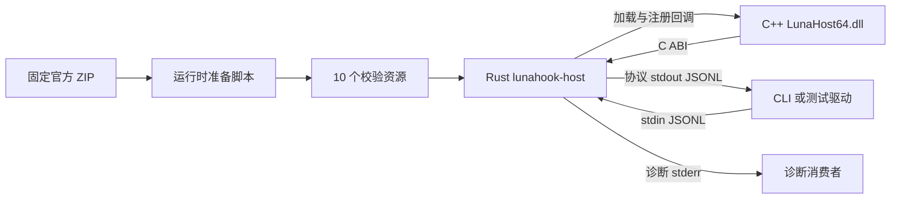
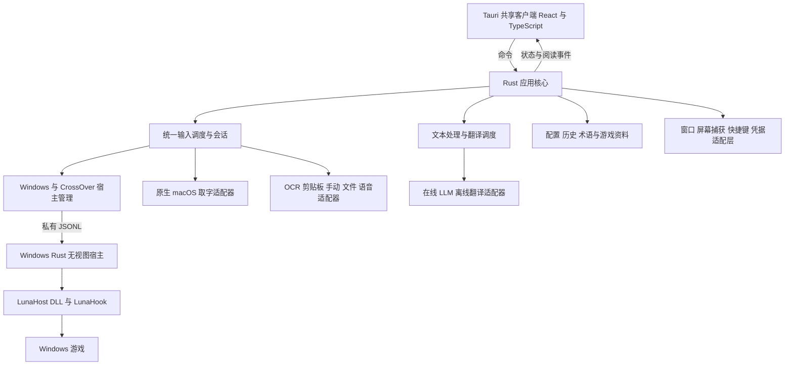
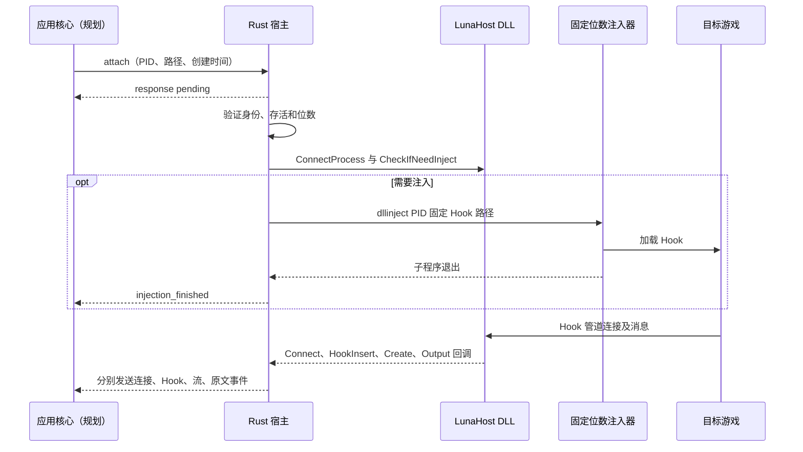
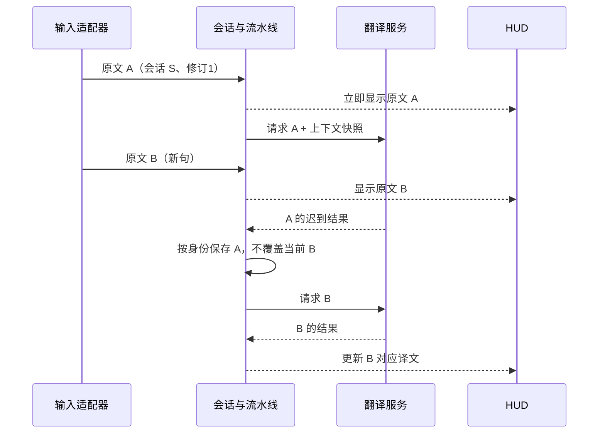

# LunaTranslator 新工程开发架构

> 历史架构记录：本文描述迁移前的原版 LunaHost 接入。后续客户端重建以[客户端重建架构](client-rebuild-architecture.md)与[ADR-003](ADR-003-client-rebuild-on-core.md)为准。本文中的十回调、旧注入器、原版资源及旧验证状态不适用于新 Core；下文保留当时语境。

版本：1.1 · 日期：2026-10-18 · 基线：当前仓库代码与本轮验证记录。已交付的大型离线架构报告保留为此前 v1.0 快照。

本报告面向架构评审、开发实施和后续维护。产品范围继承原 PRD v1.2 的 **56 项需求、22 屏设计**；工程实现与任务重新建立，不继承旧 Rust 项目的代码、任务状态或验收结论。17 个新工作包是开发分工，不能代替原需求的验收。

## 1. 阅读路径与结论

产品负责人先读第 2、3、12、14 章；应用开发者读第 3、4、8～11 章；原生后端开发者读第 5～7、13、15 章。完整协议以 [`hook-api-v1.md`](hook-api-v1.md) 和 [`hook-contracts`](../../crates/hook-contracts/src/lib.rs) 为准，任务与验收以 [`plan.md`](../development/plan.md)、[`requirements.csv`](../development/requirements.csv)、[`verification.md`](../development/verification.md) 为准。

采用的路线是：保留 C++ LunaHook 和无界面 LunaHost DLL，由独立 Windows Rust 宿主接收 C ABI 回调，再向跨平台应用核心输出原文与状态事件。应用核心承担选流、上下文、翻译、历史和配置，Tauri 客户端按原设计呈现。此边界让取字能力可以独立测试，也把原生线程与 UI、在线服务的等待隔开。

“API 回调”包括两个层次：DLL 向宿主回调；应用核心消费宿主事件并向业务订阅者发布。首版传输是私有子进程的 stdin/stdout JSONL，不要求 HTTP 服务器或网络 webhook。原 PRD 中的 Web/API 功能仍保留，后续由应用层提供。

### 1.1 本报告的证据标记

| 标记 | 含义 | 当前例子 |
|---|---|---|
| 已实现 | 当前仓库有对应代码；不自动表示真实游戏通过 | JSONL 契约、资源校验、身份检查、回调包装、有界关闭 |
| 已验证 | 验证记录包含命令、产物或实际输出 | Windows PE 构建；CrossOver 无目标初始化及 ping/status/shutdown |
| 待验证 | 已有实现路径，尚缺相应真实场景证据 | 新宿主连接 Never7/SR，Output 回调、连续取文与压力恢复 |
| 规划 | 仅有本报告的接口和职责设计 | 完整应用核心、翻译服务、SQLite、完整阅读 HUD、原生 macOS 取字 |

后续实机更新：新宿主已独立连接 SR x86；新建 `hook-client` 与 Tauri 桌面客户端已构建为 macOS arm64 release `.app`，在窗口中显示真实变化的原文，并通过最终包正常退出与重新连接检查。当前13项Rust单测、1项文档测试通过。Never7、长稳及完整产品仍待验收，详见[验证记录](../development/verification.md)与[可视化验证报告](../../reports/luna-desktop-validation-20261018.html)。

## 2. 目标、范围与产品继承

目标是建立可维护的跨平台翻译产品，而非只做一个 Hook 演示。56 项需求覆盖 Hook、OCR、剪贴板、手动/文件/语音输入、翻译与 LLM、文本优化、学习工具、游戏库、HUD、网络接口、迁移、诊断与发布。保留原优先级：22 项 P0、27 项 P1、7 项 P2。原生 macOS 游戏取字、独立 OCR、凭据和无障碍要求没有因工程重排被取消。

本阶段先验证独立取字后端，再按用户补充的验收标准交付可打包原文客户端切片。界面复用 SCR-04/05 的连接和选流关系，完整翻译与 HUD 后续实现。暂不重写所有引擎、不搬运 C++ 内部对象、不裁剪 Python/Qt 客户端；现有 LunaHost DLL 本身已提供无界面接口。

产品快照保留原 PRD、设计规范、22 屏及 89 张预览图，100 个原始文件逐项校验哈希。原稿来自远端未纳入 Git 的工作文件，因此其身份由 [`source-manifest.json`](../product/source-manifest.json) 的路径与 SHA-256 固定，不能用远端 HEAD 代指文档版本。旧稿中的开发顺序由新计划替代，功能和设计验收要求继续生效。

## 3. 系统架构：当前与目标

### 3.1 当前已实现的最小系统



SR x86 的连接、候选流与原文已在独立宿主及打包客户端中实际验证；Never7 x64 与 H3 长稳另行验收。当前客户端链路为 `Tauri/React → hook-client → lunahook-host → 原版 DLL`，窗口通过150ms顺序快照显示真实原文。

### 3.2 目标产品架构



上图只有 Windows 宿主、契约和原生运行时准备已进入当前实现；其余组件为目标设计。核心没有 UI 类型和操作系统句柄；平台细节通过接口注入。翻译器不会被载入游戏，网络超时不会在 native 回调栈内发生。

### 3.3 依赖方向与建议目录

当前工作区包含四个 crate：`lunahook-host → hook-contracts` 与 `luna-reader → hook-client → hook-contracts`。客户端通过受管 JSONL 子进程使用宿主，不链接 Windows DLL。`hook-contracts` 依赖 serde/serde_json；宿主另用 sha2，并只在 Windows 下引入 libloading 和 windows-sys。工作区采用 Rust 2024 edition、最低 Rust 1.89，实际锁定依赖见 Cargo.lock 与前端 package-lock.json。

| 目录或模块 | 状态 | 职责与禁止事项 |
|---|---|---|
| `crates/hook-contracts` | 已实现 | 请求、响应、事件、标识和错误；不依赖 Windows 或 UI |
| `crates/lunahook-host` | 已实现、SR x86取文已验证 | FFI、进程身份、原生连接、注入器、协议和退出；不负责翻译与数据库 |
| `crates/hook-client` | 最小桌面切片已实现 | 受管子进程、目标复核、完整流标识、每流100条快照历史与诊断日志；不依赖Tauri |
| `native/`、`scripts/prepare_lunahook_runtime.py` | 已实现 | 固定来源、资源哈希、准备窄运行时；不执行游戏或注入 |
| `crates/app-model` | 规划命名 | 跨输入领域模型；不得反向依赖适配器 |
| `crates/app-core` | 规划命名 | 用例、会话、调度、领域事件和端口；依赖领域模型 |
| `crates/input-*`、`translation-*`、`storage-*` | 规划命名 | 实现核心端口；外部库错误转换成领域错误 |
| `crates/platform-windows`、`platform-macos` | 规划命名 | 进程、窗口、捕获、凭据与系统能力 |
| `apps/desktop` | 原文窗口已实现并打包 | Tauri 组合根及 React UI；负责组装、选流显示与退出清理，完整HUD后续实现 |

建议先按上述逻辑分模块，达到独立测试和复用需求再拆 crate，避免为目录数量引入无意义包装。UI、CLI 和未来 HTTP 接口复用同一用例层；持久化与 provider 是可替换实现。原生 DLL 的不安全代码继续集中在宿主内，其他 crate 不复制 ABI 定义。

## 4. 执行环境与部署边界

### 4.1 Windows 原生

桌面应用启动 Windows x64 宿主，宿主加载 Host64，再按目标位数选择 Hook32/64 和 Subprocess32/64。Host64 能接收两种 Hook，不要求应用自己做 32 位 UI。目标必须以 Windows PID、创建 FILETIME 和绝对映像路径联合核对，避免 PID 重用或同名进程误连。

### 4.2 macOS 上的 CrossOver

macOS Tauri/Rust 应用无法直接加载 Windows PE DLL。平台适配器负责确认 CrossOver、选择 bottle、在同 bottle 内查询 Windows 目标身份并启动 Windows 宿主。macOS PID 只用于管理自有宿主包装进程，不能作为 Hook 目标 PID。

应用必须持续读取 stdout 与 stderr，记录宿主实例及环境身份；断开只处理本次拥有的 helper，不执行整个 bottle 的全局关闭。改变 bottle 后重新核对目标，不静默沿用旧会话。当前 smoke 脚本证明指定环境可加载宿主，但自动枚举、受管启动和恢复仍在 P1。

### 4.3 原生 macOS 游戏

这是独立后端项目：需要针对可接入真实游戏和系统限制验证提取入口，记录架构、签名和接入方式。其上层同样输出统一 InputEvent；不能复用 Windows DLL，也不能用 CrossOver 结果声称原生游戏兼容。OCR/剪贴板是独立输入路径，产品应明确显示当前来源。

| 能力 | Windows | macOS + CrossOver | 原生 macOS |
|---|---|---|---|
| 固定 Host 加载 | 实现；MSVC 原生运行待验收 | 已验证无目标初始化 | 不适用；直接运行返回 unsupported |
| 新宿主 x86/x64 游戏取字 | 原生Windows实机待验收 | SR x86已通过；Never7 x64待验收 | 需 P2 独立后端 |
| 目标身份与架构核对 | 宿主实现 | 必须在 bottle 的 Windows 环境核对 | 需原生进程身份模型 |
| 内嵌/模拟器业务 | 规划 X1 | 逐目标验证 | 由新后端单独声明 |
| 统一翻译与历史 | 规划，共享核心 | 规划，共享核心 | 规划，共享核心 |
| 窗口、捕获、快捷键 | 规划原生适配 | macOS 窗口与 guest 进程需关联 | 规划原生适配 |

能力必须分开记录“实现状态”“目标适用性”“执行环境”和具体证据；游戏能启动、helper ready、Hook 连接、取文、回写是不同结果。

## 5. 无界面宿主的内部实现

### 5.1 固定资源和信任边界

上游固定为 LunaTranslator `v12.1.2.3`，commit `c8701872a5de83f8d3272f3967457d0b8f2983c4`。[`native/upstream.lock.json`](../../native/upstream.lock.json) 包含官方 ZIP 和 10 个运行时文件的大小、哈希与 ABI profile。准备脚本先验证全部数据再落盘；宿主加载前再次按内置清单验证，不信任用户可改的运行时清单。

运行时文件拒绝符号链接，Windows 还检查已打开文件的 reparse point 属性；运行时目录自身先规范化为实际路径。Windows 文件句柄在使用期间禁止写入和删除共享，降低校验后替换风险。DLL 使用限定搜索标志加载，避免由当前目录决定依赖；注入路径由固定目录和目标位数决定，协议不接受任意 DLL 路径。

### 5.2 线程职责

| 执行单元 | 做什么 | 等待边界 |
|---|---|---|
| native 回调线程 | 复制字符串和按值元数据，更新控制状态，非阻塞入队 | 不写 stdout、不联网、不调用 UI、不同步反调 Host |
| stdin 读取线程 | 读帧、限制长度、解析请求 | 阻塞读取不阻塞 supervisor |
| supervisor | 校验命令、维护阶段、超时与关闭、转发事件 | 每次有界排空，避免文本洪流饿死控制命令 |
| native worker | 顺序调用 Host 连接/断开、管理自有注入器 | 不占用 supervisor；已尝试的 PID 不在同实例重连 |
| 协议 writer | 序列化事件、flush、报告溢出 | 输出堵塞不得倒灌为回调线程等待 |

Connect/Disconnect 同时写入原子状态槽，控制状态不依赖可能溢出的文本队列。公开事件仍可能丢失，所以应用发现 overflow 或完整性失效后，不能把当前记录称为完整；status 能帮助核对目标阶段，不能补回丢失的原文。

### 5.3 FFI 与所有权

`ThreadParam` 使用 `repr(C, align(8))`，大小 32 字节，字段偏移 0/8/16/24。函数采用 `extern "C"`，不把 C++ TextThread、HookParam 或 STL 对象带出 DLL。`Luna_Start` 的十个回调均非空；Embed/Emu 为 stub，I18N 返回 null。这只满足 ABI，不表示内嵌、模拟器业务已实现。

hookcode 和 text 按 UTF-16 复制，hookname 按 UTF-8 复制；返回前转成 Rust 所有权字符串。当前使用 lossy 解码，无效编码会替换字符，不保留原始字节；“未观察到队列丢失”不等于编码逐字节无损，严格编码错误策略需在 H3 样本中确认。当前回调扫描上限为 65,536 个 UTF-16 单元、4,096 个 hookname 字节，超限或空指针报告 `callback_invalid` 并记完整性丢失。上限防止无界扫描，但不能把任意无效 native 指针变安全；实现依赖固定 ABI 对回调期指针有效性的保证。

回调通过 catch_unwind 阻止 Rust panic 越过 C 边界；它不能恢复访问违例或原生进程崩溃。DLL 与回调状态一直保活到宿主退出，不 FreeLibrary。固定 Host 没有 Stop/Join 和取消待连接管道接口，进程边界就是资源回收边界。
这里回收的是本宿主拥有的句柄、线程和内存；若未确认 detach，游戏内 Hook 的状态仍未知。宿主退出、管道断开或收到 disconnect 均不能单独证明目标 DLL 已安全卸载，恢复连接前须重新核对实际目标状态。

### 5.4 stdout 隔离

原生代码存在 printf，不能与 JSONL 混写。宿主先复制原始 stdout 句柄供协议 writer 独占，再把 Win32/CRT stdout 重定向到 stderr；自有注入器 stdout 丢弃、stderr 交诊断。SR真实Output回调已触发；独立宿主和桌面客户端采样均保持合法JSONL，无观察到的错误或溢出。高负载与阻塞恢复仍待H3。

## 6. API、状态与连接时序

### 6.1 已实现的协议

每行 UTF-8 JSON 为一帧，`v=1`；请求 ID 是 1～128 个受限 ASCII 字符，单帧请求上限 64 KiB，拒绝未知字段/方法/版本。所有可能超过 JavaScript 精确整数范围的地址、上下文、FILETIME 和累计丢失数量采用规范十进制字符串。

```json
{"v":1,"id":"attach-1","method":"attach","params":{"pid":2896,"expected_image_path":"C:\\Games\\Never7\\GameN7_Steam.exe","expected_creation_time":"134000000000000000"}}
```

示例 PID、路径与时间只是格式演示，不能直接用于本机连接。可用方法是 `ping/status/attach/detach/shutdown`；attach 返回 `pending`。事件包括 ready、response、error、进程连接/断开、流创建/销毁、text、log、hook_inserted、injection_finished 和 overflow。

### 6.2 连接阶段必须独立



注入器退出和 native 回调存在竞态，图中并不承诺两者严格先后。原版 helper 接受返回值为 **1**；0 或1都不能独立证明收到原文。Connect 回调也不等于引擎 prepared；当前协议没有独立 prepared 回执。只有新 text 能证明该流本次产生了原文。

### 6.3 当前状态和限制

目标阶段有 `pending/connected/timed_out/failed/disconnected`。同一宿主最多记录 16 个曾尝试目标，最多一个 attach 在进行中；同一 PID 只尝试一次，断开、失败、超时或 PID 重用均需新宿主实例。请求 ID 在整个宿主实例内不可复用，当前预算为 65,536 个，耗尽后允许以新 ID shutdown 再启动新实例。当前 detach 要求回调确认 connected；待连接监听通过关闭宿主回收。

应用层必须将流标识扩展为 `(environment_id, host_instance_id, StreamId)`。仅凭 PID、地址和 context 会混淆不同 bottle、重启及旧事件。v1 没有事件序号或重放接口；应用可记录接收顺序，但不能据此证明传输无丢失。

## 7. 背压、生命周期和错误处理

当前回调队列与输出队列容量各 256；满时立即记录丢失并返回，不阻塞 native。文本、response 和 error 共用输出队列，因此控制响应也可能丢失；这是一条显式报告丢失的通道，不提供可靠交付或恰好一次语义。writer 能继续输出后发送 overflow，`status.integrity_lost` 也会保持为真。连接控制状态有独立原子槽，可补发新 status 请求核对阶段。输出完全堵塞时，overflow 或 status 本身也无法及时到达；消费端必须持续读管道，并把请求超时、宿主退出和自身队列状态纳入诊断，不以相同 ID 盲目重试 attach。

当前连接期限为 15 秒，自有注入器最多等待 12 秒并受连接总期限约束，关闭控制期限为 2 秒，随后最多等待 300ms 输出排空。它们是实现参数，不是性能指标或所有游戏的兼容承诺，也不是覆盖 DLL 初始化和所有系统调用的全局超时。native worker 阻塞与上游待连接线程不能在进程内被完整 join；关闭超时尝试报告错误后退出进程，由操作系统回收。

关闭步骤为停止接收新用例、取消自有 attach/注入器、请求断开已管理目标、在期限内观察回调，最终退出宿主。应用核心将来还须停止翻译任务并保存自身状态；绝不能为关闭 helper 而终止用户游戏、原版 Luna 或整个 bottle。应用重开连接应创建新宿主、重新查询目标身份，不复用旧流对象。

| 失败模式 | 当前/目标响应 | 开发诊断重点 |
|---|---|---|
| 缺资源、hash 错、链接替换 | 已实现加载前拒绝 | 记录所需版本和文件，不绕过校验 |
| 错 PID、路径或创建时间 | 已实现身份失败 | 重新枚举；不自动接受同名进程 |
| 错位数、无法确认位数 | 已实现拒绝 | 区分 native CPU 与目标进程架构 |
| x86 WOLF 特定目标 | 首版显式不支持 | 固定上游注入器含校验修改分支，纯注入器另立任务 |
| helper 返回1但无连接 | pending 最终超时 | 分开查 helper、管道、DLL、Hook；不伪报成功 |
| 连接但无原文 | 等待/诊断；未视作取字成功 | 是否推进对白、是否正确引擎及候选流 |
| 队列满、无效回调 | 记录 overflow/完整性失效 | 降低消费阻塞，重新采样，不能补写虚构原文 |
| 在线翻译失败 | 应用层规划保留原文并允许重试 | provider 超时、凭据、限流与调度分别记录 |

有界事件队列不等于总内存有界。当前沿用 Host 每流 10,000,000 个 UTF-16 字符的历史上限；多流长稳仍可能占用大量内存。H3 要测内存曲线，再判断是否缩限历史或做窄补丁，不在没有数据时承诺固定资源上限。

## 8. 应用核心与适配器接口（设计草案）

本章未实现。接口用于明确责任；类型名、异步运行时、数据库与插件加载方式尚未冻结，不能把伪代码当作当前公开 API。

```rust
// 设计草案，非当前可编译接口。
trait InputBackend {
    async fn capabilities(&self, target: &Target) -> CapabilityReport;
    async fn start(&self, request: StartInput) -> InputSession;
    async fn stop(&self, session: SessionId) -> StopResult;
    // InputSession 提供所有权事件流；停止与结果交付可分别观察。
}
trait TranslationProvider {
    async fn translate(&self, request: TranslationRequest) -> TranslationOutput;
}
trait HistoryRepository {
    async fn append_sentence(&self, sentence: &Sentence) -> StoreResult;
    async fn save_result(&self, result: &TranslationResult) -> StoreResult;
}
trait CredentialStore {
    async fn resolve(&self, reference: CredentialRef) -> Secret;
}
```

InputBackend 统一“启动、停止、能力、事件”，不强迫 OCR 伪装成 Hook 的 address/context。HookAdapter 负责 JSONL 到领域事件，OCRAdapter 负责捕获和识别，手动输入通过一次性命令进入相同流水线。TranslationProvider 不感知游戏句柄和 UI 控件，只收到语言、处理后文本、上下文快照与凭据引用解析结果。
草案中的 Target 是输入选择的联合模型，应允许进程、窗口、屏幕区域或无目标；它不等于强制的 GameProfile/TargetIdentity，独立 OCR、剪贴板和手动输入不要求先有游戏。

平台端口提供环境枚举、进程身份、目标窗口、截图、快捷键和安全存储；应用核心只使用稳定标识。UI 不能直接调用任意 DLL 或拼装 shell。provider 和输入插件先采用静态接口适配，动态脚本或进程插件需要单独的权限、版本和故障隔离设计，不能直接执行旧配置中的代码。

## 9. 统一数据模型与翻译一致性（设计草案）

| 模型 | 关键字段 | 用途与约束 |
|---|---|---|
| ExecutionEnvironment | id、kind、platform、bottle_ref、version | 区分原生 Windows、compat_windows、原生 macOS；稳定引用与本机路径分开 |
| GameProfile / TargetIdentity | game_id、环境、映像路径、创建时间、窗口引用 | 持久游戏资料与本次运行目标分开；PID 不作长期主键 |
| InputSession | session_id、generation、input_kind、environment_id、backend_instance | 每次重连新实例；记录暂停/运行、完整性和能力 |
| InputEvent | session、source、received_at、payload、diagnostic_refs | 原始来源可追溯；Hook 流只是 payload 一种 |
| Sentence | sentence_id、session、source_revision、raw_text、processed_text、speaker? | 原文与处理结果分开；说话人仅来自实际证据，不猜测 |
| TranslationRequest | request_id、sentence_id、revision、provider、config_revision、context_snapshot | 固定该次请求使用的规则、术语、上下文和配置 |
| TranslationResult | request_id、sentence_id、revision、provider、text、status、timings | 按请求归属保存；错误、部分流式结果和最终结果分开 |

处理顺序建议为原文接收 → 来源/选流 → 去重与聚合 → 有序预处理 → 术语/上下文快照 → 翻译调度 → 后处理 → 保存结果与阅读事件。每个规则保留 ID、版本和启用作用域；预览复用实际处理器，不建立另一套近似规则。

防止旧译文覆盖新句的条件是：结果所属 session/generation 仍有效、sentence 与 source_revision 匹配、当前显示槽仍指向该句，以及该 provider 结果未被更高 revision 替代。切流、断开或修改原文时提高 generation/revision，并取消可取消的请求。取消失败的结果仍可归入历史，但不得覆盖当前 HUD。流式分片也必须带同一身份和递增片段序号，最终状态到达后不再接受旧分片。



暂停持续输入、隐藏 HUD、停止翻译执行和停止某个输入任务是不同命令。一次 OCR 或手动翻译不会替换当前持续 Hook/OCR 来源；它们以独立任务身份进入流水线。字符去重不能全局套用，否则合法重复台词会被丢弃；策略需按输入类型、来源和时间窗口配置并保留原文。

## 10. 配置、历史与凭据（设计草案）

建议配置采用带 schema_version 的可迁移结构化文件，历史、句子、译文和索引采用 SQLite。具体选择 serde 配置格式、rusqlite 或 sqlx、异步运行时和连接策略尚未锁定，应由 A1/A2 的小型实测后记录 ADR；当前没有这些存储模块。

配置分“全局默认、当前配置、游戏专用”并显示有效值与来源。跟随默认与自定义备份分别存储：重新跟随后不覆盖旧备份；再次解除跟随时恢复备份或复制当前有效值。配置变更生成 revision，正在执行的请求继续引用原快照。需要重连的字段明确提示，不静默重连游戏。

SQLite 建议以 sessions、sources、sentences、translation_requests、translation_results 为主表，附配置/规则快照引用与完整性标记；game_id 与 sentence_id 不能由可变标题生成。事务覆盖一次句子和相关状态更新，索引服务于会话时间线和检索。截图/音频等大资源放独立目录并保存引用和生命周期，避免数据库膨胀。保留、清理和导出由用户配置，不默认永久保存所有内容。

API key 只保存在系统凭据库，配置和数据库保存 CredentialRef。macOS Keychain、Windows 系统安全存储由平台适配器封装，具体 Rust 库未锁定。UI 展示掩码和测试状态，不接收完整密钥回显；在线请求才解析凭据。诊断、导出和失败消息默认去掉密钥、认证头与敏感本机路径；是否附原文、截图和上下文应有明确选择。

## 11. Tauri 边界与原设计实施（规划）

共享客户端采用 Tauri 2 + React + TypeScript + Vite；Rust 应用核心是唯一业务状态源，React 保存编辑草稿、导航和显示状态。Tauri 作为组合根组装平台实现，命令进入用例层，不在组件里直接做 HTTP 翻译或操作 native 宿主。

建议命令为 `list_targets/start_input/stop_input/select_stream/submit_text/set_input_paused/update_config/retry_translation`，事件为 `session_changed/stream_changed/sentence_received/translation_updated/capability_changed/diagnostic`。这些是命名草案。命令有 request_id，事件有 session 和 revision；窗口重新订阅时先订阅并缓冲增量，再原子读取状态与领域事件游标快照，丢弃已被快照覆盖的增量后继续消费，避免快照与订阅之间漏事件。这个游标属于规划中的应用层，不代表当前宿主 JSONL v1 已有序号或重放能力。窗口关闭不会销毁应用核心的后台任务。

原设计的 SCR-01 HUD 为默认约 500×132pt、最小宽 360pt，原文16pt、译文22pt、状态13pt，32pt 固定操作行在正文滚动区外，默认暂停/继续和更多。隐藏不等于暂停，显示不夺游戏焦点。SCR-12～21 为十类单层设置，参考1000×720pt、最小900×600pt，不增加服务第二侧栏。SCR-04 连接与 SCR-05 选流必须逐阶段呈现证据，不能把 ready 显示成取文成功。

SCR-06 OCR 必须可从全局快捷键/菜单独立框选，拖框松手开始，不要求先添加游戏或进入设置。200% 字号、键盘操作、VoiceOver/系统辅助能力、减少透明度与多显示器恢复保留原验收要求。UI 使用原设计截图做 Playwright 对比，置顶、穿透、焦点、全屏与快捷键仍需系统真机检查；浏览器图像不能替代原生窗口行为。

## 12. 构建、交付与验收

当前资源准备命令见 [`native/README.md`](../../native/README.md)，实际 Windows 构建和 CrossOver smoke 命令见[验证记录](../development/verification.md)。本轮产物使用 `x86_64-pc-windows-gnullvm`、LLVM-MinGW 20261006/Clang23.1.3、静态 unwind；`windows-gnu` 编译检查不等于该链接产物。Windows 原生 MSVC、签名安装包和自动更新尚待 R1。

发布包建议分为桌面应用、锁定宿主、native 资源清单和对应许可证/来源材料；版本升级以“应用契约版本、宿主版本、ABI profile、上游 commit、运行时 hashes”一起记录。升级后不静默替换正在加载的 DLL，现有会话结束后启用新版本；保留旧版本和配置备份用于回退。原生二进制不进入产品资料快照，也不把工作目录 diagnostics 默认装入发布包。

| 验证层 | 需要证明的事实 | 当前状态 |
|---|---|---|
| 产品追溯 | 56需求/22屏与原稿一致，17包映射无漏项 | 已验证 |
| 契约和资源 | 精度、帧、ABI、非法输入、哈希和链接拒绝 | 已有针对性测试 |
| 构建和初始化 | 真实 PE、正确依赖、Host 加载与基础命令 | CrossOver 已验证；Windows MSVC 待验证 |
| Hook 集成 | Never7 x64、SR x86 的流和连续原文 | H2 待验证 |
| 稳定性 | 退出、超时、堵塞、溢出、重开、内存曲线 | H3 待验证 |
| 应用闭环 | 原文→真实翻译→对应历史，旧结果不串句 | A1/A2 待实施 |
| UI 与平台 | 22屏设计、窗口行为、权限和无障碍 | U1/S1及各适配器待实施 |

首轮稳定性建议采集100句/30分钟，再覆盖读档、快进、退出重开；这是待执行的样本计划，没有实测吞吐、内存或时延结论。H2/H3 记录逐阶段时间、流数量、完整性、错误和峰值内存，测量后才设性能预算。测试应覆盖外部行为和失败恢复，不为通过而硬编码 MAGES2 地址、PID 或游戏对白。

## 13. 安全与运行诊断

宿主提供本机私有管道接口，不开放公共监听、不自动提权、不接受自选 DLL 注入路径。应用层未来 HTTP/WebSocket 必须另设认证、绑定范围、消息上限、速率与背压，不能直接把私有 attach 能力暴露为无鉴权网络 API。Tauri 能力和外部资源访问按窗口与用途授权，显示内容不能获得任意 shell/native 执行能力。

诊断按 `environment → host_instance → request/session → target → stream → sentence → translation` 关联，保留阶段、版本、错误码、完整性和必要计时。原文和本机路径可能敏感，应与纯运行元数据分级。若游戏卡住，应分别取游戏与宿主的线程样本、stderr 和阶段记录；先定位卡在加载、管道、Hook 安装还是消费等待，不从“已发起注入”推导根因。

## 14. 开发分工与里程碑

| 工作包 | 主要责任 | 关键依赖与门槛 |
|---|---|---|
| F0 | 原产品快照、来源、需求和设计映射 | 作为全部工作的可追溯基线 |
| H1 | 契约、ABI、无视图宿主和资源锁 | 已有基础实现与初始化证据 |
| H2 | 新宿主真实 x64/x86 取文 | H1；扩展兼容范围前先完成 |
| H3 | 生命周期、背压、失败与窄补丁 | H2真实路径和故障样本 |
| A1 | 应用核心、环境、游戏/会话、选流和配置 | H1；不依赖图形界面 |
| A2 | 流水线、翻译、历史、上下文和术语 | A1；先证明真实译文和一致性 |
| P1 | Windows/CrossOver 受管宿主与目标枚举 | H2/A1；同环境身份与恢复 |
| P2 | 原生 macOS 取字后端 | A1；独立真实原生游戏验收 |
| S1 | 窗口身份、绑定和屏幕/窗口捕获 | A1；两平台权限和缩放 |
| U1 | 共享 UI、HUD、历史和设置 | A1/A2；按原22屏实施 |
| I1 | 手动与剪贴板 | A1/A2/U1；一次任务不覆盖持续来源 |
| I2 | 独立 OCR、选区、一次与实时任务 | A1/A2/S1/U1；完整视觉链路 |
| I3 | 文件、网络和语音输入输出 | A1/A2/U1；各服务独立验收 |
| X1 | 特殊码、直接读取、内嵌与模拟器 | H3/A2/P1或P2；取字与回写分开 |
| L1 | 分词、词典、Anki和TTS | A2/U1；真实文本与外部服务 |
| G1 | 游戏库、元数据、时长、备忘和系统工具 | A1/S1/U1；资料与会话不串 |
| R1 | 发布、更新、诊断、凭据、国际化和维护检查 | 贯穿全部；证据与实际产物 |

里程碑 M1 是 H1→H2→H3 的独立取文后端；M2 为 A1/A2/P1 的真实应用翻译闭环；M3 接原设计 UI 和 P0 输入/平台能力，按原需求逐项验收；后续按 P1/P2 完成扩展。P2 原生 macOS、S1 与 R1 应尽早做独立风险验证，不等 Windows UI 全做完才开始。里程碑表示交付切片，不能把 M1 标为完整产品 P0 完成。

## 15. 架构决策、待决项和参考

### 15.1 已决事项

保留 LunaHook/Host、独立进程隔离、C ABI→版本化 JSONL、十个非空回调、回调立即复制且不阻塞、全宽整数用字符串、DLL不卸载、重连新宿主、Windows/CrossOver与原生Mac分后端、共享Tauri客户端，均属于已采用边界，详见 [ADR-001](ADR-001-headless-lunahook.md)。变更这些边界需要说明问题、替代方案、影响与验证证据。

### 15.2 需后续实测和记录的决策

| 待决项 | 决策时机 | 判断依据 |
|---|---|---|
| 应用异步运行时与取消模型 | A1启动 | 子进程、provider、捕获和关闭整合；核心测试便利性 |
| SQLite访问库、配置格式和迁移 | A1/A2 | 事务/索引、打包体积、异步模型、备份恢复 |
| Windows/Mac安全存储库 | R1早期 | 系统凭据、升级迁移、失败提示；不落明文配置 |
| 原生Mac首款游戏和提取入口 | P2早期 | 可获得真实原文、系统权限与架构限制 |
| Host窄补丁、历史缩限、纯注入器 | H2/H3后按证据 | 取消/Stop/Join、准备回执、内存曲线及x86目标约束 |
| 协议序号、快照恢复、插件隔离 | 消费端集成后 | 能否识别缺口、恢复状态；不承诺重放丢失原文 |
| 签名、安装器、更新与产物分发 | R1 | 实际Windows/macOS产物和回退测试 |

### 15.3 源码导航

行号针对本报告生成时的代码快照；重构后以符号名定位。

| 文件与位置 | 阅读重点 |
|---|---|
| [`hook-contracts/src/lib.rs`](../../crates/hook-contracts/src/lib.rs):14、70、170、218 | 协议版本、请求验证、StreamId、Event |
| [`lunahook-host/src/abi.rs`](../../crates/lunahook-host/src/abi.rs):9 | C ABI类型及布局测试 |
| [`lunahook-host/src/runtime.rs`](../../crates/lunahook-host/src/runtime.rs):39 | 固定运行时校验和文件保活 |
| [`windows/mod.rs`](../../crates/lunahook-host/src/windows/mod.rs):65、205、411、511 | 线程组装、命令状态机、关闭和writer |
| [`windows/callbacks.rs`](../../crates/lunahook-host/src/windows/callbacks.rs):25、100、204 | 原子控制状态、FFI错误边界和Output |
| [`windows/native.rs`](../../crates/lunahook-host/src/windows/native.rs):39、108、197 | DLL加载、连接/注入器、stdout隔离 |
| [`windows/identity.rs`](../../crates/lunahook-host/src/windows/identity.rs):34、121、174 | 身份/架构核对和首版x86目标限制 |
| [`queue.rs`](../../crates/lunahook-host/src/queue.rs):23、[`framing.rs`](../../crates/lunahook-host/src/framing.rs):11 | 非阻塞背压和有界JSONL读取 |

原始依据：[PRD](../product/original/docs/01-prd.md)、[设计规范](../product/original/docs/02-design-spec.md)、[本地设计画廊](../product/original/design/index.html)、[来源清单](../product/source-manifest.json)。原生接口依据：[固定版本 LunaHostDll.cpp](https://github.com/HIllya51/LunaTranslator/blob/c8701872a5de83f8d3272f3967457d0b8f2983c4/src/NativeImpl/LunaHook/LunaHost/LunaHostDll.cpp)、[host.cpp](https://github.com/HIllya51/LunaTranslator/blob/c8701872a5de83f8d3272f3967457d0b8f2983c4/src/NativeImpl/LunaHook/LunaHost/host.cpp)、[textthread.cpp](https://github.com/HIllya51/LunaTranslator/blob/c8701872a5de83f8d3272f3967457d0b8f2983c4/src/NativeImpl/LunaHook/LunaHost/textthread.cpp)。

术语：Host 是运行在 Windows 进程中的原生通信宿主；Hook 是进入目标游戏的 DLL；宿主实例是本次 Rust 子进程；文本流是来源身份，不等于翻译会话；原文句子是业务流水线处理的单位；完整性表示本次采集是否观察到丢失，与翻译质量及引擎兼容性分别记录。
