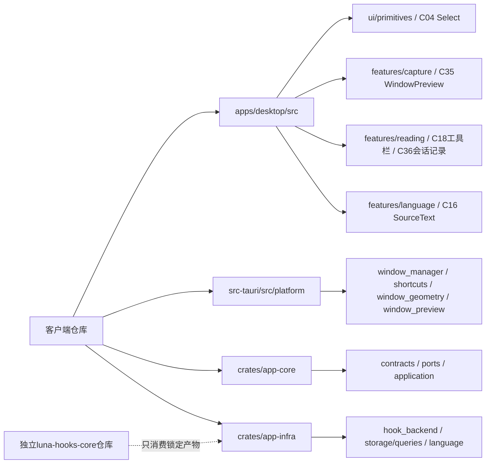

# 工程组织与文件职责

本文件是[首版研发基线](first-product-engineering-baseline.md)的目标目录规范。它同时描述既有工程边界与后续目标结构；`app-core`、`app-infra`、`language-worker`、新Core锁与资源已存在，未创建的具体节点仍为计划，不将整棵树当实现清单。当前按R90实施；源码存在、独立切片审阅和产品验收分别登记，不能由目录图推定正式包通过。

[查看总体目录结构图（SVG）](engineering-directory-map.svg)：按目录层级展示桌面应用、Rust模块、资源、测试与工具、文档及产物；独立的`luna-hooks-core`绘制在客户端仓库之外。总体图不单独声明本轮增量已实现，最新窗口预览、快捷键与会话数据目录见第6节及[技术增量树](reading-window-session-technical-design.md#9-拟增量目录与接口归属)。完整文件名与职责以下方文件树为准。

## 目标目录与当前落地的区别

本页树形结构表示职责组织目标，不能据路径名推定代码尚未实现。[当前实施计划](../development/current-client-alignment-plan.md)与本轮分片回执列出已接源码及残余差距；旧[源审登记](implementation-status.md)仍绑定此前冻结源，当前整树待重新独审，不以刷新其指纹延续旧结论。当前已存在app-core、app-infra、hook-client/contracts、lunahook-host、language-worker、四角色Tauri窗口和多数React组件；C35预览卡／详情、C36会话全量面板及WindowPreviewPort已有源码；完整状态、原生和同包效果仍分别验收。目标模块可能暂集中在已有`.rs`文件，不能仅因目标目录草图更细就把其业务标成不存在。

R90已在既有边界内增加版本化服务图、服务目录/表单、授权叶、私有存储查询及离线翻译worker。`target_paths`表示职责组织，`evidence_refs`与实际回执表示具体来源；完整页面和正式包仍需独立验收。

## 1. 仓库边界

- `luna-hooks-core`继续独立仓库，只维护C++ Hook/Host/Injector及其ABI、构建与许可。
- 本仓库维护Rust客户端、broker、原生语言worker、应用核心、前端及产品文档。
- Core和语言资源通过锁定的产物/manifest进入构建；不把上游源码、游戏安装目录或个人诊断复制进产品源码。

## 2. 目标源码树

```text
luna-translator/
├── Cargo.toml / Cargo.lock                 # Rust workspace与精确依赖
├── rust-toolchain.toml                    # 经B0验证的固定工具链，计划新增
├── apps/
│   └── desktop/
│       ├── package.json / package-lock.json
│       ├── vite.config.ts / tsconfig.json
│       ├── src/
│       │   ├── app/
│       │   │   ├── bootstrap.tsx           # 选择窗口角色、装配UI端口
│       │   │   ├── navigation.ts          # 主窗/设置导航与返回意图
│       │   │   └── ErrorBoundary.tsx
│       │   ├── bridge/
│       │   │   ├── contracts.generated.ts # Rust DTO生成，不手改
│       │   │   ├── application-port.ts    # command/query/subscribe界面端口
│       │   │   ├── tauri-port.ts          # 唯一invoke/Channel封装入口
│       │   │   └── projections/           # 快照、revision恢复、selectors
│       │   ├── windows/
│       │   │   ├── main/MainWindow.tsx
│       │   │   ├── hud/HudWindow.tsx
│       │   │   ├── settings/SettingsWindow.tsx
│       │   │   └── learning/LearningWindow.tsx
│       │   ├── features/
│       │   │   ├── library/               # 游戏库、添加/编辑/移出
│       │   │   ├── capture/               # 窗口核对、接入、选流
│       │   │   ├── reading/               # 会话、阅读控件、多译文
│       │   │   ├── language/              # RubyToken、词卡、释义
│       │   │   ├── study/                 # 固定对象、文法/词义解释
│       │   │   ├── history/               # 列表详情、重译、人工修正
│       │   │   ├── manual-input/          # 无游戏输入
│       │   │   ├── model-config/          # 用途/品牌引导、已保存编辑、共享选择及显式授权/测试
│       │   │   ├── preferences/           # 阅读/显示/快捷键/资源版本
│       │   │   └── diagnostics/           # 分阶段故障与恢复
│       │   ├── ui/
│       │   │   ├── tokens/tokens.json     # 既有产品token源，生成CSS；不擅改批准token
│       │   │   ├── tokens/generated.css
│       │   │   ├── icons/{Icon.tsx,registry.tsx}
│       │   │   ├── primitives/            # React Aria窄封装；有限选择统一Select，无原生下拉皮肤
│       │   │   ├── patterns/              # GroupForm、PageHeader等
│       │   │   └── reset.css
│       │   └── i18n/{zh-CN.json,ja-JP.json,en.json}
│       ├── tests/
│       │   ├── components/                # 有价值的行为与无障碍检查
│       │   ├── visual/                    # Playwright基线与旅程
│       │   └── support/design-port.ts     # 测试专用，不进入release导入图
│       └── src-tauri/
│           ├── tauri.conf.json
│           ├── capabilities/              # 每角色窗口作用域
│           ├── permissions/               # 自定义应用命令权限
│           └── src/
│               ├── main.rs                # 最薄平台入口
│               ├── bootstrap.rs           # 装配AppService及infra
│               ├── ipc/                  # 角色检查与窄命令，含service_configuration/google_authorization
│               └── platform/
│                   ├── window_manager.rs  # 单实例窗口与typed intent
│                   ├── menus.rs / shortcuts.rs
│                   ├── macos/material.rs
│                   └── windows/material.rs
├── crates/
│   ├── app-core/                          # 已有，独立业务/测试边界
│   │   └── src/
│   │       ├── domain/                    # library/capture/reading等实体规则
│   │       ├── application/               # 原共享Runtime；配置/保存测试/Google交互的独立操作监督
│   │       ├── ports/                     # 业务需要的出站端口
│   │       ├── contracts/                 # DTO、错误、产品/语言协议schema
│   │       └── projections/               # 每角色视图模型，不含窗口句柄
│   ├── app-infra/                         # 已有，具体I/O实现
│   │   └── src/
│   │       ├── storage/{database,migrations,queries}/ # 单writer；004来源/授权/测试与离线资源四叶
│   │       ├── providers/                 # 精确注册、typed HTTP、Google Broker/交互；无业务调度
│   │       ├── credentials/{macos,windows}/
│   │       ├── offline_translation/        # closure/policy/resolver及原worker；实际资格仍Unknown
│   │       ├── language/                  # 分词worker监督与协议client
│   │       ├── dictionary/                # 只读索引查询与来源
│   │       ├── hook_backend.rs            # 包装hook-client实现业务端口
│   │       ├── platform/                  # 文件/启动目标解析，不含UI
│   │       └── diagnostics/
│   ├── hook-contracts/                    # 已有；只承载broker v1/v2
│   ├── hook-client/                       # 已有；资源/目标/窗口/进程监督
│   ├── lunahook-host/                     # 已有；Windows broker binary
│   │   └── src/{abi,runtime,queue,framing,windows,main}.rs
│   ├── language-worker/                   # 已有；本机分词独立binary
│   │   └── src/{main,mecab_ffi,unidic,alignment,limits}.rs
│   └── offline-translation-worker/        # 独立轻量Windows翻译worker构建单元；不依赖app-infra
│       └── Cargo.toml                     # 只用已锁serde_json/sha2，复用native私有worker源
├── native/
│   ├── core-runtime.lock.json             # 已有，独立Core ABI1/JSONL2锁定输入
│   ├── offline-translation/               # Apple Swift、外部Argos适配、Windows私有worker
│   ├── upstream.lock.json                 # 历史旧profile，仅作对照，不回落
│   └── licenses/                          # 与上游来源关联
├── resources/
│   ├── language/manifest.json                
│   ├── language/{mecab,unidic,dictionary}/ # 验证后的资源/索引staging
│   └── licenses/                          # 数据/分析器许可及归属
├── schemas/                               # 计划生成IPC/schema快照
├── tests/
│   ├── contracts/                         # 版本兼容、错序、拒绝旧profile
│   ├── integration/                       # 用例与I/O适配闭环
│   └── fixtures/                          # 合成/授权，不能是生产假实现
├── scripts/
│   ├── build_desktop.py                    # 复用并改造资源/staging
│   ├── resources/                         # 锁资源、许可、转换、完整性检查
│   ├── contracts/                         # 生成TS/schema并检查漂移
│   └── report/                            # 设计及架构离线报告工具
├── docs/
│   ├── product/                           # 当前PRD、原快照、验收矩阵
│   ├── design/first-product-v1/            # 唯一完整设计稿及其证据
│   ├── design/archive/                    # 旧专题归档
│   ├── architecture/                      # 本基线、ADR、契约
│   └── development/                       # 任务、回归与发布记录
├── reports/                               # 可分享HTML/ZIP，非产品runtime
├── diagnostics/                           # 本地实机证据，默认不入分享包
├── .build/                                # 工具/下载缓存/临时资料
└── dist/                                  # 最终产品产物，不放源码
```

上述是最终职责结构，按垂直切片逐步落地，不预先创建所有空文件。`app-core/contracts/language`导出与语言worker共享的协议DTO；worker可只使用该模块的最小契约feature，不把app-infra、Tauri、数据库或网络链接进worker。若契约独立发布/构建成为实际需要，再单独拆contract crate，首版不先增加空包。

## 3. feature内组织

每个feature按需包含以下文件，只有真实出现对应职责时才创建：

```text
features/model-config/
├── index.ts                 # 跨模块公开组件/类型接口
├── ModelConfigScreen.tsx    # 组装子组件，处理页面路由
├── components/
│   ├── ConnectionEditor.tsx
│   ├── ModelProfileEditor.tsx
│   └── PurposeBindingEditor.tsx
├── controller.ts            # 经过application-port调用用例
├── selectors.ts             # 从只读projection派生显示数据
├── draft-reducer.ts         # 未保存表单缓冲，不决定运行配置
└── styles.module.css        # 本feature布局，颜色引用token
```

`SettingsWindow`仅提供侧栏、返回、子页容器和固定操作区。模型编辑器属于model-config；它也可用于游戏配置scope，不复制一份“游戏模型设置”表单。`ui/patterns/GroupForm`只负责布局，不读取当前模型或发请求。

## 4. 依赖和文件规则

1. `windows → features → ui/patterns → ui/primitives → tokens`。feature经 `bridge/application-port` 访问业务，不到处import Tauri API。
2. `src-tauri`装配 `app-core + app-infra`；`app-infra → app-core + hook-client`；`hook-client/lunahook-host → hook-contracts`；领域层不反向依赖基础设施。`offline-translation-worker`不依赖本地业务crate、Tauri、HTTP、SQLite或分词资源；其JSONL协议由app-infra监督，业务并发/重试/回退/缓存仍归共享Runtime。
3. 业务DTO源在Rust，生成TS/schema；数据库行结构、FFI裸结构与对外DTO分别命名，不能为省映射把raw pointer或SQL row传给UI。
4. 新增组件的状态、空态、失败态、焦点与Owner先明确，再实现。每个文件一个主要职责；不按行数机械拆文件，也不把多个无关服务塞进同一文件。
5. 公共UI层禁止Tauri/HTTP/数据库；领域层禁止系统I/O；FFI限于明确模块；用户数据路径从平台API定位，不以cwd或源码目录工作。
6. `tests/support/design-port.ts`只被测试构建引用。正式bootstrap只能装配TauriPort；release校验不包含设计游戏列表、样例模型结果、fixture词典或模拟桌面。
7. 引入库/切换字典/改变协议/跨层复用通过对应Owner评审；资源和schema改变更新版本及兼容fixture。提交和推送继续遵循用户单独授权。

## 5. 运行数据目录

```text
AppData/com.lunatranslator.reader/
├── profiles.json                          # 仅索引与启动档选择
├── target-locks/                          # 跨profile/进程的Hook目标owner租约
├── profiles/<profile_id>/
│   ├── reader.sqlite3                     # 业务数据及配置revision
│   ├── profile.lock                       # 本档进程写入所有权
│   ├── backups/                           # SQLite一致备份，受保留策略管理
│   └── exports/                           # 用户明确导出，不含明文Key
└── window-state.json                      # 平台窗口几何偏好

AppLog/com.lunatranslator.reader/
└── sessions/<session_id>/                 # 诊断与运行证据，非阅读数据库

AppBundle/Resources/
├── runtime/core/<version>/<arch>/         # broker/Host/Injector/Hook同版本集合
├── language/<resource_version>/           # 分析器、UniDic、只读释义索引
└── licenses/                              # GPL、第三方/数据许可及归属
```

离线引擎的安装、语言对、资源快照、路由、观测和本地授权以SQLite真实记录为权威；用户选择目录不等于已就绪。Argos运行时和商业引擎由用户合法安装，不能随意把整个Python环境或DLL复制进包；外部运行时文件身份和许可未闭合时保持不可执行。Apple语言包准备需独立系统交互，自动翻译不得触发下载。

秘密仅在系统Keychain/Credential Manager。包内资源只读；版本升级通过整套资源集合与manifest切换，不向已加载DLL原位覆盖，也不以首次在线下载补缺词典。用户数据库迁移前一致备份，坏库/写盘失败保留数据并明确恢复。

## 数据库设计源与产品实现位置

现行字段方案维护在 `docs/architecture/database-design.md` 和 `docs/architecture/database/{profile,config,dictionary}.sql`；DDL注释是字段说明的唯一来源，`scripts/quality/database_design.py` 生成字段字典、表目录、完整关系元数据与SVG并检查身份。[数据库设计](database-design.md)。

既有生产迁移在 `crates/app-infra/src/storage/migrations/`，writer在 `storage/database.rs`，查询按 `storage/queries/` 归属；业务事务契约归app-core，文档DDL不能直接当已部署迁移。真实writer/迁移/恢复用例已有 `crates/app-infra/tests/` 与存储内测试，维护身份以登记及实际adapter为准；跨模块验证按现有规范归 `tests/integration/`。设计DDL守卫维护于 `scripts/quality/test_database_design.py`，不充当真实产品存储验收。本轮会话Hook日志/完整性/保留的新增字段需要独立迁移评审，不能只修改文档和旧hash。


## 6. 阅读窗口与会话的增量目录图

以下节点是本轮已评审交互对应的技术目标；“拟新增”不是已实施声明。扩展既有M模块与C组件，不另起客户端框架，也不在Core仓库加入视图/预览/数据库。



| 目录/文件 | 状态与职责 | 允许复用 / 禁止放入 |
| --- | --- | --- |
| `src/ui/primitives/` | 既有；C04统一Select与弹层，2px间距、唯一活动项、键盘焦点 | 复用React Aria与批准token；不调用业务IPC |
| `src/features/capture/` | 既有；拟增C35，候选/核对/会话复用真实预览 | 只用ApplicationPort；不直接读原生屏幕/全屏截图 |
| `src/features/reading/` | 既有；C18工具栏，拟增C36三数据集框架 | 共用typed命令/分页；不把50条缓存当全量 |
| `src/features/language/SourceText.tsx` | 既有；token与ruby按独立偏好呈现 | 复用Rust已校验投影；不重新分词或伪造读音 |
| `src-tauri/src/platform/window_preview.rs` | 拟新增；租约/权限/独立有界帧通道 | 原生目标级采集；帧不进模型或reader.sqlite3 |
| `src-tauri/src/platform/shortcuts.rs` | 拟新增；注册、有效态、补偿、清理 | 全局action调同一用例；不把注册成功逻辑放React |
| `src-tauri/src/platform/window_geometry.rs` | 拟新增；真实bounds、工作区约束、平台几何偏好 | 原子文件与重启/多屏恢复；不存游戏句柄 |
| `crates/app-core/src/{contracts,ports,application}/` | 既有；拟增会话范围、控制/查询与端口契约 | DTO从Rust生成；不持有平台指针/SQL |
| `crates/app-infra/src/storage/queries/` | 既有；拟增全量raw/Hook查询、搜索、导出、保留 | 复用writer/游标/事务；新增schema需迁移评审 |
| `crates/app-infra/src/hook_backend.rs` | 既有；完整事件归一与缺口身份 | 沿Core ABI1/JSONL2，不扩宽DLL职责 |

详细增量文件树、候选接口、生命周期、资源与验收见[技术设计](reading-window-session-technical-design.md)。新增产品源文件前仍须登记允许路径、Owner、变更范围与适用测试；文档节点本身不会放宽目录或模块门禁。
