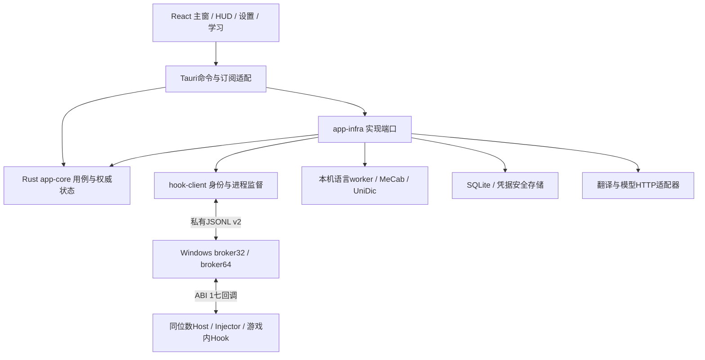

# 首版研发架构与工程基线

当前完整设计组合（guided与R79历史页）已由用户明确审核通过，身份见[源版批准记录](../development/design-approval-complete-20261031.json)；其他页面按[全页与状态闭包](../development/all-page-design-coverage.md)逐项对齐。设计源批准、独立参照、真实组件和正式包验收分别记录；原29个阅读/配置增量状态继续保留，不能代表整套页面。

## 1. 依据、实现边界与当前差距

本基线统一首版功能、框架、模块职责、进程边界和实现约束。产品依据为[首版范围](../product/first-product-scope.md)及各专项PRD；默认呈现目标为[guided设计](../design/first-product-v1/candidates/guided-service-reading-20261030/index.html?scenario=reading)，历史页由R79稿覆盖，完整61源组合已获用户审核确认。材质与既有批准PNG只在其精确批准范围内有效，不自动批准新候选、新字段或产品运行结果。

现行完整源码冻结身份以[基线记录](../development/iteration-baseline.json)为准；本页描述当前架构和源码差距，旧修订只在独立归档与执行记录中追溯。已有app-core/app-infra、独立Core与Windows双broker、真实SQLite、macOS Vault、本机语言worker、主窗/HUD/设置/学习及独立预览监督。Core由 `native/core-runtime.lock.json` 锁定，ABI 1七回调、私有JSONL 2；不运行原版完整Python/Qt客户端。

| 领域 | 已有实现 | 尚未对齐的当前目标 |
|---|---|---|
| 阅读与记录 | 源码候选已将当前卡与SourceText置于首屏，正文/raw/Hook后置独立details，固定范围分页/检索/导出和独立词法显示已有 | 共享浅层服务选择、完整实时摘要及整页字号/动作/响应式排布尚未对齐；全页与最终包验收未完成 |
| 历史页 | HistoryScreen、historyPage/historySessions、profile/filter绑定keyset cursor、详情/修正/固定学习已有 | R79布局与轻文字目录操作、旧范围失败提示、编辑全导航与焦点/caret保留、固定水位/定位后全量无漏重须迁移/实测 |
| 服务与配置 | 源码候选已有3协议服务管理列表、同页编辑和按需高级区，复用连接/模型/用途、草稿/测试/整体应用及系统安全引用 | 用途→品牌→明确接口→必要字段流程、同源13协议/21预设/4离线目录、typed认证、已保存资源资格及细粒度激活仍未完成；旧编辑器重排不等于目标页面 |
| 平台与组件 | 共享自绘Select、原生窗口/快捷键、独立collector与只读消费者 | 新布局及最终包适用原生/服务/四游戏场景尚须真实执行；8MiB/4秒预览目标仍有缺口 |

实现状态、源码语义对齐和执行证据是三条独立轴；模块存在或编译不等于功能准出，未重测也不等于未实现。当前工作及review状态以[current-phase](../development/current-phase.json)为准；[客户端对齐总计划](../development/current-client-alignment-plan.md)统一页面任务、依赖与完成条件。现阶段修正文档和实施计划，不由计划变更授予产品开工或准出新批准；原稳定性、视觉与同包回归义务继续保留。完整技术合同分别见[阅读/会话](reading-window-session-technical-design.md)和[词法/模型服务](japanese-study-and-llm.md)；新范围产品未执行保持 `not_run`，实际开跑后外部条件不足写 `blocked`，失败保留。

规范发生冲突时，范围决定交付集合，专项PRD决定业务语义，当前设计决定交互外观，本基线决定技术与职责；先记录影响并修订相应规范，不能让多稿并行定义不同现行行为。原始需求、License与冻结证据只读保留。

## 2. 确定的首版功能

| 范围 | 首版必须完成的用户任务 | 主要窗口 | 主责模块 |
| --- | --- | --- | --- |
| FP-01 | 首启空库；恢复已有记录；关闭主窗后能恢复，退出才结束应用 | 主窗、菜单栏 | library、windows |
| FP-02 | 从文件/拖入建库；核对环境、Bottle与实际目标路径；编辑与移出不删除游戏 | 游戏库、资料面板 | library、platform |
| FP-03 | 从窗口/进程选择目标，一次“关联并接入”自动启动Hook；候选到达后显式选正文 | 目标面板、选流面板 | capture、hook-client |
| FP-04 | 原文先到，译文随后；独立HUD持续阅读，长文、注音及非日语均可读 | 会话、HUD | reading、translation、language |
| FP-05 | 同目标复用；不同目标确认切换；失败重试；解除关联保留取文；显隐/暂停/断开分开 | 会话、HUD、菜单栏 | capture、windows |
| FP-06 | 传统翻译、LLM及用户已运行的本机服务；连接/模型/用途独立；草稿、测试、应用、启用分开 | 设置 | model-config、translation |
| FP-07 | 包内置分词及基础释义，断网首启可用；点词查词面、词元、读音、词性与来源 | HUD词卡、学习窗 | language、dictionary |
| FP-08 | 用户主动精读原句或解释选词；固定对象，配置往返不丢句；失败、取消和歧义可辨 | 独立学习、设置 | study、model-config |
| FP-09 | 按游戏/会话查看原文、译文与来源；重译、人工修正、旧句精读；保存失败保留编辑 | 历史 | history、reading |
| FP-10 | 无游戏也能手动输入、翻译、查词、精读并形成独立历史 | 手动翻译 | manual-input、reading |
| FP-11 | 注音/POS、阅读尺寸、暗/浅/减少透明度、快捷键；资源版本与全局/游戏来源可查 | 设置、HUD | preferences、windows |
| FP-12 | 区分资源、接入、无文本、网络、词法worker与数据连续性故障；可定位和恢复 | 诊断及各失败位置 | diagnostics、各域主责 |

首版包含多引擎翻译、版本化模型配置、三态参数、上下文/术语、凭据/密钥池、重试与回退的完整产品语义，不能因接口实现方便而缩为一个模型和一段提示词。实现顺序可分切片，完整首版的验收范围不随之缩小。

首版不交付OCR、语音、Anki/Yomitan、批量文件翻译、对外Web API、原生macOS游戏取字、内嵌回写、AI译文对照/学习草稿/历史问答。它们保留原路线与需求编号；首版不出现可点击却无实现的入口。设置保留原十类信息架构，后续类别在首版能力导航中隐藏，历史设计仍可用于路线评审。

首批交付环境为 macOS arm64 + CrossOver；Windows原生构建与兼容验证单列，不把CrossOver证据外推为Windows/nativeMac均通过。四款回归样本为SR、MO、Never7及サクラノ詩10th，排除Ever17；SR中文版只提供中文原文证据。

## 3. 确定的框架与技术栈

| 层次 | 采用方案 | 选型边界与当前状态 |
| --- | --- | --- |
| 桌面容器 | Tauri 2；WKWebView/macOS、WebView2/Windows | 复用现有工程；窗口、菜单、托盘、快捷键和权限在原生层 |
| 前端 | React 19 + TypeScript 5.9 strict + Vite 8 + npm lockfile | 沿用现有主版本；不改为另一套UI框架；不需要SSR或运行时Node服务 |
| 基础交互 | React Aria Components + 自有CSS Modules | 已在产品清单安装；只在 `ui/primitives` 封装。已有 `Select.tsx` 自绘共享控件；逐入口核对复用和状态覆盖，不引入其外部主题 |
| UI状态 | React局部reducer；`useSyncExternalStore`读取每窗projection | 首版不增加Redux/Zustand/React Router/Query缓存；跨窗业务状态由Rust持有 |
| 应用核心 | Rust 2024 edition；现有MSRV 1.89作为起点；Tokio 1 | 异步I/O和有界任务；领域对象不依赖Tauri或具体数据库 |
| 原生取文 | 独立精简C++ Core + Windows Rust broker32/broker64 | ABI 1七回调，目标同位数资源集合；私有JSONL v2另定版本 |
| HTTP与流式 | Rust异步reqwest + rustls + eventsource-stream解析SSE | 请求从Rust发出；不采用前轮blocking HTTP草稿，也不让WebView持有Key |
| 模型协议 | 当前OpenAI兼容Chat Completions、Anthropic Messages；目标完整13协议/21预设 | 当前已有两类LLM与Azure传统翻译的集中实现；三层注册和新增协议尚未实现，精确目标见第8节 |
| 传统翻译 | Azure AI Translator Text REST v3适配器 | 用户自行配置凭据/region/endpoint；不捆绑账号，不依赖网页抓取接口 |
| 本地存储 | SQLite + rusqlite bundled；单写入执行器 | 业务表、版本、历史、缓存统一事务；不把全量历史存成一个JSON文件 |
| 凭据 | `CredentialVault`端口；macOS已接Keychain，Windows Credential Manager为待实现的平台目标 | 当前非macOS系统Vault返回不可用；只在Rust层解析引用，不退回明文JSON，不另引跨平台keyring框架 |
| 分词 | MeCab 0.996 C ABI + 固定现代书面语UniDic | 延续既定方案；本机独立语言worker，随包资源；不以临时Lindera/IPADIC替代已定字段语义 |
| 基础释义 | 中文维基词典日语条目的固定数据快照；JMdict作明确标注的英语补充 | 离线派生索引、来源/归属随包；覆盖、快照及哈希须过资源门禁后锁定 |
| 契约 | Rust Serde DTO + ts-rs生成TypeScript + 协议fixture | TS类型不手抄；DTO与数据库/FFI结构分开，运行期仍做输入校验 |
| 验证 | Rust单元/协议/资源测试；Vitest + Testing Library；Playwright；原生真机回归 | 浏览器截图验外观；真机验材质、焦点、置顶、快捷键和游戏链路 |
| 工程约束 | rustfmt/clippy；TypeScript；AST/Cargo边界；设计token/许可/资源清单检查 | 执行范围以根verify及实际回执为准，不把工具名称等同于全部行为覆盖；新增依赖须独立审阅技术锁 |

现有主版本来自工作区清单，不表示它们是互联网上的最新版。开发开始时使用已审查的lockfile；新增库精确版本、工具链、MeCab构建提交、UniDic/释义快照与每文件哈希在B0门禁中一并冻结。依赖不满足当前MSRV时记录明确升级决策，不能在构建时自动拉最新。

Tauri建议核心进程管理窗口及全局状态，本方案据此把业务权威状态置于Rust；实时数据用Channel，事件只承载少量失效/生命周期通知。[Tauri进程模型](https://v2.tauri.app/concept/process-model/)、[Channel与事件](https://v2.tauri.app/develop/calling-frontend/)。React Aria不附带默认视觉，适合承接现有材质而非引入另一套皮肤。[样式机制](https://react-aria.adobe.com/styling)。

## 4. 分层、进程与依赖方向

这里的箭头是调用/装配及依赖关系；模型与数据库不会穿过取文broker。Windows broker运行在所选Bottle中，语言worker在macOS/Windows本机运行，两个进程有各自的协议、资源和生命周期。Core仓库继续独立维护，客户端只消费锁定产物，不复制Core源码。

领域与用例定义 `HookBackend`、`LibraryRepository`、`HistoryRepository`、`ConfigRepository`、`ModelGateway`、`LexicalAnalyzer`、`DictionaryRepository`、`CredentialVault`、`WindowCoordinator`、`WindowPreviewPort`、`SessionRecordRepository` 等端口；新增端口的正式DTO/版本与权限仍需在实施切片中冻结。`app-infra`实现I/O；Tauri组合根注入实现。领域层禁止依赖Tauri、reqwest、rusqlite、Win32和MeCab裸指针；broker禁止依赖翻译、模型、数据库和UI。

Windows系统调用、文件选择、启动器解析及材质放平台适配；游戏记录、请求归属和模型配置规则不按操作系统复制。暂不引入微服务、Node/Python运行服务或远程应用后端。

### 4.1 独立窗口预览与消费者

M12的SessionPreviewCoordinator已监督独立常驻collector；同一签名可执行文件以 `--capture-worker` 最早分派真实第二PID。worker独占AppKit RunLoop、系统单窗口picker、原SCContentFilter及Windows/Native前后身份核验；授权filter不跨进程序列化，不以重建CGWindowID冒称原授权。主窗、候选面板和封面只消费只读投影/最新帧，每个监听独立取消，挂卸载、折叠、滚动或慢消费者不控制producer。

窗口选择、重试、暂停、取消和解除是明确控制意图；候选向会话按generation/CAS移交同filter，候选卸载不能停止新session。Windows可信关联与Native画面可用性分开；权限拒绝/待选窗/不可采集不抹去有效关联。元数据不推进画面时间，首帧仅允许同lease/generation/consumer从未知hash单向解析为已核目标；错身份、旧序号/回调仍拒绝。原filter允许系统实际判断离屏采集；无filter自动定位仍要求可见性。编码/同窗尺寸暂态按原单flight预算恢复，不换目标或自动弹picker。

采集保持最多2租约、全局1在途、1000ms采样、960×540/512KiB输出、启动/停止5/3秒约束；全局8MiB硬内存预算和固定4秒过期SLO尚无完整验收，不能从尺寸限制推导已满足。ANSI显式配对、精确单窗系统工具后备、可信自动映射、权限和睡眠恢复完整规则见[阅读技术设计](reading-window-session-technical-design.md#4-运行窗口实时预览)。collector不承载Hook、词法、翻译或SQL；同源最终包持续变化帧、消费者隔离与唤醒恢复须独立验收。

## 5. 模块划分与职责归属

职责是逻辑Owner，不是承诺七个人的编制；同一个人可承担多个Owner。每个模块有一名主责，跨域调用经公开端口，评审者负责接口与验收边界。

| Owner | 归属 | 负责决定 | 必须协作评审 |
| --- | --- | --- | --- |
| AP 应用核心 | 领域、用例、配置版本、阅读对象 | 状态转换、输入/结果身份、事务与用例接口 | UI、HK、AI、JA |
| HK 原生接入 | Core消费、broker、Hook会话 | ABI、目标身份、资源完整性、退出及背压 | AP、QA |
| PL 桌面平台 | Tauri组合根、窗口与系统能力 | 焦点/置顶/显隐、材质、权限、原生对话框 | UI、AP、QA |
| AI 翻译与模型 | provider/协议、调度、用途配置 | 请求解析、能力、流式、凭据引用、输出校验 | AP、UI、QA |
| JA 本地语言 | 分词、辞书索引、Unicode对齐 | 词法schema、资源版本、释义来源与离线质量 | AP、UI、QA |
| UI 产品界面 | feature界面、组件库、tokens | 交互、布局、可访问语义、跨窗组件复用 | AP、PL、设计评审 |
| QA 交付 | 构建资源、质量与证据 | 追溯表、门禁、安装包、回归记录 | 对应模块Owner |

| ID / 模块 | 职责与输出 | 不承担 | 主责 |
| --- | --- | --- | --- |
| M01 / library | 稳定游戏记录、路径与环境去重、入库编辑移出 | Hook FFI、HTTP、UI state | AP |
| M02 / capture | 关联接入协调、完整身份、复用切换、显式选流与预览身份租约 | Translation、Dictionary、auto TextOutW selection | AP |
| M03 / reading | 不可变raw事实、阅读单元、源归属、暂停消费与当前句/词法状态投影 | Network、FFI、DOM extraction | AP |
| M04 / model-config | 连接模型用途、草稿应用、覆盖、三态参数与测试身份 | UI-only effective config、plaintext keys | AP |
| M05 / translation | 多引擎调度、上下文术语、缓存、取消与迟到归属 | Hook callback、implicit fallback | AI |
| M06 / providers | 当前3协议与流事件错误归一；目标13协议/21预设同源注册、4离线引擎目录与执行适配 | Frontend secrets、business profile state | AI |
| M07 / language | MeCab/UniDic词法、Unicode完整span、真实读音、worker资源/失败/迟到隔离 | Hook broker、model HTTP、UI | JA |
| M08 / dictionary | 中文基础释义本地查询、版本、来源及英语补充 | automatic network、fake lexical samples | JA |
| M09 / study | 固定词句、按需文法/语境解释、结构证据及歧义 | auto follow current sentence、agent tools | AI |
| M10 / history-persistence | 多版本译文、会话正文/raw/Hook全量分页检索导出、保留保护、事务迁移与备份 | frontend SQL、diagnostic log as history | AP |
| M11 / preferences | 全局/游戏阅读偏好、分词ruby词性独立显示、快捷键草稿与有效来源、资源只读信息 | model secret ownership | AP |
| M12 / desktop-platform | 原生多窗、HUD拖动/位置恢复、窗口级真实预览/权限、材质、快捷键补偿与IPC作用域 | domain business rules、browser fake desktop | PL |
| M13 / product-ui | 窗口feature组合、统一Select、常用工具栏、会话三数据集、真实词法投影与可访问组件 | HTTP、SQL、FFI、Keychain reads | UI |
| M14 / native-broker | Core ABI1、同位数资源、回调复制、JSONL v2、完整事件/序号/缺口及退出监督 | Tauri、models、dictionary、SQLite | HK |
| M15 / diagnostics-release | 脱敏诊断、资源锁/许可、构建清单、逐需求分层覆盖与同最终包证据/发布回归 | secret/body default logging、fake runtime pass | QA |
| M16 / credentials | 不可变安全引用、版本/池成员、撤销、系统秘密生命周期 | plaintext JSON、CLI argv secrets、UI key readback | PL |

机器可读清单见[模块与职责矩阵](engineering-modules.csv)。矩阵记录源码实现、语义对齐和证据状态；target_paths表示目标组织。已实现不等于当前包实机通过，实际差距见implementation-status清单。

## 6. 业务契约与状态模型

### 6.1 关联并接入

`选择候选 → 核对完整身份（目标有效且权限具备时自动预览） → 关联并接入 → 校验资源/ABI → 监听与注入 → Host连接 → 候选 → 用户选正文 → ReadingUnit`。预览权限和采集是独立能力，不触发注入，拒绝录屏不阻断Hook；详见[窗口与会话技术设计](reading-window-session-technical-design.md#4-运行窗口实时预览)。

TargetIdentity包含执行环境、真实Bottle引用、规范化完整路径、Windows PID、创建时间与架构；SessionIdentity另含broker实例和session_id，窗口身份也单独保存。复用判定和跨档target租约以TargetIdentity为键，不能要求预览目标先有broker实例。确认前不改变当前会话；相同TargetIdentity复用，不同目标由同一核对面板明确“切换并接入”。同名EXE或裸PID不能触发复用。

失败保留仍有效关联并显示具体阶段；重试先fresh核验。解除关联仅清窗口关系。断开与应用退出结束自有broker；不杀游戏或整个Bottle；没有卸载回执就显示未确认，不能把helper退出当DLL已卸载。

Windows target probe在其查询线程使用PMv2 scope，覆盖枚举与GetCursorPos→WindowFromPoint→GetAncestor→inspect_window链，退出前恢复原context；缺API、设置/恢复失败走明确错误，恢复前不报成功。保留负坐标，反向/空矩形和完整身份异常拒绝。无坐标的绑定核对、激活和标题证明不增加几何门槛；不改游戏/全局DPI、窗口几何或容器配置。

### 6.2 原始事件、阅读对象与结果

RawEvent不可变，保存来源实例、完整流标识与单调接收序号；页大小和UI缓存不是保留上限。会话正文、全部提取、Hook阶段事件是三个独立可分页集合，暂停消费和正文合并不能抹去已接收raw事件；控制事件和保留已由schema2追加实现；进一步新增字段须独立schema/迁移评审。ReadingUnit含 `unit_id / text_revision / source_hash / session_id / selected_source_refs / processing_revision`。分词、翻译、精读都引用ReadingUnit的固定版本，不能从ruby DOM反读原文。

结果身份至少为 `profile_id + session_id + unit_id + text_revision + task_id + applied_config_revision`，同时保存request_semantics_hash区分配置记录修订与实际请求语义；词法增加资源/schema版本，模型增加模板、术语、上下文及凭据版本。只是推进到新句时，有效旧结果可入所属旧历史；取消、停用、换档或影响请求语义的配置变更使任务失效后，不再写正文/解释历史。显示名或界面偏好变化不取消语义未变的在途任务。人工修正独立存储，不被后来结果覆盖。

字符串按UTF-8字节跨度在Rust校验，投影中显式转换UTF-16位置；64位地址、FILETIME和不安全整数范围的序号通过规范十进制字符串传输。结构化文法必须通过schema、引用、边界、原文hash、拒绝/截断检查；纯文本模式不画精确引用高亮。

### 6.3 多窗状态与通信

Rust应用核心是唯一业务状态源；主窗关闭后，Hook、翻译和历史仍可工作。各窗只有只读projection与本地UI草稿，不能由主窗充当广播服务器。设置草稿由ConfigService版本化保存，切窗/重启可恢复；尚未保存的表单编辑由对应窗口持有，往返不丢失。

读模型通过“建立订阅并在同一服务边界返回snapshot+revision”启动，后续按窗口Channel推送有序delta。每条含 `projection_id / profile_generation / base_revision / revision`；缺口或旧generation触发重取快照，不把Tauri事件当持久消息队列。事件只用于窗口生命周期/数据失效通知；慢窗口有界合并projection并重同步，不能阻塞原文。前端用selector订阅、局部reducer和`useSyncExternalStore`，而不是每150ms整应用轮询。[React外部存储接口](https://react.dev/reference/react/useSyncExternalStore)。

命令统一返回 `Result<CommandReceipt, AppError>`，状态以Rust快照/投影为准；Receipt含request_id与revision，重复点击带幂等operation_id。`AppError`含稳定code、stage、可恢复动作及脱敏detail。UI只能调用已注册用例；不开放任意shell、任意DLL加载或直接SQL。

配置编辑等命令还带expected_revision，跨窗并发冲突保留编辑并返回revision_conflict，不静默最后写入覆盖。订阅包含server_instance_id，应用重启时丢弃旧projection代次。按main/hud/settings/learning分别注册应用命令权限并在Rust复核作用域；仅写窗口capability文件并不会自动给所有自定义命令建立细粒度隔离。

## 7. 并发、隔离与数据存储

| 执行单元 | 采用方式 | 队列/取消与故障规则 |
| --- | --- | --- |
| Core回调 | broker内有界复制+非阻塞入队 | 控制与正文保留独立容量；溢出置粘性integrity_lost及计数，不阻塞游戏 |
| Hook会话 | 一目标一个owner与broker监督 | 有限detach/exit期限；重启换实例并隔离迟到事件 |
| HTTP | Tokio异步reqwest；翻译/精读/语境查词分队列 | 默认每用途并发1、超时60秒、自动重试关闭；多引擎按用途总限额执行，结果独立 |
| 词法 | 独立原生语言worker，持有MeCab实例 | 版本化私有请求协议，输入/输出/队列有界；超时重启自有worker，不用spawn_blocking超时假称已终止 |
| SQLite | 专用写执行器 + 有界请求队列；分页/索引读 | 业务提交事务化；显示/历史落盘分别反馈；失败保留编辑和可恢复状态 |
| UI投影 | 每窗口有界Channel + revision快照 | 可以合并渲染状态，不能悄悄删除业务事件或伪造已落盘 |

数据库选 `rusqlite` 的bundled SQLite，具体版本由发布清单记录；使用单writer、事务、外键、busy timeout。WAL与备份一致性在资源门禁验证，升级选用包含当前SQLite官方修复的版本，不无条件链接系统旧SQLite。选择同步SQLite绑定是为了把事务与线程归属集中到一个执行器，并不允许在Tauri/UI线程直接跑SQL。[rusqlite](https://docs.rs/rusqlite/latest/rusqlite/)、[SQLite WAL](https://sqlite.org/wal.html)。

数据库按配置档独立：`profiles/<profile_id>/reader.sqlite3`。主表包括 `games/sessions/raw_events/reading_units/source_refs/translations/corrections/study_results/config_revisions/connections/models/purpose_bindings/templates/terms/test_records/cache_entries`；查询与保留策略在schema迁移中实现，原始事件按显式保留政策管理，不承诺无限存上游完整剧情；当前会话全部已接收事件不得因页面大小、显示缓存或默认GC静默裁剪，用户清理与容量故障须保留可见范围/缺口。

字段级方案见[数据库设计](database-design.md)、[逐字段字典](database/field-dictionary.md)、[可筛选字段CSV](database/field-dictionary.csv)与[实体关系图](database/relationships.svg)。`database/*.sql` 是字段设计源；当前生产迁移维护于 `crates/app-infra/src/storage/migrations/`，两者由独立schema契约核对，不能直接执行文档DDL冒充迁移。字段、主外键、索引、封存/GC、配置与任务身份、秘密引用、事务、备份及迁移边界由该设计展开；新增字段细节待复核，总体架构确认不自动批准新增字段细节。

字段边界和存储模块验收以[程序化约束](database-design.md#13-字段边界与存储模块的可执行验收)及[存储验收子检查](../development/storage-acceptance.md)为准。独立冻结schema与真实候选库结构逐对象比较；全部字段的适用边界必须实际执行，生产存储变更/发布还须运行真实Rust迁移与Repository测试。现有 `rust-storage-complete-v1` 维护schema1的22类、431字段与10路线；schema2另追加4表29字段、Hook journal和scope/解绑语义，独立合同与真实adapter见[会话技术设计](reading-window-session-technical-design.md#74-保留恢复与-schema-评审)。旧431字段结果不能替代schema2执行，新增字段须独立迁移与真实adapter验收。

配置草稿与已应用版本存数据库不可变revision；`profiles.json`只保存配置档索引和启动选择。窗口几何单独保存于平台偏好。资源索引是随包只读辞书SQLite，与可写用户数据库分开。凭据只存系统安全库，业务表保存版本化引用与脱敏身份；缓存/历史/导出不存明文Key。

同配置档采用进程级文件锁，第二实例转向已运行实例或明确拒绝；不同档可以并行，各自DB、任务、broker owner隔离。应用侧profile切换递增generation并取消旧任务；词句对象保留为待用户操作，不自动发给新档。

接入owner不能只靠配置档锁。另以环境/真实Bottle引用/本次Windows目标身份在应用共享的target-locks目录建立跨进程租约，保证不同档也不能争用同一目标；外部Luna/探针冲突由Core检查和明确失败处理，不结束别人的进程。

Keychain和SQLite没有跨存储事务。新增秘密先生成独立pending引用，再事务提交配置引用；失败清理未引用项，崩溃后按可识别pending记录清理。撤销先持久化revoked并停止任务，再删除系统秘密；删除失败显示待清理，不恢复请求权限。macOS签名/升级后的Keychain访问与Windows凭据保护分别实测。[Apple Keychain](https://developer.apple.com/documentation/security/adding-a-password-to-the-keychain)。

### 7.1 历史页的独立查询与版本归属

已批准的R79历史页按FP-09、MC-20和HP-01～12落实为CP-11，由M10/AP主责，M03/AP、M13/UI、M12/PL及M15/QA协作。会话目录和记录复用现有两个Repository查询，各自绑定profile generation、scope、cursor、范围水位、loaded IDs与request epoch；replace/append及失败重试语义明确，过期结果与finally不能污染新任务。当前keyset cursor已有profile/filter/kind隔离；固定水位、定位后跨页完整性及R79交互仍需产品实测，不假定字段已存在。

切范围失败保留旧内容并标“上一范围”；编辑期间禁用全部导航与重试并保存草稿/focus/caret。定位当前句显式复位两个范围并固定unit/revision，置顶后继续全量分页无漏重；词卡、重译、精读沿同一不可变对象，父游戏推进和迟到结果不偷换对象。R79会话加载为轻文字操作，hover/focus/disabled/spinner/error与窄窗/200%均验。完整合同见[阅读技术设计第15节](reading-window-session-technical-design.md#15-历史页会话目录记录分页与固定阅读对象)，不更改存储DDL、技术栈或Core职责。

## 8. 模型、词典与本地语言的职责细化

目标范围为13个HTTP协议/21个接口预设和4个独立离线引擎候选；腾讯TMT/TC3排除，TokenHub Chat及专用翻译分别保留。现有生产源码只有 `openai_compatible`、`anthropic`、`azure_translator` 三种集中协议。三层注册、其余协议、typed凭据/OAuth、独立离线配置和细粒度绑定激活均尚未实现，不能将设计目录计为安装能力。

完整合同见[语言与模型技术设计第5章](japanese-study-and-llm.md#5-翻译引擎与模型服务设计)、[机器目录](model-service-registry-design.json)和[产品详规](../product/model-configuration-prd.md)。M04持配置/资格及不可变版本，M05唯一持调度，M06持协议/profile/preset和执行适配，M16持typed秘密及授权。协议/profile精确版本冻结到Connection/RequestPlan，目录从同次Rust注册生成，UI不维护另一份厂商分支。

配置管理以已添加服务列表同页编辑，按用途→品牌→明确接口呈现必要字段；适用高级参数、密钥池、精读和查词用途按需展开。日常选择只读取当前档已保存资源的可选投影；字段合法且用途支持但未测试的HTTP服务可明确选用并标未验证，当前版本已知失败/撤权/非法阻断。离线引擎仍须通过实际API、路线、语言对和资源门禁，未知必要条件不放行。保存、探测、样句测试、应用、启用和日常选用分别处理，不能互相触发。

HTTP、platform_native和local_worker通过同一ModelGateway按EngineTarget精确分派，离线不伪造Connection/URL/Key/模型ID。Apple Translation、Argos、J北京和金山只限translation，不进入grammar/context_word；平台API/合法资源/worker运行栈、DTO/codec和新增持久关系须分别评审。Argos生产Python或新推理框架未批准；商业DLL仅由与DLL同位数的独立翻译worker加载，不进入UI、主业务、Hook、collector、language-worker或游戏。直达为默认，中转必须明确应用冻结的逐跳route；失败不隐式切云。

共享浅层选择由M04原子激活保存版本并保持用途启停，仅后续句生效；当前句重译独立，主/对照稳定身份去重，全局/游戏覆盖及恢复继承保留。M05取消旧绑定任务并隔离迟到流、缓存与历史提交；历史继续保留原来源。现有整体SaveConfiguration/ApplyConfiguration不代表已经具备该细粒度命令。

模型配置不是一个 `endpoint + model + apiKey` 对象。连接保存协议/位置/网络，模型保存真实ID/能力/默认参数，用途保存翻译引擎序列或单一学习绑定；均有独立ID、版本和引用。复制前说明哪些实体独立、哪些仍共享。

- 全局/游戏参数按“模型默认→全局用途→游戏覆盖”解析；每项为继承、设置、省略。显式0不等于未发送；保留字段禁止扩展参数覆写。
- 保存草稿不发网络、不改变applied；测试采用明确样例并分连接/模型/用途/凭据身份记录。模型列表失败保留手填ID，HTTP200不等于文法用途通过。
- 应用冻结请求语义与凭据版本；输入/路由/凭据/授权/输出契约变化使相关旧任务失效，单纯显示名变化不取消。停用用途/连接、撤销凭据立即阻止相关新请求并取消在途。恢复连接须明确恢复用途，不能仅保存草稿就重发台词。
- 多引擎翻译按配置顺序展示，每个结果独立来源与失败；不把它实现成静默回退。密钥池、重试、退避和回退均为显式策略，默认不开自动换Key/换供应商。
- 同一OpenAI兼容服务可以服务本机或远程，不因此自动拥有枚举、结构化、取消或全部参数能力。Anthropic使用独立请求/流事件转换；不引入Node AI SDK、代理工具链或模型权重。
- 内置通用翻译/精读/语境查词模板均按用途版本化；Hy-MT2、Index-Translate、SakuraLLM/GalTransl等专用模板保留适配档、来源版本和模型能力匹配。未完成适配标未支持，不因名称相似自动套用，也不把通用模板当全部专模已经支持。
- 中文基础释义使用固定中文词条快照构建本地索引；逐条保存来源、必要归属及许可。MeCab/UniDic只给词法，JMdict英语条目只作英语补充；都不能冒称中文释义。未收录时保留词元并说明，不请求模型伪造基础词典。

UniDic采用官方提供的现代书面语自由许可版本，不选标为非商业限制的资源；包内保留其指定许可与作者文件。维基词典派生数据、JMdict及MeCab分别记录许可与归属，不把主项目GPL当作所有数据的许可。[UniDic说明](https://clrd.ninjal.ac.jp/unidic/faq.html)、[MeCab](https://taku910.github.io/mecab/)、[EDRDG许可](https://www.edrdg.org/edrdg/licence.html)。现有资源已由 `resources/language/manifest.json` 记录MeCab/UniDic、中文基础释义与英语补充的版本/来源/hash，包内只读索引已经存在。真实worker到HUD的新组合须随包执行；资源存在不等于语言质量通过，不能用手写token补通过。

## 9. 组件划分与复用

采用四级：`tokens → ui/primitives → ui/patterns → features/screens + windows`。数据模型与状态机在Rust；前端feature负责用例编排、校验提示与展示。公共组件不导入业务feature或Tauri IPC，feature不直接访问数据库和HTTP。

| 组件层 | 组件族 | 复用位置 |
| --- | --- | --- |
| 基础材质与交互 | MaterialSurface、Button/IconButton、TextField、Select、Switch、Tabs、Dialog、Popover、Menu、Disclosure | 全窗口 |
| 分组布局 | AppSidebar、SettingsSidebar、GroupForm、FormRow、PersistentFooter、EmptyState、ErrorState、StatusLabel | 主窗、设置、目标核对、学习 |
| 阅读 | SourceText/RubyToken、TranslationStack、ReadingToolbar、UnitIdentity、FrozenSentenceNotice | 会话、HUD、历史详情、手动、学习 |
| 游戏与接入 | GameCard/Grid、GameMetadataForm、TargetList、TargetReview、ConnectionProgress、StreamPicker、WindowPreview | 入库、关联、重试、重新选流、当前会话实时预览 |
| 模型配置 | ConnectionEditor、ModelProfileEditor、PurposeBindingEditor、ParameterEditor、ContextPreview、CredentialPicker、ScopedTestResult | 全局设置与游戏覆盖复用同一编辑器 |
| 查词与精读 | WordCard、DictionaryEntryList、GrammarSkeleton、EvidenceReference、StudyTaskState | HUD浮卡、独立学习、旧句学习 |
| 历史与手动 | HistoryList/Detail、SessionRecordPanel、CorrectionEditor、ManualInputEditor | 主窗历史/会话三数据集与手动feature；分页框架复用，行数据分别typed |

详细文件、事件与状态归属见[组件矩阵](engineering-components.csv)。HUD和独立当前阅读卡复用SourceText/阅读内容组件；三记录区各自保持查询/筛选/分页/滚动/跟随和计数，默认折叠只改可见性，警告/缺口摘要持续可见。当前卡不依附记录Tab；HUD不复用主窗侧栏；设置和游戏覆盖复用编辑器，但有效值按各自scope读取；独立学习复用原文/词卡渲染，但固定自己的ReadingUnitRef，不持有“全局当前句”引用。

### 9.1 完整页面的组合与交付边界

页面任务按用户完成的流程组织。复用ConnectionEditor、ModelEditor等内部编辑器不意味着用户仍须按技术实体顺序配置；现有端口不足时先补接口和资格权威，页面保持部分实现，不用新的壳层掩盖缺失能力。

| 页面 | 必须形成的组件组合与顺序 | 已有能力与待完成接口 | 整页完成条件 |
|---|---|---|---|
| 当前会话 | 连接对象与就近操作、共享浅层服务选择、当前阅读状态/原译文卡及常用动作、辅助预览、后置三个独立折叠区；具体位置以当前设计为准 | AppSnapshot当前unit、词法、三数据集与预览端口已有；已保存服务资格/细粒度activate和全会话实时摘要仍待相应合同与实现 | CP-01与CP-06/07依赖闭合；入口、动作、状态、真实client尺寸和全部适用显示组合逐项对照，不能只核当前卡文本 |
| 翻译服务配置 | 统一已添加列表、用途→品牌→明确接口、必要字段与保存/测试、独立精读/查词和按需高级区域 | 现有3协议及整体草稿保存/应用可复用；同源目录/typed认证、字段与资格投影、细粒度选用是待完成合同 | CP-02～07适用依赖闭合；完整创建/编辑/取消/保存/测试/返回选用流程与设计一致，字段齐全且不暴露无意义技术输入 |
| 通用设置 | 已确认三组结构：分词词典、阅读记录、本机偏好；标题轻scope保留字段来源/继承，当前会话操作通过定向入口，系统登录状态独立 | 复用原scope/字段mask/CAS与M12登录端口；恢复只改draft、save生效，导航不写偏好或捕获，系统异常详情按需展开；三者不共用保存动作或bool状态 | 控件实际行为、无会话/OS错误/等待批准、焦点与整页排布分别通过；局部接线不关闭整页视觉任务 |
| 历史页 | 游戏/会话范围、会话目录与记录双分页、固定记录详情/编辑/学习、R79轻文字加载操作 | 现有双查询和cursor可复用；目标水位、错误保留旧范围及完整编辑/焦点语义仍逐项核对 | CP-11的HP-01～12与逐状态参照、真实React/Repository及适用最终包证据全部闭合 |

完整页面必须同时满足功能流程、组件顺序和层级、数据/命令权威、异常恢复与适用视觉/原生证据。内部子任务可记录部分实现，但不能因“旧Tab已移除”“按钮已出现”或某个行为断言通过而关闭整页任务。源码候选、实际安装包和受测包分别读取身份，页面源码存在不证明用户正在运行该版本。

## 10. 设计规范与实现约束

1. **材质**：以连续暗蓝灰窗体、较厚中性灰内面为基准。macOS由原生visual effect提供背景采样，WebView透明并用共享token叠层；CSS blur仅表达DOM内层，不能把假壁纸贴图当原生毛玻璃。减少透明度时用同色实底。Windows按同语义token适配，不据浏览器截图承诺相同合成效果。
2. **颜色**：主要文字 `#e9e9ef`、次要 `#b0b2c0`、辅助 `#9495a5`、强调 `#c4c5cf`。主按钮与选中用灰阶；不新增彩色分类底块、亮蓝默认按钮或紫色强调。警告/错误颜色只用于必要小面积状态。
3. **token**：以当前 `material-tokens.css` 为迁移输入；研发时建立单一 `ui/tokens/tokens.json`，生成CSS变量和原生窗口参数。设计稿与产品从同一来源生成，不长期手工维护两份色值。
4. **图标**：迁移现有SVG路径，24×24 viewBox、1.65圆头描边、常规18px，使用currentColor；保留各图标来源/许可。首版不另引一套图标族，也不使用Unicode符号替代图标。
5. **尺寸**：窗体圆角16、内面13、控件7；设置正文13pt、标题23pt。HUD舒适宽560pt、原文18/译文24；紧凑500pt、原文16/译文22；控制行32pt。注音增加独立上方空间，长文正文滚动，200%字号保持操作可达。pt在设计中对应逻辑尺寸，不直接乘设备scale。
6. **窗口**：主窗/HUD/设置/学习为真实独立窗口；词卡是锚定浮层，关联与选流是主窗附属面板。设置左上使用轻量透明“← 返回主界面”，保留草稿；长目标核对的确认操作固定底部。
7. **状态**：每个数据面板定义空、加载、可用、部分失败、失败、取消/过期和禁用；“未配置”不同于“失败”，“已关联”不同于“已收到原文”。文案统一通过字典/key管理，稳定错误码不直接显示为主标题。
8. **可访问性**：键盘能选流、点词、关弹层与返回；焦点可见、标签完整。词性用文本说明，不能只靠颜色；模型说明文本不渲染未经净化HTML。
9. **验证**：Playwright在相同视口/字体/scale/主题/数据/状态下对照已确认参考；原稿、补充对照及当前新增状态分别可追溯，不以固定旧图片数量判断新需求完整覆盖。全组件入口、Select几何/键鼠状态、八种词法显示组合必须有适用检查；WKWebView/原生材质、焦点、多屏、置顶、全屏、快捷键和权限另用同一最终包验证。截图相似不代替真实功能。

10. **Select**：所有产品有限选择复用C04，活动项由键鼠共用唯一activeKey；选项间2px、不压缩，选中勾记与导航高亮分离，禁用项不高亮，列表仅内部滚动。
11. **HUD**：顶部常用窗口操作与拖动区、底栏阅读操作直接可达；更多仅低频，不重复常用动作。真实拖动/位置恢复/全局快捷键由平台有效态证明，原文、译文、分词、ruby与词性按各自偏好组合呈现。

React Aria仅承接无样式交互，UI仍由以上token和组件契约决定。产品不引入原型的评审栏、模拟桌面/Dock、场景参数、假窗口列表、假测试结果、自动生成的样例译文或演示词典。

## 11. 复用、改造与移除规则

| 现有资产 | 决策 | 复用方式 |
| --- | --- | --- |
| PRD原始快照、REQ/SCR、许可与来源 | 保留原字节 | 当前专项规范覆盖首版细化；不删原始需求冒充收敛 |
| 高保真稿材质、图标、布局与交互 | 迁移为组件与token | 通过组件矩阵追踪；不把HTML全局状态和fixture搬进产品 |
| hook-contracts | 演进为明确v1/v2 profile | v1留技术对照；新Core只走经验证v2，不自动回落 |
| lunahook-host | 保留进程监督、复制/排队与日志的有效模式 | FFI/资源/注入器按新ABI重建，同位数双broker分别验证 |
| hook-client | 复用完整身份、取消、复用/切换与清理经验 | 提取HookBackend适配，资源锁与状态分层补齐；不带UI规则 |
| WindowBindingPanel及旧App | 复用交互契约和实机证据 | 重构为feature组件；移除单页PoC重复入口及自动抢选流规则 |
| 临时JSON store、页面、Lindera等未完成草稿 | 不直接纳入基线 | 研发B0先隔离/审查，只有符合本方案并过测试的部分才采用 |
| Core和语言资源 | 消费锁定发行集合 | 目标包清单校验版本、架构、大小、hash、ABI/schema及许可 |
| 旧设计专题与旧报告 | 保留归档 | 当前入口不再引用其为现行规范；不篡改旧截图证据 |

复用以同一个实现与明确契约为目标：公共组件消费DTO，不复制条件分支；同一用例由Tauri和未来API适配，不在Web API中重新实现业务；平台差异集中adapter，不复制整页；译文、词法和AI解释共享ReadingUnit身份，结果模型各自独立。

## 12. 文件组织、命名和依赖守则

完整目录树见[工程组织规范](engineering-layout.md)；接口归属见[阅读窗口与会话技术设计](reading-window-session-technical-design.md#9-源码目录与接口归属)。已有crate以当前源码为准，新增节点只在对应实施切片创建，不用空目录伪装已完成。核心原则：

- Rust按domain/application/ports与infra分层；TypeScript按feature收敛，通用UI在ui层；Tauri仅组合根、IPC与窗口平台能力。
- 组件PascalCase、hook以use开头、Rust文件snake_case、目录kebab-case；DTO wire字段遵循Rust Serde声明并由ts-rs生成，当前桌面DTO使用camelCase、相关枚举按契约声明snake_case；不手抄另一份类型。
- 每feature仅暴露 `index.ts` 公共接口，跨feature不深引内部文件；禁止宽泛 `utils.ts/services.ts/store.ts` 承载整个应用；数据与I/O逻辑不塞进App.tsx/main.rs。
- 边界由ESLint导入限制、Cargo依赖与架构测试检查；TS生成物只由Rust契约导出，CI检查无漂移。领域层用可控假端口测试，正式包不能启用fixture分支。
- `tests/fixtures`只放合成或授权数据；游戏截图/完整台词/密钥不作为默认公开fixture。`.build`、`dist`、诊断和资源缓存不参与源码组织；release从干净staging生成。

## 13. 实施顺序与完成条件

| 门禁 | 应形成的结果 | 对应当前阶段 |
| --- | --- | --- |
| B0 工程与资源冻结 | 本基线评审；依赖版本、SQLite、MeCab/UniDic/中文释义快照及许可/hash冻结；补齐任务/回归映射 | 当前已有锁定资源与实现；新增契约和政策需增量评审 |
| B1 Core原文垂直闭环 | v2契约、双broker、正式包取文、关联接入/复用/切换/失败恢复/选流 | 对应原M1，技术门禁，不是完整首版 |
| B2 阅读与数据闭环 | 真多窗、SQLite、资料/历史/修正、显示/焦点、手动输入 | 对应M2的应用基础 |
| B3 翻译与配置闭环 | 13个HTTP协议/21个预设及4个本机非LLM引擎的适用真实请求与配置流程；多引擎、版本/资格/选用、Key/池、参数/上下文/缓存/取消和用途测试 | 对应M2及AI-CFG-01～16、PA/OT/SS/FL/GD/GUI累计义务 |
| B4 本地学习闭环 | 包内资源断网首启、token/span、中文词卡、按需精读/语境查词、固定旧句与质量样本 | 对应M2-L |
| B5 首版产品回归 | 同一个最终包逐款四游戏、历史/配置/学习/故障/长文/原生窗口回归；全部证据绑定包hash | 首版FP-01～12发布门禁 |

任务重排不删除原55任务/111用例或22条MC/20条GL。RW-01～34及当前guided的70来源/576观察须逐项、逐层、逐状态进入发布闭包；新增接口/schema实施前冻结对应契约，不把任务或工程检查数量当作新增细节已覆盖。真实凭据或本机服务不可用时，用例标blocked并保留原因，不能用模型fixture补通过。

现有存储、真实组件、provider fixture及有限原生adapter按登记能力复用。新范围缺adapter、已有adapter未覆盖、外部账号/资源缺失和已执行失败分别记录；不能把它们合并为“所有adapter都不存在”，也不能据旧结果准出。设计确认、技术契约/字段评审和最终产品回归分别记录。

## 14. 官方依据与证据边界

以下是选型依据；实际支持范围以受锁依赖、SDK、编译和对应平台执行为准，资料本身不证明产品集成或运行通过。

- [Tauri进程与状态](https://v2.tauri.app/concept/process-model/)、[IPC/Channel](https://v2.tauri.app/develop/calling-frontend/)、[Capabilities](https://v2.tauri.app/security/capabilities/)。
- [React useSyncExternalStore](https://react.dev/reference/react/useSyncExternalStore)、[React Aria无默认样式](https://react-aria.adobe.com/styling)。
- [Tokio spawn_blocking取消边界](https://docs.rs/tokio/latest/tokio/task/fn.spawn_blocking.html)、[reqwest](https://docs.rs/reqwest/latest/reqwest/)、[rusqlite](https://docs.rs/rusqlite/latest/rusqlite/)、[SQLite WAL](https://sqlite.org/wal.html)。
- [MeCab API](https://taku910.github.io/mecab/libmecab.html)、[UniDic下载](https://clrd.ninjal.ac.jp/unidic/download.html)与[字段/许可说明](https://clrd.ninjal.ac.jp/unidic/faq.html)。
- [中文维基词典数据入口](https://kaikki.org/zhwiktionary/rawdata.html)、[Wikimedia使用条款](https://foundation.wikimedia.org/wiki/Policy:Terms_of_Use)、[JMdict与EDRDG许可](https://www.edrdg.org/edrdg/licence.html)。
- [Anthropic Messages](https://platform.claude.com/docs/en/api/messages)、[Azure Translator Text](https://learn.microsoft.com/azure/ai-services/translator/text-translation/reference/v3/translate)、[llama.cpp服务](https://github.com/ggml-org/llama.cpp/tree/master/tools/server)。兼容OpenAI协议按具体服务与测试记录声明能力，不据接口名作概括承诺。

历史原文与修订证据：[只读归档](../archive/documentation-r75/docs/architecture/first-product-engineering-baseline.md)。
