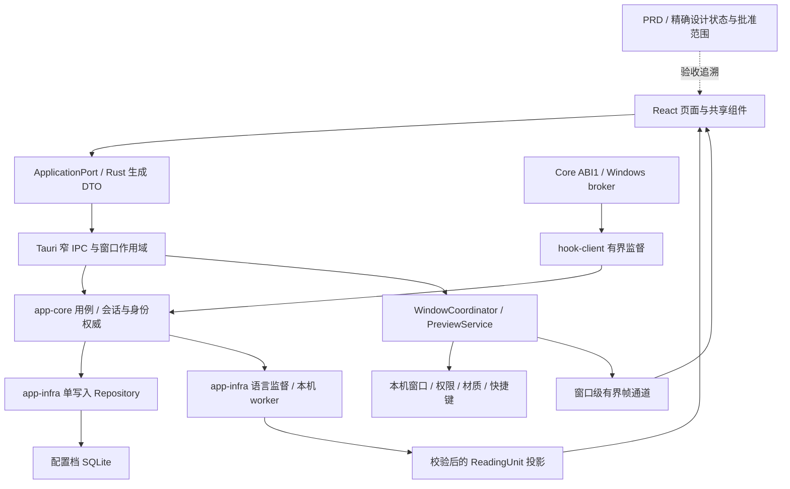
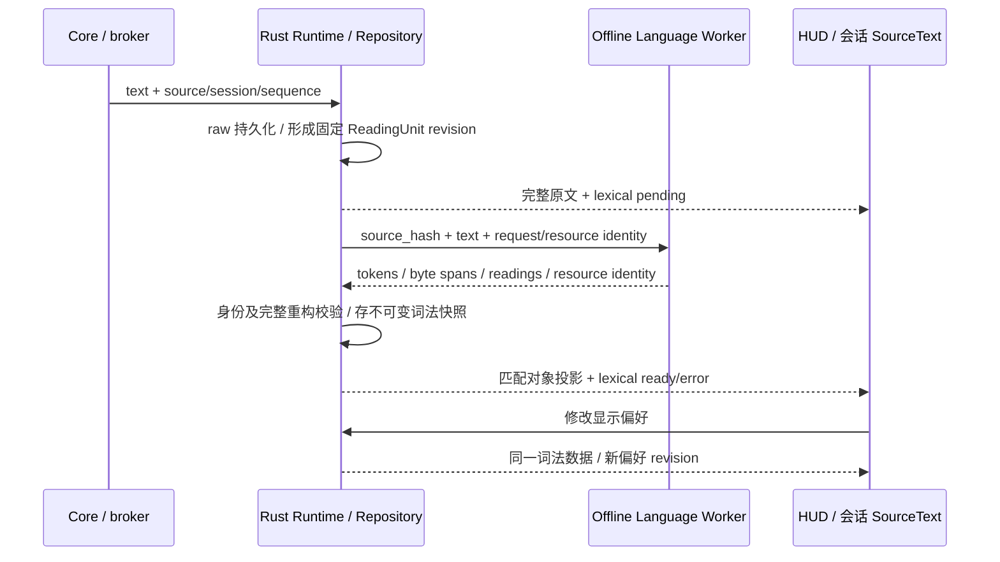

# 阅读窗口、预览与会话数据技术设计

当前完整设计组合（guided与R79历史页）已由用户明确审核通过，身份见[源版批准记录](../development/design-approval-complete-20261031.json)；其他页面按[全页与状态闭包](../development/all-page-design-coverage.md)逐项对齐。设计源批准、独立参照、真实组件和正式包验收分别记录；原29个阅读/配置增量状态继续保留，不能代表整套页面。

## 1. 现行目标与实现边界

本文定义FP-03/04/05/07/09/11/12及RW-01～34的技术行为。现行完整冻结身份以[基线记录](../development/iteration-baseline.json)为准；默认呈现目标为[guided设计](../design/first-product-v1/candidates/guided-service-reading-20261030/index.html?scenario=reading)，历史页由[已批准R79设计](../design/first-product-v1/candidates/history-session-paging-20261031/index.html?scenario=history)覆盖，两者组成已批准61源组合。任务与准出闭包见[客户端对齐总计划](../development/current-client-alignment-plan.md)，总体分层、框架、Core及数据库规则见[研发基线](first-product-engineering-baseline.md)。

| 领域 | 已有源码 | 尚未对齐／执行边界 |
|---|---|---|
| 当前阅读 | 独立当前卡、真实SourceText/词卡、M05投影和共享浅层服务选择已有源码；Main角色字号、七项动作与单结果来源层级已收敛 | 相同视口/数据/状态对照与独立复核分别留证；富文本设计状态、完整参照、Native和游戏仍须逐层验收，不能从源码推断整页完成 |
| 三数据集 | CP-01候选已删除互斥Tab，三个SessionRecordPanel稳定挂载于后置details，默认收起，保留查询/页/错误/锚点/跟随及真实范围摘要 | 收起暂停隐藏列表的历史重放，摘要明确上次读取/已加载警告；全会话实时元数据摘要仍待窄查询方案，不能用已加载warning数冒充全集 |
| 历史页 | HistoryScreen已有historyPage/historySessions、独立generation/游标、详情读取、修正与固定学习 | R79布局/轻文字操作、失败保留旧范围的明确提示、编辑时全部导航及草稿焦点保留等仍须迁移及真实验证，见第15节 |
| 平台预览 | SessionPreviewCoordinator、collector监督、候选/session消费者与只读投影已有；VCP采用紧凑C35卡与独立只读详情 | 新布局不能重建采集；权限、首帧/旧帧、消费者隔离和睡眠恢复须同源最终包实际验收，8MiB/4秒目标仍有缺口 |
| 服务选择 | 共享SavedServiceProjection、细粒度选用/启停/继承端口及HTTP来源执行已有源码和限定验证 | 离线资格、模型发现客户端及完整状态闭包仍未齐；不得由窗口保存current、伪造资格或用整体Apply代替独立选用 |

M03/AP持接收事实和当前正文对象，M05/AI持翻译与取消，M10/AP持正文/raw/Hook持久全集，M11/AP持偏好，M12/PL持平台预览/窗口，M13/UI持局部呈现，M15/QA持脱敏诊断与准出。当前卡和折叠容器先沿既有DTO实现，不默认新增DDL；摘要不足时先审窄typed query，不从UI临时计数猜全集。服务、认证及离线资源的新合同另见[模型技术稿](japanese-study-and-llm.md#5-翻译引擎与模型服务设计)。

### 1.1 当前会话的页面组合与接口就绪

当前设计的完整会话页由共享服务选择、当前正文状态与独立原译文卡、就近常用动作、辅助预览以及后置正文/全部提取/Hook诊断组成；不是只替换一个article。桌面复合设计画布中的假窗口宽度不等于实际WebView client宽度，页面列布局、折叠位置、字号/注音和操作可达性必须在相同逻辑client及状态下核对。

| 能力 | 已有源码端口/组件 | 待完成部分及阻断 |
|---|---|---|
| 当前正文与词法/译文 | AppSnapshot.current、C16/SourceText、M05翻译投影及固定ReadingUnitRef | 按已确认页面组合校准状态、字级、来源和动作；有效render与whole-client证据未齐仍未完成 |
| 暂停、翻译启停与记录 | SetCapturePaused、SetTranslationEnabled、ApplicationPort.sessionRecords及三个SessionRecordPanel | 完整实时摘要缺窄查询合同；不能用已加载页计数冒充全会话，暂停与三数据集语义按第7节保留 |
| 服务选择 | 共享已保存资源资格投影、细粒度选用/启停/继承与统一浅层选择器已接线 | 完整旅程/适用状态与真实资格仍独立验证；界面预览的内存样例不得作为服务可用性或真实选用证据 |
| 预览 | SessionPreviewCoordinator及C35卡/详情 | 作为只读消费者接入，页面重排和展开不改变采集租约、帧时间或游戏几何；逐态C35及最终包结果独立验收 |

上述依赖按[当前计划](../development/current-client-alignment-plan.md)落实到整页任务。已实现的当前卡或折叠区只可记局部完成；服务入口、状态、排布和适用验收尚缺时，当前会话页不能关闭。

已有源码不等于适用产品验收。真实组件、Rust身份/竞态、Repository多页/恢复/导出、原生窗口/资源及同包四游戏分别执行；新目标未执行保持 `not_run`，真实开跑后外部条件不足写 `blocked`，失败原件保留。

### 1.2 Main角色字号与来源信息层级

M11/Rust继续持有有效偏好、全局/游戏覆盖及保存值；M13只派生当前阅读视图。`mainReadingTypography`以阅读浮窗舒适基准18/24对应Main23/18，分别计算`sourceFontPt*(23/18)`和`translationFontPt*(18/24)`；不将两项合为单一缩放率，不消费`hud.compact`，不反写snapshot、默认值、数据库或游戏覆盖。Main SourceText、流式译文和完成译文消费同一派生结果；HUD、History和Study沿各自既有角色路径。输入由Rust验证有限正数，派生数若发生浮点溢出/下溢则保留该项原合法值，不能偷偷改成默认字号或新增持久化范围。

依据是同一已批准源：显示设置将数字字号归在“阅读浮窗”，HUD为18/24、紧凑为16/22；guided Main独立23/18。原型Main没有连上自定义字号，上述独立比例是保留现有偏好权威的最小呈现解释，不能称原型已完整实现自定义交互，也没有全局pt到px换算依据。

Main不再重复绘制HUD/设置已有的分词、注音、词性控制行，但真实SourceText、词卡请求、七项常用动作和跨句固定身份保持。单译文若能归入现有footer，则一次呈现provider、目标语及人工修正；多译文继续逐项呈现。来源缺失、错误、无任务和迟到状态不得为贴图而隐藏；正文/raw/Hook的固定范围及“上次读取”事实不改成伪实时数量。

已确认源的Main `app.js`直接转义原文，原公开开关可影响HUD/学习窗，不能使Main生成对应ruby/POS。现行合同要求Main使用真实SourceText，因此这属于Main富文本设计状态参照缺口；保留真实注音/词性，相关整页零差异保持阻断。关闭标注的对照与开启标注的功能验证分别留证，不删除功能、遮罩或改批准源制造通过。

### 1.3 手动页组合与真实阅读对象

C25复用PageHeader、C03输入、共享ServiceSelector及C16/C17 ReadingContent，布局只在manual-input内收敛。已批准Header的几何不改；正文使用直接textarea、先翻译后清空、常驻结果区，去掉大服务行和额外编辑外框。共享选择器的manual紧凑外观只改变呈现，不复制savedServices、资格或选用逻辑；原standard/session/HUD路径各自回归。手动结果的译文字号按已批准19px角色从已存24px基准独立派生，完成与流式消费同一可选呈现值；ReadingContent/TranslationTaskStates其他调用不传此值时保持既有默认，不写回偏好。有限正数边界沿同一纯字号helper，helper从reading公开出口复用。原稿没有手动页紧凑服务选用、可编辑源语言及真实富文本结果的完整组合状态，这些参照缺口继续阻断相应整页验收。

ManualInputScreen按本次manual_input回执及profile/server/generation固定unit/revision，恢复兜底核sourceSummary.sourceKind为manual；无gameId的Hook仍是Hook，来源未知不作手动结果。未提交不把全局末句塞进结果框，也不为对照图修改受控样例的真实来源。编辑草稿与已保存对象独立，清空不删除存储或代替cancel_task。

ApplicationStore.command在dispatch后还等待refresh，action.pending只表示保存/刷新；模型阶段、部分输出、错误和取消沿固定ReadingUnitProjection与原任务端口。不得引入原型timer、自己维护假任务或把保存回执当翻译成功。源语言选择保留既有三项；SavedServiceProjection没有有效目标语言字段，UI在结果前说明随服务设置，结果后显示真实Translation.targetLanguage，不在M13重写Rust语言解析器。

定向“翻译设置…”使用仅translation的SettingsPageIntent/Request及openSettingsPage/onSettingsPageRequested。M12持有内存pending与单调revision，先保存再show并向settings事件投递，锁不跨原生操作；写命令仅main，读命令仅settings，公共TS从Rust生成。接收端先监听后补读、按revision去重，并调用最新go；目标已是translation时先短路，取消待离页确认但不清草稿/密钥/测试状态或递增resetKey。普通openWindow和Main导航不变，不增加URL路由或持久化schema。源码/受控编译与同包Native的首次、现有、最小化、脏编辑往返分别留证。


## r3执行合同与现有实现分离

P1r3初次计划独审`attempt-01`为`changes_required`，原回执/发布前后图原字节保留；本次覆盖的是待审计划，不签准入、不执行产品。完整机器义务见[绑定旅程机器计划](../development/binding-journey-plan.json)的`execution_obligations`与`resume_epoch.observation_contracts.storage_parent_child.production_timeline`。所有新增登记均为**planned/not_implemented/not_run**；P2只在原16个门禁文件注册/消费，P3必须等fresh准入后才可在原63个实现文件增加真实writer/测试。文字负例、登记、构建或guard自测均不能关闭产品义务。

| 固定义务 | Owner与真实执行路径 | 原件与独立判断 |
|---|---|---|
| EX-LIB-GLOBAL / EX-LIB-SCOPED | UI＋AP/HK；原38组件scene全部保留，新增`BJS-01-library-global-owner`、`BJS-01-scoped-reconnect-owner`；现有Rust `binding_journey::bj_component_transport`＋生产MainWindow/CaptureSheet | 实际SqliteStore/Runtime `SaveGames`保存A/B，返回gameResults与初始snapshot；DOM选A，页头全局入口选运行B应默认既有B。seed后save_game/save_games为0、确认前associate/attach为0、确认后B恰好一次；scoped恢复保留真实意图。Python从实际Rust snapshot/target/review上下文独算ID，不接受自由expectedGameId或单game样例。 |
| EX-LIFE-CORE | AP/HK；扩现有`cargo test --locked -p app-core --test binding_journey bj_07_domain -- --exact --nocapture`，原断言保留 | 分别实际S2资源/target-lease停旧会话前失败、S1仍active，获取fresh current-preview authority；profile/server/full active witness竞态的回调必须0。窄authority仍待P3实现，不是现成API。 |
| EX-LIFE-NATIVE-UNIT | PL；coordinator现文件内固定`platform::session_preview_coordinator::preview_cancellation_tests::bj_07_active_session_preview_reconciliation`及机器合同另四个exact test；实际`cargo test --locked --manifest-path apps/desktop/src-tauri/Cargo.toml --bin luna-reader <固定完整名> -- --exact --nocapture` | 真实M12独立订阅Core-active，受控低层barrier/collector ack，不挂UI、不靠直接ensure。旧handoff0、新candidate不变、陈旧witness拒绝；busy/release重复singleflight，healthy/paused不重启，无window/无明确授权不picker。编译artifact/list/exact/源/nonce/PID/原日志和真实事件表由Python独算；不冒充OS。 |
| EX-LEASE-NATIVE-UNIT | PL；WindowPreviewService现文件内固定`bj_07_nonblocking_retirement_admission`、`bj_07_old_retirement_cannot_release_new_candidate` | 真实2active＋1draining/pending原预算、精确ticket/owner/Fence、guard进出与enqueue、实际release ack/admission顺序；guard内不能等待Stop、不能旧ticket释放新candidate。 |
| EX-STORAGE-TIMELINE | Storage实现、QA门禁消费；实际source_selection_sets父integration＋database私有cfg(test)子libtest | Scope创建≠API入口，arming≠native故障；当前AfterDdl备份时间0是缺证，不能过。P3在生产open/备份落盘完成/事务/DDL/native失败/return及回读处补观察，按route适用性与严格事件次序核验；缺失用null＋not_reached原因，不用0或父relay顶替。 |
| EX-NATIVE-SUCCESS-ROLES | PL/Root真实签名包；原固定名`bj_08_native`、`bj_09_native`（当前未实现），实际app-infra Native writer | 成功beginReading后SourceSheet已卸载且Main已隐藏，committed/temporary/saved采真实HUD＋此前识别Main隐藏＋原DB/journal提交权威。BJ09保存意图/保存后检查另以正常显示Main→重开文本流只读观察，禁止重注入/重提交/改set/重复原效果；不能重开掩盖原窗口效果失败，重开draft为false合法，saved须真实remember=true及saved_snapshot。temporary要真实非空保存基线。 |
| EX-NATIVE-PROGRESS-TRACES | PL/Root真实签名包；固定`bj_06_native`（当前未实现） | 固定waiting-observed/fast-candidates两条清单，按实际当前operation/source事实与OS区间独算选路。waiting实拍等待→候选，fast只要求实际当前候选，历史握手/连接/source顺序由loss-free账本证明，不强造四张中间截图或产品延迟；无首次progress原件不宣称首次轮询，域/真实React迟到与过早阶段义务不减。 |
| EX-LIFE-SIGNED-NATIVE | Root/PL/QA；同源最终签名包BJ07，另同包四游戏/真实服务 | Native-unit不能代OS。保留原五句/款、Never7跨三页、预览/Hook/词卡/翻译与退出恢复、原153/RW/901全部独立义务。 |

P2任务`R3-02-EXEC`/`R3-02-STORAGE-TIME`/`R3-02-NATIVE-OBS`先落精确registry、raw字段、独立消费和缺失/篡改拒绝；新产品producer缺失时仍blocked/failed，不因注册而绿。P3任务`R3-04-EXEC`/`R3-04-STORAGE-TIME`/`R3-04-NATIVE-WRITER`再实现真实producer并以相同源/nonce原件复验；完整P1/P2独审和新准入前不可写产品。LIB01～05、LIFE01～08及LEASE01～04均逐项绑定机器义务，原76定义不删改；Native十四类反例另累计，BJ14整页零RGBA与全部存储不变。


## 2. 接入、存储与资源事实

客户端由独立Core锁消费ABI 1七回调与私有JSONL 2，双broker按目标位数运行于已核Bottle；语言worker在本机独立运行。预览、快捷键、词法和会话查询均不加入游戏DLL或broker。构建包须验证源码封印、EXE、签名、ZIP、Core/词典资源和许可，不通过重写外部manifest重标旧包。

内部旧启动适配的pending文件租约使用创建进程拥有的窄guard，成功加锁后才构造；guard覆盖原discover/reserve/run及全部早退，owner Drop显式unlock，fork子进程Drop不能解除父活锁。该修复不增加启动产品能力、不改锁路径、30秒持久pending/10秒debounce/15秒run期限或错误码；父释放与子不误释放由真实fork握手及默认并行infra回归验证。

正式入口只连接已运行目标，不启动游戏。CaptureSheet编辑候选和资料草稿，复用SaveGames动态itemId/gameId/rowRevision；正式关联主路径通过reviewAssociation签发opaque review，再提交ReviewedAssociateRequest（operationId/reviewId）。原AssociateRequest仅保留Core内部none/reuse兼容，不是Native正式绑定入口；已有库、新资料和仅本次归属在同面板选择。Library页头统一入口为unscoped，不能由选中卡片gameId覆盖实际candidate精确匹配；MainWindow可包装为()=>connect(null)，不改LibraryScreen或扩其授权。CurrentSession明确重连等scoped入口保留真实用户归属意图。多库A已选/B实际运行时默认既有B，零隐式新建，只有核对确认后才注入；单game受控fixture不能授予此项通过。初扫独立scanning/ready/empty/error及epoch；每实例只共享进行中的targets请求，settle后可重新扫描。资料中的launch PE架构在actual canonical未知时只是提示，首次核验以真实candidate为准；已有实际路径/架构、环境及Bottle严格核对，不按游戏名、显示名或第一条记录替代身份。

正式主路径ApplicationRuntime::associate_reviewed先复核opaque review、profile代次、原活动会话与完整候选，再沿guarded关联执行；Core内部associate仅保留none/reuse兼容。CoreHookBackend::with_associated_session_commit沿capture_lock→lease→active→短SQL核会话，SQL成功后发布空归属。SQL actor不回调native，回调克隆active后释放锁；同SID补归属不重注入，失败保留有效连接，不同非空归属拒绝。sessions.game_id只从NULL补齐，ReadingUnit/sourceSummary经session JOIN取得归属，不改旧revision、原文、语言、hash、processing_snapshot、tokens或translations。

本机封面经安全托管资产链读取；首帧回退仅在缺本机封面、正式关联与授权有效时按CAS保存，不覆盖已有封面，不接收临时候选或旧generation帧。SQLite profile租约是记录获取进程PID的RAII guard：先关连接，父所有者显式unlock，fork子只close，不能解锁父进程。

raw持久化先于暂停正文消费，Hook journal/操作身份独立入库；活动会话、open正文引用及固定导出范围受保留保护。当前生产源码按累计schema5核验；001～004迁移与原hash保持，历史schema1原始合同、schema2追加4表29字段及后续v3/v4设计各按原身份保留，不重标为schema5。新增005与当前83表/748字段的独立期望、迁移、边界及真实adapter分层核对，最终schema5验收仍未完成。共享自绘Select、原生HUD/快捷键、三数据集、独立ruby/POS已有实现；完整视觉、语言质量和当前最终包结果不能从这些入口存在推导。

### 2.1 绑定旅程的目标合同与现状

依据FP-03/04/05/09/12、GL/RW及已批准`game-library.js`、`app.js`，交付单位为库页入口、候选身份与必要系统配对、一次关联、真实阶段、正文草稿确认和阅读窗口交接。原R92源的两页/单流/错误别名偏差已由首次P3推进修复；当前已有review/operation/集合/schema5与真实组件接线。真实RPC诊断和Native非作者审阅仍发现恢复入口、兼容入口与观察合同缺口，r3先封存后修门禁再续写。BIND-001～006仍未完成，源码或局部恢复结果不能提升整页/正式包验收。

M02/M03持有目标关系与业务状态，M10持有选择和来源版本，M12持有预览与窗口效果，M13只维护交互草稿，M15消费真实证据。保留现有Core ABI、broker、collector/filter和候选→会话transfer/Fence，不在本轮重写采集器、改变游戏设置或扩大框架。

### 2.2 关系核对与真实接入进度

正式客户端端口为`reviewAssociation`、reviewed `associate`、`associationProgress`、`sourceSelection`、`beginReading`及独立窗口效果重试，已接线的源码需按最终冻结点重新编译和实测。仅含candidate/game/布尔confirm_switch的旧Native `application_associate`不具opaque review权威，必须零副作用返回`reviewed_association_required`；不能先改预览epoch再拒绝。Core内部旧none/reuse及单数`select_source`兼容保留，跨目标切换与正式客户端统一经过新增Rust权威。旧请求重放不注入、不移交/停止预览、不修改当前Native偏好或窗口。

| 端口/投影 | 输入和结果的最小语义 | 权威与隔离 |
|---|---|---|
| `reviewAssociation` | 服务签发candidate、拟归属游戏与当前会话上下文；返回opaque review ID及none/reuse/switch/unavailable关系、核验依据与失效原因 | Rust比较完整Bottle/路径/架构/PID/创建身份，不按名称或gameId猜测；review绑定profile代次、candidate与当前session代次，执行associate前再次核验。旧review不能授权停止新会话 |
| `associationProgress` | 按operation ID查询/订阅核验、资源准备、启动请求、真实握手、等待文本、候选可选及失败事实 | 复用capture_operations、Hook journal及真实Core事件；`association_ready`或Promise resolve不代表握手。投影带operation/session/generation，旧事件不推进新旅程 |
| `sourceSelection` | 当前已提交set、完整成员/版本、来源高级字段和最近明确保存说明；匹配结果为可核对候选或requires_review | 只读投影；u64 address/context/subcontext为规范十进制字符串，禁止JS number精度损失。缺字段不造0；sourceId和绝对地址不作为跨会话自动匹配依据 |
| `beginReading` | operation ID、当前session、预期set revision、source ID有序集合、remember意图；返回同事务已提交set及后续窗口效果身份 | 非空/去重/有界、同有效session、head CAS、游戏归属与记住规则由Rust验证；复选草稿不写业务。相同operation+相同规范请求重放原结果，冲突请求拒绝 |

接入生命周期由Rust持有，关闭阶段观察面板仅取消该观察者，不停止已提交关联或Hook。错误保留真实operation及阶段，并提供明确接入重试；重试先再次核验目标。“窗口已关联，取文接入失败”、已连接等待文本与候选可读分开。当前operation的candidates_ready与真实来源投影驱动正文面板，旧阶段列表可按批准交互收起；不以Promise、假streams或别的operation推进。无用户意图的挂载/轮询不得弹系统picker。

### 2.3 预览前置配对与选择草稿

ANSI安全自动核验不可用时，精确消费`preview_window_selection_required`等系统确认状态，在候选核对区呈现首次选择动作。用户明确操作后才请求系统singleWindow确认；全局TCC与单窗口filter分别表达。真实预览在最终关联前供核对，随后沿既有transfer/Fence移交同一Windows身份、同一个filter；候选stop只作用旧generation。确认后不再常规要求选择同一窗口。普通刷新、首次没有图、不可用旧帧和已过期分别表达，只有新有效帧可进入live。预览不可用不阻断已核对Windows身份的Hook路径。

UI维护本次source集合、remember及展开状态，选择变化不调用命令。显式开始阅读才一次提交，失败保留草稿；稍后选择不提交或断开。高级样本和Hook/address/context/context2来自真实capture_sources投影。警告保留可查，非当前Bottle信息不挤占身份和预览的主要层级；C1正常/窄窗及200%各态独立验证。

### 2.4 选择集合、来源血缘与schema5

新增设计见[选择集合schema5](database/v5/README.md)及其可执行DDL/边界定义；schema5生产实现已在首次P3落源，尚未据此完成最终生产存储验收；001～004迁移及原hash不变。新增`source_selection_sets`和`source_selection_members`，只读当前成员视图作为业务查询的共同依据。旧`source_selections`及reading_unit_revisions的FK、`source_ref_selected_source`触发器保留原义：每个成员仍拥有真实、单来源的selection revision，不将多流伪装成一条代表性source。

一次确认在单writer事务中检查session/head/操作幂等、封口旧open单元、为全部所选成员分配新的selection revision、写set与members、确认完整成员数并封印，再写既有operation_receipts。任一失败全部回滚；每次新确认，即使A→B→A或仍选A，也分配全新成员版本。旧单数`SelectSource`委托同一单成员集合事务，不维护第二条max-revision权威。新set revision和selection revision均检查加法溢出；IPC按其生成类型保持无损。

迁移为每个旧selection构造保留原revision的单成员集合，最新已封印set保持原“最新单流”的生效语义；历史source_refs、原文/译文/词法/processing快照及001～004 ledger字节不变。重新打开与0/1/2/3/4→5、旧客户端拒绝未知schema且不改库、故障中断及只读/busy/ENOSPC均需独立生产测试。完整期望由冻结的独立v4设计与005设计SQL构造为[v5合同](database/v5/schema-contract.json)：83表/748个profile字段，旧对象原义不变。当前writer测试、备份文件名及比较器调用须按精确依赖更新；旧v4原测试和实际冻结Store4另行执行，v4比较器不能改为接受5，不能删除旧字段/route/故障断言。完整产品存储adapter的既有v4/v5缺口保持独立阻断，不借本次有限生产迁移检查提升。

正文消费按当前已封印集合查当前event.source对应成员revision，按来源分别形成阅读单元，不把不同来源拼接。自动翻译有两条现存资格链：`storage/database.rs`的工作任务准备及旧任务准备/重试。两者必须在同一writer任务中共同验证finalized、最新text revision、有效会话与“当前集合包含该成员revision”，不能继续以session最大`selection_revision`授权，否则仅最后成员会翻译，或A→B→A重新授权旧句。显式历史重译仍沿原固定对象用途，不伪装成新的自动请求资格。

### 2.5 保存选择与原生窗口效果

remember使用集合级`saved_snapshot`及版本化`match_snapshot_json`，与成员的真实来源血缘分开。查询在本profile按真实游戏归属和兼容目标身份读取最近一次明确saved集合；后续temporary集合不清除或覆盖它。没有gameId时UI明确禁用且Rust拒绝remember。当前来源扩展只有PID等会话性信息，不能承诺跨启动稳定匹配；缺可靠模块相对身份/可移植匹配证明时返回`requires_review`，显示上次来源与原因，不按Hook名、旧sourceId、PID或ASLR绝对地址自动勾选或提交。保存说明可在用户核对后继续使用，开始阅读仍为显式确认。

当前保留逻辑只删除raw payload、历史单元及缓存，不删除sessions/capture_sources/source_selections；schema5集合与匹配说明同样受保护，payload清理不抹去remember。未来增加会话整段清理时，必须先建立独立偏好快照或显式保护，不得cascade删除已保存规则。未知matcher版本只读保留，展示需重新核对，不改成临时成功。

选择事务成功后，M12执行绑定profile/server generation/session/set revision/operation的独立窗口效果：先显示HUD并真实读回可见成功，再隐藏Main并读回隐藏。持久化结果与窗口结果分别回执；失败显示“选择已保存，窗口操作未完成”，只重试窗口效果，不再次生成set、保存规则或注入。每次重试前核当前session与set head，旧操作不能隐藏新会话主窗或显示旧HUD。原生show/hide本身幂等，不为瞬时窗口状态新增业务表。BJ13以实际before Main身份、完整loss-free事件顺序和completed最终OS/原始HUD图证明，不要求外部截图定格同步调用间瞬间；不加测试延迟或伪造时间。事件按同一authority及correlation绑定，不能被并发review覆盖；guard内只做有界入队，独立持FD writer写日志，丢失/异常与flush watermark可核对，日志无业务控制权限。

## 3. 模块与进程边界



图中箭头表示调用或数据流，不代表 UI 可以导入底层实现。业务规则仍在 app-core；平台实效归 M12，原生取文归 M14，持久化归 M10，语言归 M07。预览帧不进入模型网关、不进入 SQLite 正文历史，也不经过 Windows broker。

### 3.1 Owner 与复用

| 领域 | 主责 / 协作 | 复用点 | 责任契约 |
| --- | --- | --- | --- |
| 目标与会话 | AP / HK、PL | M02；TargetCandidate、SessionIdentity | 预览身份租约、切换取消，不把预览选择当关联接入 |
| 平台窗口 | PL / AP、UI | M12；window_manager 与菜单恢复 | WindowCoordinator、WindowPreviewPort、几何与快捷键有效态、材质能力 |
| 原始取文与阶段 | HK / AP | M14；JSONL2 NativeEvent 与序号 | 完整事件归一、上游缺口和暂停边界，不扩宽 Core ABI |
| 会话存储 | AP / HK、QA | M03/M10；raw_events、source_refs、HistoryQuery | 三数据集分页、范围与完整性、显式保留、脱敏导出 |
| 语言与正文 | JA / AP、UI | M07/M08；LanguageServices、ReadingUnit | 分词/ruby 独立偏好、词法状态、真实 span 与迟到隔离 |
| 公共界面 | UI / PL、QA | M13；C01/C04/C13/C16/C18/C23/C33/C34 | 共用 Select、预览、会话记录面板与 HUD 工具栏；不复制业务命令 |
| 证据与发布 | QA / 各 Owner | M15；现有 runner 和证据身份 | RW 全量覆盖、层级能力、真实执行与缺项阻断 |

## 4. 运行窗口实时预览

C35、原生预览Service、显式权限、nonce窗口身份核验和有界最新帧管线已有源码；SessionPreviewCoordinator监督独立collector。下列责任契约中的示意类型不替代 `window_capabilities.rs` 与窄IPC `reading.rs` 的编译类型；CAP-PREVIEW的最终包实效单独验收。

### 4.0 紧凑卡与详情：目标、实现与验收分别记录

现行C35目标为用户已采用的[五项组件补充](../development/design-approval-preview-20261104.json)，原61源及历史批准图不变；比较画布不是完整主窗替代入口。`WindowPreview`仍使用原候选/session consumer、订阅与控制意图；打开、关闭、滚动或复制详情均不发起采集、不重建租约、不启动Hook。此呈现目标不授权公共DTO、数据库或原生采集协议变更。

已实现346px卡片、280px纵排上限、内容宽520px横排和只读详情。尚待对齐的是：独立历史成功时间与当前可显示帧的分离、恢复/撤权/关闭的历史事实展示、身份与资料来源的精确措辞，以及新补充稿的逐状态独立参照。当前组件清帧后只按可显示frame取主卡时间，不能据此宣称PC-04已实现。详情已经区分投影与能力权限，但完整PC-05仍须逐事实与新目标核对。源稿采用不等于这些实现或零像素验收通过。

| 部分 | 当前源码 | 验收边界 |
|---|---|---|
| C35主卡 | 346px高、54px标题与46px底栏；16:9图像，容器内容宽度520px起横向；竖向图片最大280px避免中间宽度挤压元数据和操作 | 原批准稿的中间宽度图片遮挡保留为源稿差异，产品通用边界修正不能自动批准为新参照 |
| 材质 | 复用现有token，C35/预览Sheet局部同时保留标准与WebKit backdrop声明，降透明度/不支持时回退 | 浏览器计算样式与截图不代表macOS正式包材质验收 |
| PreviewDetails | 复用React Aria Sheet，独立清点真实surface；360×560视口约束、正文独立滚动、Escape返回入口，复制保持焦点、同步防双发、关闭重开隔离旧Promise提示 | 原始诊断与长路径移入详情；复制在途/错误和长事实仍须同态设计映射与独立参照 |
| 事实来源 | 候选TargetCandidate与游戏资料分别标记；游戏路径明确为可编辑资料，不声称Native实核；预览回执权限与能力查询权限分开，缺少Native阶段等明确未提供 | 不从hash、缓存或接口没有的字段推导当前核验事实，不为与演示稿相同而填假值 |
| 阅读局部 | 概览透明、边框/阴影收敛，后置折叠摘要按现行最终CSS级联的11px纵向内距；程序文件标记“仅记录” | 不恢复旧Tab/手动开启预览/启动游戏入口，角色字号依第1.2节呈现，保持Rust偏好和真实词法权威 |

独立HTML源与真实React候选使用同态输入、单独截图及零差异复算；演示标签属于产品外工具，既有像素失败与缺参照运行记录保留。新目标的参照必须来自补充稿明确的卡片/详情状态，不能继续用父源缺失或已被覆盖的C35呈现充当当前批准参照。新增详情的状态进入全页及现行合同，原802项义务和已登记新增状态全部保留，现行适用集合以全页机器清单为准，当前901项（原809项全部保留）；有限C35浏览器结果不能替代全态适配器、独立参照批准、正式包或游戏验收。

### 4.1 端口与身份

`WindowPreviewPort` 是业务所需的平台能力接口。app-core 只处理可比较的身份和生命周期，不持有 `CGWindowID`、`SCWindow`、原生句柄或图像指针。Tauri平台适配经受监督collector解析已验证目标，返回不可由前端伪造任意窗口的预览引用。

拟议身份为 `profile_generation + consumer_id + preview_generation + target_identity_hash + host_window_instance`。其中窗口实例须关联宿主 PID 及创建身份、宿主窗口 ID、Bottle 和 Windows 目标完整身份；相同标题、重用 PID/窗口编号不得命中旧引用。仅有进程候选而没有可验证窗口时返回 `no_capture_window`，不改采整个屏幕。

```rust
// 契约草图；不是已存在类型或编译通过的代码。
trait WindowPreviewPort {
    fn permission(&self) -> PreviewPermission;
    fn start(&self, request: VerifiedPreviewRequest) -> PreviewLease;
    fn pause(&self, lease: PreviewLeaseId) -> PreviewReceipt;
    fn resume(&self, lease: PreviewLeaseId) -> PreviewReceipt;
    fn stop(&self, lease: PreviewLeaseId) -> PreviewReceipt;
}
```

命令只接受服务签发的候选/绑定引用，不接受任意文件路径、屏幕 ID 或调用方提供的裸句柄。列表、核对和当前会话复用 C35 `WindowPreview`，显示清晰来源；候选预览与当前绑定预览使用不同 consumer，取消核对只释放候选租约，不影响原会话。

macOS已采用ScreenCaptureKit窗口级过滤和完整nonce身份核验，预览最低macOS14；原应用最低macOS11不变，旧系统明确不支持预览。权限查询不提示；用户明确选定有效目标后按系统需要申请，已有权限自动预览；不用全屏裁剪替代窗口隔离。[Apple 窗口捕获示例](https://developer.apple.com/documentation/screencapturekit/capturing-screen-content-in-macos)、[窗口过滤器](https://developer.apple.com/documentation/screencapturekit/sccontentfilter/init%28desktopindependentwindow%3A%29)。

### 4.2 权限与状态机

`off → requesting_permission → starting → live`；另外有 `paused / stale / minimized / target_closed / permission_denied / permission_revoked / unavailable / stopped`。权限已授予不等于本次目标可采集。采集权限、帧可用性和 Hook 连接状态是三个独立投影字段。

用户明确选择有效目标后可进入权限申请/系统设置/重新检查；已有权限自动开始，授权返回后自动恢复该有效对象，不再每次点击开启。空库列举或接收台词不无目标触发录屏授权。拒绝不改变取文会话；系统设置入口和重新检查由平台提供受限 intent，不允许 UI 任意启动 URL/shell。候选面板取消/切换时仅释放候选租约；正式关联后session持有预览，记录区展开/折叠、滚动或切页不释放。解除窗口关联、目标退出、退出配置档或应用时释放对应session租约；停止后到达的帧因 generation 不符被丢弃。

新目标确认生效时先提升 preview_generation 并清除旧目标画面，再启动新租约。旧目标原生回调、编码任务或 Channel 迟到均不能更改新画面的状态或时间。调用 stop 成功前不能宣称底层资源已经释放；错误保留可恢复状态。

### 4.3 帧、时间与资源预算

拟议帧信封包含 `preview_id / generation / frame_sequence / target_identity_hash / captured_at / width / height / content_hash / encoding / payload_ref`。64 位序号以规范十进制字符串跨 IPC；时间来自平台本次有效采集回调，UI 的 render/heartbeat、重复发送同一帧或封面替换都不更新时间。复用旧帧时保留其原采集时间；实际新帧与旧帧内容相同也不能声称“画面发生变化”。尝试时间、最后有效采集时间、上次内容变化时间和权限检查时间分别记录：静态游戏可以仍在正常采集，stale依据真实采集健康/期限判断，不依据“内容没有变化”误报。真实变化验收仍须观察至少两次可识别内容变化，不能只比较采集时间或frame_sequence。

帧传输使用独立、按窗口授权的有界通道或受限临时内存资源，不塞进全应用快照，也不把每帧 base64 写入事件总线或正文数据库。只保留待显示的最新帧；慢窗口允许丢弃中间帧，但必须保留最新帧身份与实际时间。帧丢弃策略不用于 raw Hook 业务事件。

现有编码限额为最多2个租约、全局1次在途采集、1000ms采样、960×540/JPEG512KiB上限，采集启动/停止期限5/3秒；身份核验有独立有界期限。实际采集timeout/busy会投影stale并保留原帧时间；独立的固定4秒过期判定仍为规划缺口。帧走最新槽和每租约单飞pull，不走全局图像事件总线。候选关闭取消候选租约，session租约不随记录可见性或临时候选卸载；列表只对用户明确选中且身份有效的目标自动预览。8MiB为规划内存预算，目前没有全局内存硬预算检查，不能将现有尺寸/并发限额当作该预算已验收；最终包仍需资源、时序、窗口隔离实测，并保留该缺口。

不启用音频，不持续录制或连续保存帧，不传翻译/AI服务、不写诊断包。静态封面的允许回退为：本机封面缺失、正式关联有效目标、录屏已授权时保存首张有效帧到托管assets并绑定game；临时候选/旧generation/错绑目标不存帧，已有封面不覆盖。用户明确导出当前帧时使用系统保存面板并标注帧时间与来源；预览故障日志只含脱敏状态、尺寸与错误码。窗口被遮挡但平台不能独立采集时明确 unavailable；不抬起目标、不抢焦点，也不混入遮挡应用的内容。

### 4.4 显式单窗口配对与完整身份

M12负责macOS系统SCContentSharingPicker单窗口事务，M02继续提供Windows完整身份、候选/会话绑定与既有probe，M13仅发ApplicationPort显式意图并呈现投影。新增唯一窄IPC`application_preview_select_window`复用`PreviewStartRequest`和`PreviewProjection`；无新业务Command、公开DTO、DB或依赖。C13/C14/C35是适用组件。

用户选择是跨命名空间配对的明确来源，不冒称自动归属证明。macOS15.2+允许从filter读取唯一includedWindow；allowedPickerModes精确SingleWindow、style Window、allowsChangingSelectedContent=NO。原SCContentFilter由native opaque token持有，capture与关闭绑定该精确资源；只采该窗口，不接受应用/整屏选择。其余include数组依官方实际语义校验，不凭假设空数组误拒。系统picker仅一个事务ID，冻结candidate/session/preview epoch，主线程不等待；取消/失败/90秒超时/目标替换/迟到回调都不复活旧对象。

#### 关联校验的保证与限制

效果前后重新校验Win PID/EXE/创建FILETIME/架构/HWND/class，native CGWindowID/ownerPID/启动身份。目标PE的真实dev/ino映射仅作错选过滤；当前只有4KiB只读header，不能称执行身份证明。对同Bottle同真实PE的多活跃Win进程拒绝自动推定实例。Windows路径复用`platform/game_launch.rs`既有驱动映射与解析，不复制实现。

若owner初始环境可见WINEPREFIX，核对canonical根且任何矛盾拒绝；环境不可见时不能伪造已核对结果。另可核对实际运行bundle路径/格式、CXHelperAppBottleName/Tag和目标cxbottle.conf BottleID，字段、文件身份/hash前后稳定、重复BottleID拒绝。该分支严格命名`helper_metadata_consistent`，只说明launcher元数据交叉校验，不冒充实际有效prefix attestation。用户在面板查看真实画面并核对目标；辅助窗不可按标题/尺寸自动当主游戏窗。

每帧前后继续校验所需Win绑定、native启动身份/对象、关联证据及租约generation；旧帧/回调不能进入新目标。TCC原门控保持，picker局部授权不替代全局权限。系统不可采集及离屏返回按真实状态处理，保留最后成功帧但不得标实时。

#### 失败控制槽与验证

内部logical slot区分Pending/Failed/Resolved。Failed保留opaque控制句柄/generation/冻结request，但没有native capture资源或成功帧；仅Resolved参与capture与封面。现有resume用于明确重试、stop释放槽；manual-pair-required只由专用显式意图打开picker。session启动失败发布同一typed终态，不只写日志和返回generic pending，不无限重复challenge。UI的无lease失败/IPC异常也终结starting；有lease transport只允许一次有界恢复，权限恢复/目标变化/明确重试可重置。

受控React、Rust策略/lease、实际native picker回调、最终同签名新包画面与游戏取文分层记录。验收至少包含ANSI手动配对后连续不同真实帧、误选/取消/迟到/多实例/目标关闭/权限/超时/预算和封面边界；未执行保持not_run。批准图、零差异阈值和既有视觉source drift失败不因本文提升通过。


### 4.5 精确单窗口后备与会话移交

ScreenCaptureKit优先；单窗口兼容后备保持窄条件。生产保持SC优先，仅保留了用户明确选定filter的目标遇到特定兼容/离屏错误时进入窄后备；TCC、身份、取消与目标失效不降级，不使用桌面截图或矩形裁剪。

M12私有`macos/window_capture.rs`用绝对系统路径与结构化参数，无shell；单在途、源像素/输入字节/输出字节/时间均有界。由于系统工具不支持stdout或已unlink文件描述符输出，后备使用独占0700目录，child的umask077使输出保持0600。Apple工具实际会原子替换预建文件，故在child完成后O_NOFOLLOW打开新regular文件，核对uid/dev/nlink、父目录身份及读取前后新inode稳定，拒绝symlink和读取期间替换；该平台行为须保留真实工具证据，不能以假写入测试推定。检查退出状态、真实非空JPEG、原始尺寸与像素上界后复用内存codec归一为既有960×540/512KiB输出。finally删除；异常退出遗留仅按适配器私有目录及已退出owner限定清理。它不建立截图历史，不证明尚未实现的全局8MiB内存预算。源码预算为源图4,194,304像素、输入2MiB、owned child3秒、输出960×540且524,288字节，一笔在途。25ms轮询仅作cheap native/TCC/代际校验；完整Windows probe在帧前后执行，不在每次轮询创建helper。实际端到端耗时及正式包授权仍需实测。

正式reviewed关联成功后，由Core保存的原review/成功会话witness/head授权窄Native预览效果，不能从“当前Hook目标”替换原candidate。文件身份冻结I/O在短guard前完成，capture/完整Hook lease内只校原identity并修改元数据/有界排队；replay或旧head不执行效果。同候选epoch才允许transfer/cleanup及epoch推进；候选已关闭/换代而Core当前authority仍有效时，只幂等创建/保留该精确SID的Session预览，不改新的candidate或epoch。移交失败不伪造实时帧，不撤销已成功Hook关联；日志不加入采集或Hook控制链。M12必须独立订阅真实Core active session/代次并幂等协调Session采集，UI保持只订阅；不得把生命周期挂在旧operation handoff、Promise、面板挂载或previewSession纯读轮询上。若S1成功待handoff、用户关闭面板、S2又在stop_owned_session前资源/target lease失败而S1仍active，M12须由当前会话权威最终建立S1预览；旧S1 candidate callback仍为零，不碰新的候选。必要时增加窄只读current-session preview authority及短guard，核profile/server代次和完整active Hook/broker/resource/target witness，不放宽原operation/head guard。复用collector/filter/Fence和有界lease；无已核window、首次明确系统确认和typed busy如实呈现，重复通知不重启同一采集或自动弹picker。当前Core成功而候选epoch变化时，旧Session与新Candidate可能占满原容量，r3仅精确扩展window_preview.rs以提供窄nonblocking retire/admission：短guard内标记旧exact lease的stop_requested并bounded enqueue，guard外等待真实release后接续；保持最多2active加1draining/待接续预算、typed busy、ownership/generation与Fence，不抬预算、不在guard内control Stop等待3秒，不允许旧op释放新candidate。

### 4.6 collector监督、订阅与恢复

SessionPreviewCoordinator监督唯一持久collector；同一签名可执行文件最早 `--capture-worker` 分派真实第二PID，worker持AppKit RunLoop、系统singleWindow picker、原SCContentFilter和完整Windows/Native proof。filter没有公开跨进程编码合同，picker/filter/capture必须同worker持有；不能把重建CGID称为原授权。Hook、语言、翻译和SQLite不进入collector。

主窗、候选面板和封面只订阅状态/最新帧。每个React监听独立取消；挂卸载、折叠、滚动和慢消费者不启动、停止或重新核验producer。选择、重试、暂停、取消及解除才是控制意图；可信自动映射与已有权限自动预览保留，挂载不自动弹系统picker。主窗读取已提交绑定快照，封面fresh核验显式委托同worker；快照仅供展示，不替代下一帧强校验。

Windows已提交关联与Native预览就绪分开：待选窗、权限拒绝或不可采集不抹掉可信关联，真实Windows身份失效另行处理。候选向session按完整identity与generation/CAS移交同filter；旧candidate stop不命中新session。控制槽与背压、typed busy释放、旧请求/旧finally和回调都按精确租约归属；旧会话不得阻塞新会话。

合法首帧可在同lease/generation/consumer下将未知targetIdentityHash单向解析为完整已核hash；已知目标变化、迟到null及旧sequence拒绝。consumer_update和latest_update使用同一安全投影formatter，元数据不覆盖诊断、不替旧图推进画面时间；降级缓存及权限拒绝后的迟到帧不构成实时恢复。安全detail与独立友好提示分别可定位。

持原单窗filter时，onScreen=false不在SCK调用前代替系统作失败判断；无filter自动定位保留可见性拒绝。编码和同窗尺寸暂变可在既有single-flight/有界重试中保留原choice并重新完整核验；不改source/epoch/窗口pin，不换目标、不自动弹picker或重启App/Hook/游戏。身份/权限失效及时撤销，预算/坏帧仍拒绝；失败保留真实末帧时间，只有新的有效帧才回到live。

私有状态须区分Native初始返回、兼容后备最终错误、重试及终止结果，使用固定安全错误码，不传原始stderr、内容、路径或token。系统picker超时、SCK调用、Hook正文到达是独立事实。最终同源签名包的持续变化帧、切页/慢消费者隔离和休眠恢复须实际执行，不能从Hook连接或组件通过推导预览通过；8MiB与4秒SLO缺口保持。

## 5. HUD：原生窗口与常用操作

M13落实已确认的三页补充：历史只重组现有Select/目录容器与同轨CSS，不改变M10游标/编辑权威；通用页采用新批准的标题/轻scope与三组排布，标题进入正文滚动区，保留固定可换行保存区；行承担11px/14px安全内距。设置sidebar的footer为nav兄弟并margin-top:auto/flex-shrink:0，37px行高/3px间隔/12px字跟随批准源。General显式WindowFrame局部变体只使用单层shell-fill，保留既有blur/saturation/alpha和透明Native宿主；其他页面默认frame不变。General响应式沿批准viewport950/620，header的窄content分支只调整scope排布，不增container440整页padding/footer规则。PreferencesScreen复用M11原scope读取、字段mask、draft generation、head CAS与保存/放弃/恢复，不移植设计HTML的内存API。GeneralSettings只承载records/local及typed会话导航，M12登录启动仍沿既有端口独立负责。停止会话由Rust session投影派生，不新增前端业务状态机；实际binding查询仍跨取文停止持续，原WindowPreview在绑定有效时保持同key/同订阅，解绑才撤出，旧句动作固定unit/revision。精读/HUD继续通过真实窗口端口，原型的辅助画布CSS不复制到客户端。翻译失败恢复调用已有typed translation intent，不复制HTTP/配置执行器。

M13顶部栏使用38px固定flex项、上下6px/左右7px内边距；26px共享服务选择器、26px拖动手柄和24px窗口工具按原交互分离。正文继续独立flex滚动，顶部/底栏不随正文移动；间距不改变服务资格、Native位置或Rust持久偏好。设计采用继承61源加独立HUD间距CSS，父批准/PNG及材质token不改，局部像素待核对且完整产品门禁保持阻断。

源码已接入，原生交互须同包验收。 常用工具栏、局部滚动、原生拖动、几何持久/恢复、偏好快捷键prepare/commit/rollback和菜单恢复已实现；平台返回实际effective组合，desired不是生效证据。见CAP-HUD-CONTROLS／DRAG／SCROLL-MENU／SHORTCUT。

### 5.1 工具栏与命令复用

C18 只拥有可见布局与瞬时展开状态。顶部固定置顶、紧凑/舒适、隐藏；空白和独立手柄为拖动区。底栏直接提供分词、注音、词性、原译模式、自动翻译、暂停/继续、重译、复制、精读。更多菜单仅保留设置、选择/更换窗口、适用时解除关联、恢复位置、断开取文；不得再次复制常用动作。

`560pt` 舒适与 `500pt` 紧凑均要保留全部入口和 tooltip/可访问名称；允许按确认稿分组组织固定工具区，不以缩到不可点、横向滚动或移回更多解决拥挤。正文是唯一滚动容器，外窗/根文档 overflow 锁定，工具区与弹层不随正文滚动。弹层采用 click/toggle 状态；pointerup 不关闭，外点或 Escape 按焦点规则关闭。

显隐、暂停、自动翻译、显示模式四个状态独立。菜单栏、快捷键和工具栏调用同一个 Rust intent；复制、重译和精读捕获点击时 `ReadingUnitRef`，不能等异步执行时再读取可变 current。复制来自 `source_text`，不从 ruby DOM 提取。仅译文但当前句没有译文时保留原文及等待/错误提示，不显示空白。

### 5.2 拖动与几何

`WindowCoordinator` 是 M12 的协调职责，不另建业务数据库服务。HUD 的有效 `pointerdown` 由受控 application-port 转到原生窗口移动能力；窗口角色必须为 hud、来源为真实用户操作、按键和控件命中合法。UI 只发开始拖动意图，不能用 CSS transform/前端坐标制造“窗口已移动”。Tauri 具有窗口拖动及 moved/scale 事件能力，实际封装须使用锁定版本 API 并保持权限最小。[Tauri Window API](https://v2.tauri.app/reference/javascript/api/namespacewindow/)。

按钮、词语、文本选择、菜单、Select 和正文滚动不作为拖动来源。释放鼠标结束原生拖动；移动事件仅报告实际 bounds。几何以逻辑单位保存，附显示器标识、工作区、当时 scale 和几何版本；保存的是窗口偏好，不保存游戏句柄或重用旧窗口身份。

窗口几何存平台用户数据文件，按 schema 版本校验并原子替换；不写进配置 revision、不增加 reader.sqlite3 高频写负载。移动期间合并/debounce 写入，拖动结束、退出前刷新；磁盘失败提示“本次位置未保存”，不影响窗口本次位置和取文。

恢复时重新枚举工作区：先匹配显示器，再将实际 bounds 约束到可见范围；找不到旧屏幕则定位当前可用屏幕。多屏坐标可为负，不能按单屏 origin=0 裁剪；物理像素与逻辑 pt 显式转换。拔屏、scale/分辨率变化、全屏和 Spaces 后重新校验顶部操作区可达。菜单栏始终提供恢复 HUD 与重置位置，隐藏 HUD 不取消当前会话。

### 5.3 快捷键事务与有效状态

三个 typed action 为 `toggle_hud / toggle_capture_pause / cycle_reading_display_mode`。`⌥⌘H` 与 `⌥⌘P` 沿用设计默认候选；显示模式未设置。默认组合与全局/游戏 scope 由实施卡冻结，不因设计监听可响应就认定原生组合可注册。

`ShortcutCoordinator` 管理 `draft / validating / registering / active / failed / cleanup_pending`。设置草稿、数据库偏好头和系统注册是不同对象；投影同时给出 desired bindings、effective bindings、scope 来源、registration generation 和每项错误。菜单与 tooltip 只显示 effective，不把保存成功当已启用。

原生注册和 SQLite 没有跨系统事务，采用可补偿的 apply：由进程内唯一 coordinator 串行化所有有效绑定变更（scope用于解析来源，不开并行系统注册）→ 校验组合/应用内重复/权限与 expected_revision → 复用未变化的自有注册，为新增组合注册候选且暂不派发 → 全部准备成功后提交偏好并切换唯一派发 generation → 清理旧注册。准备或持久提交失败时清理候选并保持/恢复旧 effective；若平台要求先释放旧组合，需在受控窗口内回滚并验证旧注册。切换后的旧注册清理失败标 cleanup_pending，旧 generation 不再派发，不能倒退已提交偏好而假称回滚完成。回滚也失败时明确部分失效和恢复动作，不能显示原子成功。其他应用占用最终以系统注册结果为准，不用本应用的isRegistered推断全系统空闲。进程崩溃后由已应用持久偏好重新注册并报告实际结果，不根据“之前是 active”推断系统仍持有绑定。

只响应预定的按下边沿，避免按住重复与按下/释放各触发一次。菜单录入/快捷键录制时抑制产品派发；无会话时暂停项 disabled，显示/隐藏与重置仍可用。切换游戏、配置档、应用退出清理自有注册，不注销其他进程的组合。macOS采用Carbon原生桥接，沿已锁cc构建依赖；不引入快捷键插件。依赖身份按技术锁校验，新依赖或版本变更须另行审阅。

## 6. Select 与公共组件契约

自绘Select已实现。 C04复用已有React Aria，原生select仅作不可见表单语义；可见trigger/listbox/option、单一活动态、2px间隔、键盘与长列表已有真实组件测试。整窗零差异与最终包仍分别核对，见C04／CAP-SELECT。

C04 的弹层在打开时建立当前文档的独立 portal，抵消根文档 CSS zoom 后由 React Aria 按视口定位；列表恢复实际显示倍率，保持选项字号、完整文本和内部滚动。关闭、卸载及 StrictMode 重建均清理或恢复宿主；resize 与倍率变化同步定位。200%必须验证真实指针选择首尾选项，不能用键盘绕过屏外选项。

沿用已安装 `react-aria-components`，在 C04 建立一个不带外部主题的 `Select` 封装；无限选项或搜索输入另用 ComboBox，不强迫自由模型 ID 改成有限列表。现有 `Controls.tsx` 的导出可作为迁移兼容入口，业务页面仍只提供 options、value 和 onChange。

| 状态维度 | 不变量 | 必测组合 |
| --- | --- | --- |
| selectedKey | 只表示已确认值，勾记可与导航位置不同 | 方向键移动但不确认、Escape/外点取消不改值 |
| activeKey | hover 与键盘共享唯一活动项，不同时叠加两种背景 | 鼠标从 A 移到 B、键盘后鼠标、鼠标后键盘 |
| 行布局 | 垂直 gap=2px；option 不 flex-shrink；独立圆角背景 | 多行长名、200%字号、长列表、禁用邻项 |
| 不可选 | disabled 不成为活动目标，不触发 onChange | 键鼠跳过、全禁用、空列表 Enter |
| 弹层 | 边界定位、内部滚动、不推动父文档 | HUD 窄宽、屏幕底部、列表最大高度 |
| 焦点 | Enter/Space 打开；方向键导航；Enter 确认；Escape 归还触发器 | 原值非首项、Tab 离开、加载/失败重试 |

selected 是数据状态，active 是一个可导航高亮；选中勾记不会额外产生另一块 hover 背景。高亮背景不得以负 margin、box-shadow 外扩覆盖 2px 间隔。视觉规则沿既有精确批准CSS/样例及现行设计状态，在产品组件复现，不把原型隐藏 `<select>` 的实现方式直接移入产品。

应用层不扫描 DOM 临时套皮。所有产品有限选择入口须有登记：设置服务/用途/语言/主题/scope，正文流、会话筛选等；逐项验证真实使用的是共享 C04。新错误成功恢复时清除 error 投影；加载、空态和禁用不可用一个假的第一选项混同。

## 7. 当前会话的三类全量数据

三数据集及Rust管线已实现，真实持久验收单独执行。 暂停先保存raw，typed Hook事件与接入操作入库；C36复用固定水位查询/分页/全量筛选/JSONL导出，宽序号按字符串跨IPC；关闭等待producer停止、FIFO屏障及writer确认，未知缺失不伪造计数。见CAP-RAW／SESSION-UI／HOOK-LOG／RETENTION。

### 7.1 权威集合与暂停语义

| 数据集 | 内容 | 权威来源 | 不等同于 |
| --- | --- | --- | --- |
| body | 本会话形成的 ReadingUnit、修订、译文/状态和源引用 | 现有阅读事务与历史 Repository | 每个原始回调 |
| extraction | 本会话所有已接收候选流 text 事件、原文、序号、未选原因和正文归属 | raw_events/raw_event_payloads + source_refs | 每流最新样本、已选流正文 |
| hook_events | 资源/身份核验、注入、回调握手、发现流、选流、重试、断开与错误 | 归一化控制事件的持久存储 | 最近 100 条诊断健康提示 |

从接入操作开始建操作身份；session 尚未创建的资源/映射失败先关联 operation，成功后明确关联会话，不能将全过程开头丢掉。原始回调借用内存仍在 broker 返回前复制，队列仍有界，禁止同步写盘或翻译阻塞游戏线程。

收到的原始事件先形成有序持久事实，再按当前选流、暂停与合并规则决定是否产生/更新正文和衍生任务。暂停期间已经接收的 raw 仍需保留，正文消费/翻译派发保持暂停；若某平台实际停止上游接收，记录暂停区间并标示该范围没有采集，不能称为上游剧情完整。恢复不自动为暂停区间补造台词或补发模型请求。

合并/去重只影响 ReadingUnit；raw event 仍保留，source_refs 或派生归属说明它参与了哪个正文版本、被合并或为何未选。丢包、背压、序号缺口、写盘失败分开记录；未知数量写 unknown，不用当前数据库行数推导“没有丢”。

### 7.1.1 诊断保真与默认降噪

沿既有HookUpdate→HookEventInput→repository→sessionRecords投影，保留Ready的ABI/commit/arch、Error具体code/message、Log有界脱敏原生内容、HookInserted pid/address/hookcode、InjectionFinished arch/exitcode与真实资源DLL选择。复用既有message/metadata容器；typed facts或公共DTO变更须单独审阅，不通过任意JSON绕过可编译合同。u64保持既有安全表示，未知事实不根据游戏名或任意字符串猜造。

Core HOSTINFO映射固定为Console=0、Warning=1、EmuWarning=2、EmuConnected=3、EngineType=4；不能仅用kind<0判断warning。原生message需要长度/Unicode边界、去NUL/控制符与凭据/私人路径脱敏；保留有用引擎/扫描范围/安装地址，不用通用“收到日志”抹掉内容，也不把游戏全文重新混进默认诊断。保留原既有安全测试目的并新增保真正例。

默认Hook视图为“接入与故障”，压低正常raw已保存/text_unselected等处置噪声；全部事件/全部提取保留原始数据、计数、序列和分页搜索导出。warning/error/丢失/存储失败始终可见，不能用聚合吞首末消息或隐藏错误次数。helper接受/退出0、进程连接、候选出现、正文已选分别显示，不互相推断成功。

### 7.2 分页与范围契约

`ApplicationPort.sessionRecords(query)` 已存在（`apps/desktop/src/bridge/application-port.ts:23`），app-core的 `session_records::validate_query` 校验输入，再由单一 Repository 读取；下列示意保留目标语义，实际编译字段以Rust生成DTO为准。`HistoryQuery` 可复用正文视图，但 raw 和 hook 返回各自 typed row，不把三类内容拼成任意 JSON 文本。UI 不传 SQL，不从 diagnostics 数组反推全量。

```ts
// 逻辑契约示意；正式类型须从 Rust Serde/ts-rs 生成。
type SessionRecordQuery = {
  sessionId: string;
  dataset: 'body' | 'extraction' | 'hook_events';
  filter: SessionRecordFilter;
  cursor: string | null;
  pageSize: number;
};
type SessionRecordPage = {
  records: SessionRecord[];
  nextCursor: string | null;
  snapshot: SessionRangeSnapshot;
  loadedRange: SequenceRange;
  completeness: SessionCompleteness;
};
```

游标为不透明、版本化且服务端校验的值，绑定 profile/session/dataset/filter hash/排序方向/固定 high-watermark/最后稳定序号。跨会话、改筛选后复用、无效编码或已清理的游标明确失败，不退回第一页假装成功。排序依靠每个数据集的单调接收序列，时间仅用于展示；不能把系统墙钟当唯一顺序。

第一次查询冻结当前 high-watermark，后续页限定在这个范围，新的事件以单独计数/增量提示到达，避免分页过程中插入导致遗漏或重复。页面大小仅控制本页返回条数，不是会话容量或export/search范围。实际查询实施有界页长、checked SQLite整数范围与规范十进制字符串DTO；到达存储序号边界明确拒绝并记录错误，不承诺无界增长，不经JS Number传宽序号。

固定范围冻结记录集合、原文版本与排序，不冻结已有正文行的译文或人工修正。Rust每次正文页查询按固定unit/textRevision读取当前持久化内容；`databaseRevision`为范围建立时的revision，不能据其未变化认定译文未变化。刷新合同为：UI轮询及刷新重试读取全部已加载页的不透明游标，校验同一generation、会话/数据集/快照/高水位和稳定行来源身份，成功后原子更新既有行内容，保留集合、顺序及尾页游标。任一页失败保留整批最后成功内容；不得以当前句结果填充历史，或仅刷新首50条。源码、组件及同源包实测结果分别记录，不由文档提升验收。

`SessionRangeSnapshot` 至少表达首次可用/最后收到/最后确认持久位置、匹配总数的范围、保留起点、已知丢失区间、未知区间、清理状态与数据库 revision。`complete` 只能表示已接收范围内持久且无已知缺口，不宣称 Core 未发送的内容全部存在。加载更多累计到总范围末端，不能拿内存缓存最后 N 条作为结果终点。

### 7.3 跟随、检索与导出

C36 `SessionRecordPanel`复用于正文、全部提取与Hook三个独立记录区域，row与filter分别typed。CP-01候选使用三个稳定key=session:dataset的后置details，默认关闭；折叠不卸载实例，不取消应用/预览的生产者订阅，不清查询/页/错误/锚点/跟随/导出。容器拒绝内部行details的冒泡toggle；关闭前保存稳定行与像素偏移；折叠或主导航隐藏期间到达的分页结果仍按原query owner处理，不从零尺寸隐藏布局重测锚点。重新可见后恢复同一序号与偏移，不重新读取最新页。隐藏区可暂停自身历史页重放，展开按原refresh语义恢复；摘要标记上次读取、匹配范围、已加载warning/error和真实完整性。实时全会话摘要仍是待补能力，不把旧范围或已加载计数冒充最新全集。目标继续要求各区数量、警告/缺口持续清楚。自动跟随是局部浏览状态，不改变取文状态。用户上翻/搜索/选旧项时固定当前浏览锚点与 high-watermark，后台继续接收并显示新增数量；只有“回到最新”移动视口。验证需比较序号和 scrollTop，不只比较条数。

旧行译文导致高度变化时，暂停跟随的浏览位置按首个可见稳定行及像素偏移恢复；单独保持旧scrollTop不足以保证同一内容仍可见。刷新与加载更多须串行，同一范围旧响应以及已切换会话/数据集/筛选的迟到响应均不得覆盖更新的行内容、游标或状态。重译等待、失败及取消保留已有完成译文；新译文和修正只更新准确unit/textRevision，不改变固定精读对象。

搜索与筛选在整个权威集合执行，返回命中的稳定序列与游标，不局限已加载页；请求带 query generation，旧搜索结果不能覆盖新条件。现有字段/index 能否承载正文全文与原始 BLOB 搜索，在存储切片中先测方案；不要先承诺 FTS、新依赖或任意性能指标。

导出先冻结 `session + dataset + filter + high-watermark + completeness`，让用户确认全会话或当前筛选结果及隐私范围。Repository 分页流式读取，临时文件成功完成后原子交付；失败留下明确未完成状态，不将半份文件命名为完整。取消/目标磁盘满不清理会话数据库。正文/全部提取可能包含完整台词，Hook 信息可能含路径/目标身份；用户导出和默认脱敏诊断为不同入口，任何自动报告均不夹带台词、帧、Key 或认证头。

### 7.4 保留、恢复与 schema 评审

当前会话全量数据不能被短期缓存、默认跨会话GC或重启静默裁掉。现有实现已在open-unit引用保护之外增加活动会话和固定导出范围保护；已结束正文的历史source_refs不因此获得永久保留保证；历史会话采用可见保留政策，清理前说明数据集、范围及不可恢复性。资源有限时拒绝新写入并报告已确认范围/缺口，而非自动删前段维持“完整”。

本节保留schema2全量记录专项的历史设计义务，不将它重标为当前累计结构。schema1原始DDL、001迁移和431字段契约保持不变；schema2追加4表29字段的独立设计、关系、类型与边界仍登记在[database/v2](database/v2/README.md)，实际迁移嵌入database.rs。当前累计schema5及新增005另见第2.4节与[database/v5](database/v5/README.md)，001～004原字节、各历史设计及字段原义不改。该历史专项审阅覆盖：

- Hook/control 事件的持久列、级别/阶段/代码/operation/session/stream 关联，考虑扩展现有 raw event_kind 与独立 typed 控制表的取舍。
- 单调序号、首次/末次确认位置、缺口与未知范围、显式清理证据及分页必要索引。
- raw 保留与 session 生命周期的保护关系，payload 已清理但摘要仍在时的可见语义。
- 偏好显示/快捷键有效态与窗口几何边界，避免把系统有效状态当作静态数据库已生效字段。

schema2历史专项保留独立DDL/结构契约、29字段字典、生产Rust类型与关系、备份迁移/恢复及边界负例；storage_product_acceptance_v2只核其原schema2与scope/解绑范围，不授当前累计schema5通过。当前Store5必须另验独立完整83表/748字段、生产迁移/集合/父子故障链及所有适用route；最终包真实运行与机器合同全部必需检查仍不可缺，历史431字段或v2专项通过不替代当前执行。

## 8. 分词、ruby、偏好与原生材质

独立词法显示已实现；已有语境质量失败仍是有效缺口。 关闭分词不再一并清空ruby载体，八组合/迟到/失败/原文重构已有组件与Rust检查。真实worker和MO/Sakura语境读音仍需最终包实测；材质创建参数不等于实际合成通过。见CAP-RUBY／LANGUAGE-QUALITY／C01。

### 8.1 真实语言数据流



词法结果身份沿用 `profile_generation + session_id + unit_id + text_revision + source_hash + analysis_revision + language_resource_version`。worker 返回的是本机 MeCab/UniDic 结果，Rust 校验 UTF-8 边界、UTF-16 转换、顺序、完整表面重构和资源身份；UI 可防御检查但不是校验权威。空格和标点按原文保留，组合符号/补充平面字符不能被索引错配。

当前已有 LanguageClient 的输入/帧上限、超时、进程 kill 与重启，继续复用；不引入 UI 分词、第二份浏览器词典或模型推断 ruby。无匹配有效快照时呈现原文与 `pending / resource_unavailable / worker_failed / alignment_invalid / reading_unavailable` 的不同状态。错误不能只藏在诊断页，让用户看到“开启但没效果”。

### 8.2 显示偏好与当前句即时重绘

分析需求与呈现偏好分开：分词边界、注音、词性任意需要词法信息时可调本地分析；已有效结果优先复用。开关更改立即作用于当前同一 ReadingUnit，不等下句，不重新注入、不触发模型。分词关闭而注音开启时仍使用 token/span 为汉字绘制真实 ruby，但没有分词边界/可点击单元的突出样式；词性依已确认规则只在可点分词开启且词性偏好开启时显示。偏好值本身独立保存，重新开启分词时恢复用户原词性选择。

SourceText/对应渲染器必须覆盖 2³ 八种偏好组合，而不仅“全开/全关”；同一句逐字重构保持一致。无真实读音、纯假名和标点不补造 ruby。当前句切换使旧结果只能归所属旧记录，不贴到新句；取消/换档/资源换代使不匹配任务失效。

HUD、独立当前阅读卡、历史详情、手动和学习复用C16/SourceText；当前卡固定M03选择的unit/revision并引用M05独立译文状态。CP-01候选已将原概览中的普通p改为同一SourceText，并通过真实set_hud_preference/set_reading_annotations端口作用于当前句；注音/POS/点击与原词法身份规则一致。固定词卡由稳定组件持有不可变unit/revision/token，不能以当前句身份给组件重新key。C36审计列表可保留纯文布局；固定句学习和复制通过同一ReadingUnitRef处理，不把每条raw payload当正文分词。学习/词卡不跟随当前句替换，复制始终取不可变source_text。ruby行高、禁则分组与词法token身份分离，长文/200%字号/标点换行不合并词义或错用点击索引。

当前阅读对象由Rust统一选择：存在opening/active Hook会话时，`AppSnapshot.current`只能是该会话最新可见正文，没有正文则为None；暂停保留同会话末句。该查询按会话在数据库中执行，不能从已截断的全局history首屏过滤。没有运行中的Hook时保留原有全局末句恢复和新手动输入行为。Hook运行期间的手动输入在手动页按自身receipt呈现，不抢占游戏HUD；显式固定的历史学习对象独立保留。无当前句时HUD不展示旧句/旧译文，复制、重译、精读入口不可触发旧对象。


### 8.2.1 通用设置的独立控制权威

当前暂停沿用`SetCapturePaused`和Rust会话controls权威，在当前会话操作；通用页不再重复调用该命令，会话定向导航使用独立`MainPageIntent::Session`/`openMainPage(session)`，历史使用`openMainPage(history)`；原`capture`继续代表选择或更换游戏窗口，不能当作会话别名。MainWindow显式消费三个意图，Session清除选窗弹层并进入真实会话页，无会话、已停止和活动状态均不自动弹选窗；History清除弹层进入历史，Capture保持原选窗行为。意图只增补Rust DTO枚举并用原export_contracts生成TS，IPC缓存/revision/角色权限实现不变；实际接收者、重放和去重必须一并回归。原设置角色权限不借布局扩张，选流/断开/取消仍拒绝；没有新增偏好字段、DDL、持久默认或IPC命令；仅导航DTO新增明确Session变体。PreferencesScreen作用范围仅绑定阅读草稿/CAS；GeneralSettings的导航与OS登录读取/写后回读分别pending/error/generation，不以阅读保存事务代替系统操作。General页对可见有效偏好签名和前台focus/visibility恢复维护合并失效，当前干净scope通过原preferencesScope重新读取；draft/scope请求代际和前台epoch拒绝旧响应，同签名的后续focus不能被旧read结清。离开页/卸载清理监听，后台不轮询commit，不扩DTO；全局修改被另一活动游戏mask完全遮住时，返回前台复核而不冒称后台实时通知。历史恒定全量保存，不提供关闭开关。

`ApplicationPort.loginStartup()`与`setLoginStartup(enabled)`经窄Tauri适配到M12 `platform/login_startup.rs`，不经过M11/SQLite/配置JSON。Rust生成`LoginStartupStatus`与`LoginStartupState`，前端不得手抄DTO或用bool替代OS状态。只有settings可调用；macOS使用SMAppService主应用服务，在主线程完成显式控制并复读状态，错误结构化返回。非macOS、不可信/adhoc/非签名.app及验收profile不支持写入，不能退回LaunchAgent脚本或模拟成功。测试使用注入seam/controlled transport，不更改用户登录项。

UI保留最后已确认状态，读写pending禁重复意图，generation拒绝卸载和旧请求覆盖；系统等待批准单独显示。通用页默认只显示单行短状态，详情保留完整原始detail/error和重新读取入口；NotFound根因与恢复未被本次布局确认，不强述重装可修复。阅读偏好、历史/会话导航与应用级登录启动分别说明作用对象及保存方式，不共用保存事务；来源/覆盖字段仅在单游戏范围按需出现，恢复继承只改草稿。M12公共契约不改变既有Core、采集、Hook、语言worker协议或数据库语义；语言worker随传递依赖重建工件时仍保持资源版本与语言数据。参照、真实React行为、最终签名包系统登录设置分别验收，未做真实登录过程不可宣称成功，控件接线通过不关闭整页布局任务。General新增等待/读错/保存错误只使用已有scopeBusy/scopeView/scopeError/action权威；首读无已知值不制造默认开关，刷新保留旧值禁编辑，读错/保存失败保留草稿并可重试。QA的同包渲染采用显式有限CLI、独立无业务组合根/私有label与唯一有界只读观测IPC；普通入口不导入fixture或扩业务权限，固定临时nonce目录与正常退出。Tauri只生成一份sealed Context，私有分支在Builder前替换配置以避免重复Info.plist；config_mut不会重建已解析ACL，隔离还必须由私有label不命中既有能力及真实已注册core命令ACL拒绝证明，业务命令须未注册；错拼保留--general-visual命名空间必须明确失败退出，不能退回个人profile。A独立公开WK真实组件与B签名包隔离组合根分别采集，不复用候选帧，不把受控渲染写成游戏/OS/DB通过。General使用固定14状态/27capture的code-owned映射，source-only G01迁移校准、独立参照审核、真实组件以及同包Native分别出具原件。参照生产工件与最终候选工件明确记为不同source epoch；有限参照renderer/source资产闭包须逐字相同，最终候选仍绑定当前完整源码、归档、运行PID与nonce。0RGBA适用于原始整窗，无mask/crop/resample。Native外部采集器在观测和owned-window核验后，对全部状态及两侧统一固定3秒稳定期，原两帧间隔不变，实际monotonic及OS区间独立核对；不修改产品时序、按结果延时或选择绿色帧。原始失败记录保留。Native独立只读CG/ColorSync probe同时约束primary显示器、原ICC和捕获前后状态，原PNG iCCP逐字匹配；完整窗口须全部在唯一primary内。固定27项使用不可变parent批次锁与成功前缀，不接受跨屏或失败续挑；不能改变UI配色或转换原图掩盖环境漂移。全局设计映射异常转为失败项，原门禁不降级且有限General检查继续真实执行；比较器仅对完整原始PNG字节作有界进程内纯结果缓存，每次实际重读、内部不可变、外返新对象，缺损/变化仍按原严格算法拒绝，不按路径或mtime缓存。检查器仅识别同版本CPython Framework启动器与真实运行体的精确代码/链接关系，仍逐项核OS进程身份及Luna完整资源签名；元数据超时以结构化失败返回。C04仅增加General有限呈现变体，默认规则与React Aria的选择/键盘/关闭行为继续复用；弹层坐标由真实trigger/viewport推导，保留小数而不以截图偏移补偿。恢复继承以真实draftOverrides派生按钮禁用与草稿提示，保存、放弃和CAS权威不变。

### 8.3 原生半透明材质

既有窗口已配置 transparent 和 macOS HudWindow effect，但这只表明创建参数，不能证明实际背景透入。M12 投影 `material_requested / material_effective / reduced_transparency_source / platform_error`；C01 根据实际能力显示，字体 alpha 不随底板 opacity 改变。

macOS 由原生窗口合成效果采样窗口后方内容；WKWebView、html/body/root 和外层容器须透明，正文表面使用已确认 token 的半透明叠层。CSS backdrop-filter 只能处理其可见合成内容，不代替系统窗口采样；不把固定游戏壁纸贴在产品里制造玻璃。系统减少透明度或用户不透明模式优先采用实色回退，保留对比与明确生效来源。

验收在同一个最终包、相同 HUD bounds 下切换实际明/暗/多彩背景，分别记录外部背景与内部底板采样、文字可读性和回退状态；预先声明采样点与政策，不能事后遮罩失败区域。浏览器截图只验已确认 DOM 布局与样例材质，不据此宣称系统合成已通过。

## 9. 源码目录与接口归属

下列为现有源码归属；文件存在不说明对应产品行为通过。哈希和Owner按机器清单核对，不另建空架构或复制业务。

以下列出现有文件与复用点。目录树不改变`luna-hooks-core`独立仓库边界。

```text
apps/desktop/
├── src/
│   ├── bridge/application-port.ts           # typed commands/queries/subscriptions
│   ├── ui/primitives/                       # C04 统一 Select / ListBox / Popover
│   ├── features/capture/                    # C13/C14 + C35 WindowPreview / PreviewDetails
│   ├── features/reading/                    # C18 工具栏；C36 SessionRecordPanel
│   ├── features/language/SourceText.tsx      # C16 共享 token/ruby 渲染
│   └── windows/hud/                         # 角色外壳与拖动区，不持有业务权威
└── src-tauri/src/
    ├── ipc/{commands,queries,subscriptions,reading}.rs
    └── platform/
        ├── window_manager.rs               # 复用；WindowCoordinator 的装配入口
        ├── runtime_paths.rs                # M12 私有验收data/log根、早期租约；共享target锁不拆分
        ├── session_preview_coordinator.rs  # 独立collector监督/控制与只读订阅
        ├── window_preview.rs               # 租约/最新帧拉取/授权
        ├── shortcuts.rs                    # Carbon注册/补偿/清理
        ├── window_geometry.rs              # 工作区约束/原子几何
        └── macos/                          # 窗口采集/材质窄平台适配
crates/
├── app-core/src/
│   ├── contracts/                          # DTO 权威，生成 TS；新增需协议审阅
│   ├── ports/                              # 业务端口/会话查询；平台预览由窄IPC适配
│   └── application/                        # 会话范围/控制/查询/并发身份
├── app-infra/src/
│   ├── hook_backend.rs                     # 完整事件映射，沿 JSONL2 复用
│   ├── storage/queries/                    # 会话三数据集、保留与流式导出
│   └── language_services.rs                # 现有 worker 监督，不复制 MeCab
└── language-worker/                        # 本机词法；不知窗口/模型/SQL
```

| 接口类别 | 责任操作/数据 | 权威与权限 |
| --- | --- | --- |
| 预览 command/query/channel | start/pause/resume/stop；permission/capability；PreviewFrame | main 的候选/会话拥有者；只有原生服务可解析目标窗口 |
| 窗口 intent | begin_hud_drag / reset_hud_position / set_hud_visibility | hud/菜单受控入口；不开放任意窗口句柄和任意位置写入 |
| 快捷键 apply/query | apply_shortcuts(expected_revision)；EffectiveShortcutProjection | settings/main 编辑，系统 action 派发经同一个应用用例 |
| 会话 query/subscription | session_records / session_range / newer_count | main 当前档与明确 session，游标绑定过滤和范围 |
| 导出 command | prepare_export / confirm_export / cancel_export | 用户确认的数据范围和系统保存目标，不接受任意写盘路径 |
| 阅读 command/projection | reading_preferences / lexical_state / ReadingUnit | 多窗同一已应用偏好和不可变对象身份 |

正式 wire 名称、枚举、权限表、错误码与版本兼容由实施 OpenSpec 冻结，TS 从 Rust 生成；此表不能作为临时手抄 DTO 的理由。现有 IPC 与 ApplicationPort 统一扩展，不在页面新增直接 Tauri/SQL/HTTP 调用。

## 10. 资源、并发与隐私规则

| 通道 | 队列与取消 | 失败可观察性 |
| --- | --- | --- |
| Hook 回调 | 原有非阻塞复制/有界队列；raw 事实不得用投影合并替代 | overflow/未知缺口粘性显示，不假称全量 |
| 会话 writer | 单 writer；正文、raw、控制事件和范围更新在规定事务边界内 | 最后确认位置、失败范围、未保存可复制文本 |
| 预览 | 最新帧有界；暂停/切目标/关窗取消采集和编码 | 最后帧及时间，权限/目标/资源错误分开 |
| 搜索与导出 | query generation；固定 high-watermark；有界分页流式写 | 取消、部分文件、已清理范围和无法恢复明确 |
| 快捷键 | 进程唯一coordinator串行apply；scope解析、generation派发与补偿清理 | desired/effective 差异和回滚失败明确 |
| 语言 | 复用独立 worker 截止期限与输出上限；对象身份校验 | 原文保留；错误状态和重试；旧结果不得覆盖新句 |
| UI 投影 | 每窗有限快照/delta；缺 revision 重同步 | UI 慢不阻塞游戏与数据库；重同步不能静默漏 raw |

数据库、凭据库、原生注册均没有一体化系统事务，必须分别记录 durable intent、effect receipt 和补偿状态。避免“先写已成功再尝试系统操作”。操作幂等性沿用 operation_id；跨窗修改带 expected_revision，冲突保留编辑。

正常系统退出与应用内退出必须经过同一个受控收尾：停止接收并排空Core/relay、等待writer FIFO确认、持久化Disconnect及最终快照、释放预览和导出后才结束进程。macOS的AppleEvent/Cmd-Q不得只依赖`ExitRequested`或在`applicationWillTerminate`同步等待；通过`applicationShouldTerminate`延后答复，主线程只投递退出请求，异步完成后批准退出，失败则拒绝并恢复可重试状态。不得覆盖delegate已有实现或更换Tao/Wry。受控Cocoa测试与最终包真实退出的DB/broker核对须分别通过，不能把“进程已消失”记作正常收尾成功。

原生请求与最终答复均排到主RunLoop的common modes；Tauri主线程Task只排队，必须返回并释放框架回调锁后，才实际答复AppKit，避免YES同步触发终止时重入同一锁。NO答复和Rust重试状态恢复在同一个RunLoop块内完成。受控Cocoa用例须验证答复延后及重试；最终Tauri包仍须另验真实收尾。

敏感边界分三类：持续预览帧为内存瞬时，用户明确授权的单张封面以独立托管静态资产保存；原文属于用户本地阅读数据；Hook 路径/身份属于诊断敏感信息。三者均不默认上传。模型请求仅使用用户已启用用途按既有请求计划发送的文本，不能顺带发送预览或全量 Hook 历史。默认错误/崩溃日志只记录稳定错误码与脱敏摘要。

## 11. 分层验收与完成条件

真实组件adapter必须执行当前登记的完整RBC场景并逐项核nonce、实际断言和源身份；先实际运行Cargo中的SQLite/runtime生产者，再将本次nonce、源码与payload hash绑定的完整DTO交给Node，禁止手造快照或缩减为旧场景子集。守卫正反例与产品组件执行分别记录；存储v2保留其历史schema2与scope/解绑范围，当前累计schema5另走独立完整合同及真实生产writer/迁移/故障核验；原生与四游戏仍需最终同包。RW适用层、原153发布组合与现行完整设计的61个源文件、C35组件补充和当前901项适用状态义务（保留原809历史）均不因工具接线自动通过；精确集合以当前设计合同及批准记录为准。

| RW | 设计/组件证据 | 必需真实链路 | Owner |
| --- | --- | --- | --- |
| 01～06 | 入口、权限、时间/失效和切目标状态 | 原生真实窗口变化帧、权限撤销、同名/PID复用、最小化/退出 | PL/HK/UI |
| 07～12 | 拖动区排除控件、工具栏状态、快捷键草稿/错误 | 原生 bounds、游戏前台全局动作、冲突补偿、重启/拔屏/scale | PL/AP/UI |
| 13～16 | 所有 Select 入口与完整状态；2px间隔、单活动项、内部滚动 | 正式页面/最终 WebView 中同组件交互；不需要凭空发明游戏依赖 | UI |
| 17～23 | 独立当前卡与三默认折叠区，保留暂停跟随、新到计数、全量搜索/导出界面 | Core 多流/选前/暂停期 raw、持久化、超过多页、GC、重启与磁盘失败 | AP/HK/QA |
| 24～25 | 明/暗/彩背景样例、不透明回退、底板独立 opacity | 同最终包原生背景采样与系统减少透明度 | PL/UI |
| 26～30 | 同句八组合、ruby/换行/200%字号、故障与迟到 | 随包真实 worker/词典→Rust投影→HUD，断网首启、Unicode与旧结果隔离 | JA/AP/UI |
| 31～34 | 原稿组件清单、常用前置与更多去重、所有状态 | 按适用层真实候选/最终包/游戏及覆盖闭包，不继承旧通过 | QA/各 Owner |

具体测试维护与执行器改进由[门禁差距分析](../development/design-review-gap-analysis.md)、[分层测试计划](../development/first-product-test-plan.md)及对应OpenSpec 约束。产品项以 RW CSV 为权威身份，不在测试里复制另一份 34 项名单充当规范；原153组合与当前809项适用状态义务不被设计QA自动提升。

完成条件为：每个 RW 有设计状态、实现组件/平台能力、适用层、检查与实际结果；完整会话页须同时闭合第1.1节所有区域、真实端口和依赖，实际功能与布局一并通过。比较需核对有效字体/字号/ruby/POS、同状态数据和真实client；局部target或保存full.png都不能代替whole-client。真实层缺 adapter 为 not_run，外部条件不足为 blocked。负例至少实际拒绝：仅 prototype 拖动替代 native；fixture token 替代真实 worker；50 条缓存冒充全部会话；暂停期 raw 消失；GC 删除当前会话前段；同名目标串帧；高亮重叠；仅注音无 ruby；背景图模糊替代原生材质；旧包回执冒充新包。守卫自测通过只证明拒绝逻辑，不能关闭真实产品待办。

## 12. 实施切片与技术决策检查点

1. **计划与契约**：先覆盖更新绑定全旅程、BIND-01～06差距、Owner/精确路径及schema5集合/保存/窗口效果合同；现行批准设计和旧原件保留。计划独审完成前不进入依赖实现。
2. **先建立可拒绝的门禁**：冻结计划及oracle，新增从库页开始的绑定旅程、实际Rust状态交给真实组件、集合/保存与自动任务资格、原生窗口效果检查。当前旧实现必须产生可定位语义失败；守卫正反例单独通过。只有非作者审查的阶段准入成立后，才修改产品实现；旧RBC安全恢复、五类负例、原存储义务和全部设计状态保留。
3. **分层实现**：依第2.1～2.5节先补Rust权威/追加schema5与真实投影，再以窄Tauri接线和复用CaptureSheet/WindowPreview落实已批准页面；继续按第1.1节完成当前卡、常用动作与后置记录，不复制业务规则或放宽采集安全。
4. **会话可追溯**：原始接收与正文消费解耦，Hook 全阶段持久化，三数据集查询/检索/导出/保留；含暂停、切流、背压、GC 和恢复的跨层真实组合。
5. **同包收口**：冻结所有产品代码和资源后生成候选，执行完整组件/语言/原生/四游戏适用回归，核对最终包 SHA、源身份与设计基线。Windows 原生和原生 macOS 游戏取字不沿用 CrossOver 结论。

既有精确批准范围继续有效；现行guided源版本已获用户审核确认。新增技术政策、字段迁移、设计状态和实现结果分别评审与验收，本文不授予新增批准。

## 13. 有界续写政策与不可变处理版本

现有采集块不提供可靠游戏整页信号。Core idle flush与FULL_STRING不代表已收到其他行；客户端在M03实施纯领域fold，M10以原单writer事务保存，M05维护自动任务资格，M13只读投影。不得改Host flush、按游戏名/姓名/台词特判或在UI拼历史掩盖边界。V1/V2历史单元及snapshot保留原义，当前V3在V2完成/容量规则上增加第14节严格增长分支；不可在同unit混用政策。

### 13.1 具名政策、不可变版本与单一权威

保留具名 V1 及原1600ms应拆段等领域断言，不用同名规则静默改写历史证明。有界续写V2的 `processing_revision` 为 `hook-bounded-continuation-v2`；对应 `processing_snapshot_json` 必须如实描述政策名称、完成形态、legacy idle 的含义、绝对硬上限、容量及拼接规则。历史 V1 unit、revision 和 snapshot 原样保留。遇到旧政策的 open 正文，按已存政策判断或先封口，不在同一个 unit 混入两种政策的 revisions。

| 条件 | V2 责任契约 | 必须保持的证明 |
| --- | --- | --- |
| 未完成片段1500ms静默 | 不单凭 idle 永久封口，原文立即投影；同身份后行在硬限内续为同 unit 新 revision | 原 V1 的 idle 拆段断言仍以 V1 原义执行；V2 另验证1600ms、2～3秒和边界值 |
| unit 创建起6000ms | 保留原绝对硬上限；不能每次新行到来都续命 | ingest 和 timer 均在同一政策下只封口一次；后续片段新建正文 |
| 尾部句末标点 | 仅在支持的日中引号/括号配对正确、且满足既有句末形态时立即封口 | 未闭合引号内的句号或省略号不早封；嵌套、错序和尾空白实测；任意闭引号不是新的结束保证 |
| 容量和身份 | UTF-8不超过65536字节，revision及source refs各不超过128；不跨session/source/selection续写 | 不截断Unicode、不制造分隔符；同事件重放幂等，异事件同文仍保留；前缀增长/回退原义不变 |
| 生命周期及版本 | 换流、暂停、断开、退出和既有异常/容量屏障仍结束 open；不重新打开 finalized | 同一writer、原事务/CAS和raw先持久顺序；旧版本/旧会话隔离 |

完成形态是明确列举并测试的词法启发式，不能称为语义句子解析。ASCII apostrophe 不能无条件当作开引号；ASCII双引号的配对规则和支持的日中符号集随领域实现显式登记。ingest 折叠、句末立即 seal 和无输入 timer 三处调用同一领域政策，SQL/UI 不分别复制另一套判断。

Append 必须由有序原始事件和 source refs 重构为精确全文；新 revision 更新可见正文，旧 revision 的原文与引用不得修改。完整快照增长仍遵循原有前缀/回退规则。前端只消费 Rust 给出的当前 unit/revision，不能从 ruby DOM 反读或拼接历史正文。

### 13.2 自动任务资格和有限保证

保留 finalized 且为当前有效最新 revision 才能自动发起翻译的 writer 资格检查，不为 open 新增模型调用。原文更新可以立即发布；词法、译文、精读与历史分别引用固定 unit/text_revision/task/config 身份。迟到旧结果只能归于其原对象，不能贴到新修订或下一句。若未来需要未完成正文先翻译，须另立 stable-ready 与永久 finalized 的契约及原子检查点，该政策不暗增该状态。

V2在既有硬限内处理慢分行续写，**不提供任意 GDI 回调的可靠游戏整页识别**：同源两段无标点文本既可能是同屏续写，也可能是用户快速翻过两屏，当前协议无法区分。6000ms内的快速无标点换页仍可能合并，超过6000ms的慢输出仍可能被硬拆。无尾标点且没有新输入时，自动翻译可能由原idle约1.5秒延后至unit创建起约6秒，原文显示不等待。该代价和歧义必须进入报告与回归，不能继续增加超时或捏造点击/reset信号掩盖。

可靠分页若成为必需目标，应先找到真实完整逻辑文本来源，或由实际 Core 生产者提供经实测验证的 append/snapshot/reset/dialogue epoch，再独立评审协议与状态机。预览画面、焦点和鼠标点击不能悄悄升级为正文页边界。


### 13.3 验证边界

真实SQLite验证idle后仍open、2～3秒后同unit精确全文、旧revision不变、有序refs重构、6000ms及生命周期只结束一次。runtime测试冻结逻辑时钟并等待真实watch/任务，等待器不得自动推进跨过硬限；验证open零网络、完整revision只发一次和迟到隔离。无标点用例明确采用hard-age前提，保留原业务断言。最终包逐屏核对Game/Main/HUD全文、raw/revision及译文来源；SR至少五屏含慢分行，再以同包完成MO、Never7与サクラノ詩10th，排除Ever17。受控测试不替代该验收。

## 14. 保留前缀的引号内增长快照V3

当前源码在V2规则上增加严格的局部增长分支，`processing_revision=hook-bounded-quoted-growth-v3`。它处理带前缀旧文的唯一未闭引号后缀增长，避免整段Append产生重复；不追溯修改V1/V2历史对象或结果，不改变Core ABI/JSONL、DTO、DDL、UI与依赖。

### 14.1 窄结构增长条件

V3新增保留prefix的局部增长fold，依然不是通用去重或可靠游戏分页。先核原age/revision/容量与生命周期边界，完整文本的既有GrowingSnapshot优先；只有同session/source/selection、政策一致且仍open的正文，才考虑局部增长。

旧正文在唯一支持的未闭合引号之前必须正确配对，扫描中不得出现错序/不匹配闭符号；首轮只接受一个明确剩余引号，括号本身不作为增长锚点。该引号到旧文末尾的**整个后缀**至少含一个非空白内容字符，incoming必须以该后缀为严格前缀且包含新增字节。不能trim、normalize、最长公共子串、任意suffix/prefix overlap、吞重复或按游戏/姓名/台词判断。支持引号及ASCII转义规则由具名领域实现和测试明确锁定，不能在仓储复制另一套语法。

Domain返回相对聚合正文的UTF8 `prefix_bytes`；新正文精确为`old[..prefix_bytes] + incoming`。prefix=0且incoming增长整个旧文时沿原完整GrowingSnapshot。仅见一个开引号、相同后缀、回退、非严格增长、无引号重叠、多anchor、嵌套歧义或错配不走新分支，按原有明确行为处理；不同event的合法同文不能被删除，event identity重放仍幂等。

### 14.2 按真实来源重建新修订

`prefix_bytes`不是某个raw payload的绝对offset。仓储按旧revision的`ref_ordinal`顺序逐段消费保留字节：完整保留先前refs，切口落在某段时用该段真实`byte_start + remaining`截断，再停止；同时支持跨多个refs及非零raw起点。新revision连续排列这些prefix refs，再追加incoming实际的`[start,end)`来源span，不能引用整段未参与正文的payload，不能把不相邻span压成一个伪来源。

旧revision、旧source_refs和raw payload均不UPDATE/DELETE；新原文与新refs在原单writer/raw-first事务及CAS内提交。每个切口必须是对应UTF8字符串字符边界；长度、offset、累计字节及ordinal转换使用checked计算。生产实现必须证明`concat(new refs slices) == new_text.as_bytes()`，而不是仅依赖DDL中的span长度CHECK。

如果旧prefix refs/payload缺失、字节不足、切口非法、算术溢出或重构不相等，应明确拒绝本次正文成功，并通过现有有效错误/marker路径记录未确认完整性。当前实现复用`storage_failure`，由database.rs中的`needs_capture_marker`消费，`note_capture_unconfirmed`在下一次完整性flush或断开时保存`storage_unconfirmed`及`integrity=unknown`；真实SQLite损坏来源测试另行核验此链。不能只抛错而悄悄丢失完整性事实。

### 14.3 政策、容量与自动任务保持

当前源码的V3 `processing_revision`为`hook-bounded-quoted-growth-v3`，由`CAPTURE_PROCESSING_REVISION_V3`标识；原`CAPTURE_PROCESSING_REVISION`仍为V2历史身份。快照`policy=bounded-quoted-growth-v3`、`quotedGrowth=unique-open-quote-prefix-growth-v1`、`join=exact-ref-concatenation`，明确表示新refs按序精确拼接；`fold=GrowingQuotedSnapshot`时`prefixBytes`为数字，其余fold为null，完成规则仍为`balanced-terminal-v2`。这些是不可混用的处理身份，不改写旧缓存、旧processing snapshot或旧正文；字段验收以独立字面预期同步新生产身份，DDL保持不变。

旧V1/V2或未知策略open按既有版本处理或先封口，不能在一个unit混入V3修订。V3沿用V2完成形态和unit创建起6000ms绝对硬上限，增长不重置创建时间；ingest、立即完成seal和timer使用同一具名政策。UTF8新长度按`prefix_bytes + incoming.len()`核≤65536，实际retained refs加incoming核≤128，revision仍≤128；不能按旧文加incoming误拒，也不能只检查incoming而放过prefix容量。领域可保守拒绝ref上界，writer仍须核实际新refs，不扩大任何上限。

finalized不重新打开；选流、暂停、断开、重连、shutdown及既有异常屏障保持。自动模型请求仍由writer核finalized+最新revision+活跃会话+当前选流，open零网络；原文立即可见，迟到词法/译文/精读仅归属原固定对象，不覆盖新修订。模型输出不参与原文正确性判断。

### 14.4 有限保证与验证

严格引号后缀增长是有界启发式：相同输入可能是局部重绘，也可能是快速翻到有相同引述开头的新页，当前来源没有page/reset/snapshot信号，无法普遍区分。相同后缀重绘、无引号局部重绘、正文中间变化快照不在本规则保证内；不为失败继续叠加模糊去重、人名表或无限重试。第13节的快速无标点换页歧义、超过6秒硬拆与无标点翻译延迟代价继续有效。

先用合成中日文、emoji/组合符通过真实SQLite入口保留V2红测；V1/V2旧断言原义不变，V3另验证保留prefix、同unit不可变新修订、旧refs原字节与独立SQL重构。重点包括跨2/127/128refs、非零raw offset、切口在span中间或边界、UTF8切口、prefix接近64KiB、零长度遗留ref、缺payload及错配/歧义/非增长拒绝。冻结clock的真实runtime验证open零网络、最终精确全文仅派发一次及迟到隔离，完整系统生命周期原用例保持。

## 15. 历史页会话目录、记录分页与固定阅读对象

依据为[HP专项PRD](../product/history-session-paging-prd.md)、[R79历史页](../design/first-product-v1/candidates/history-session-paging-20261031/index.html?scenario=history)及[完整批准记录](../development/design-approval-complete-20261031.json)，实施任务为CP-11，需求为FP-09、MC-20与HP-01～12。这里同步目标技术合同；现有实现、设计recipe、独立参照和产品运行证据分别登记，不改DDL、技术栈或真实产品代码。

### 15.1 M10/AP权威与两条独立查询

M10/AP持有历史范围、Repository与事务权威，M03提供不可变阅读对象，M13/UI持局部呈现，M12/PL只承接窗口/焦点，M15/QA持证据。复用ApplicationPort的`historyPage(HistoryQuery)`、`historySessions(HistorySessionsQuery)`和`readingUnit(unitId,textRevision)`，经窄Tauri、ApplicationRuntime与HistoryRepository到SQLite；UI不直接HTTP、SQL或FFI，也不从当前snapshot首屏拼会话全集。

记录查询按game/sourceKind/session过滤，会话目录只按game/sourceKind过滤；各有cursor、范围水位、loaded IDs、状态和request epoch。稳定排序使用时间及完整ID/revision作相等时次序，不能改为会随新句漂移的offset。当前Repository已有绑定profile/filter/kind的keyset cursor；历史目标还需独立核对固定范围水位与loaded-ID窗口在新句、重译、恢复及定位下的无漏重保证，不能把另一SessionRecordQuery的high-watermark字段当成HistoryQuery已具备的事实。若需要扩展typed query/cursor，先审契约兼容，不默认新增表或重写旧revision。

首次/刷新/切范围为replace；加载更早为append。失败与重试保存原请求语义、原cursor及已加载ID窗口；append按`unitId + textRevision`／sessionId去重，且不回首页、不清选中记录/滚动。记录和目录任务使用各自epoch，所有完成、错误与finally均复核profile generation、scope、epoch和cursor归属。换档、切范围、刷新或取消后旧结果不能覆盖新范围，也不能结清新任务的loading；目录追加不能刷新记录页。

### 15.2 可见失败、编辑及显式定位

切新范围失败时保留旧列表、详情与选择，并明确“上一范围的记录”，请求的筛选与数据实际范围分别持有；不以新标签冒充旧数据。首次读取、记录追加、目录追加、无会话、无正文、失败重试和结束分别表达，结束不保留会重复空请求的按钮。当前HistoryScreen已分开page/catalog作用域与错误，仍需按目标补全旧范围可读和来源提示；模块存在或静态合同通过不关闭这项差距。

人工修正固定translation及base revision。编辑期间，游戏/会话筛选、记录选择、记录/目录分页及重试、刷新、定位等全部导航禁用；不能只有视觉disabled，动作入口也须拒绝。草稿、焦点、caret/selection与局部滚动在父投影刷新、迟到结果和普通重绘中保留，避免按commit revision重挂编辑器。保存失败/冲突保留草稿与原对象；取消恢复原译文并退出，不新添二次确认。独立详情loading/error及revision冲突仍需自己的参照/行为映射，不用列表loading或通用saveError替代。

“定位当前句”只由用户显式触发：取得当前unit/revision快照，清回全部游戏/全部会话，推进两条查询epoch，重置其范围并选中该固定对象。若将当前句置顶，后续cursor必须仍遍历同一完整有序范围，去重且不跳过中间页；定位不能把被移动ID从后续范围删除或让分页少计。新句自然到达与父刷新不自动定位，不清用户过滤、页、选中、滚动或编辑。

### 15.3 固定词句、R79操作及执行边界

复制、词卡、重译与精读固定所选`profile_generation/session_id/unit_id/text_revision/source_hash`及翻译/配置身份。父游戏推进只更新其对应当前对象；迟到译文、词法或精读结果只能归属原对象，人工修正不能被后台模型覆盖。词卡使用点击时词元索引和token snapshot，精读沿用freezeLearning，禁止重读当前句偷换旧句。

“加载更早会话”复用共享Button/Select与已确认tokens，采用R79目录旁轻文字层级，逐项验证hover、focus-visible、disabled、spinner、error/retry、长标签、740×1200窄窗和实际CSS200%缩放；不提高阈值或覆盖批准图。真实React适配器必须覆盖范围竞态、两查询独立、失败保留旧范围、编辑全部导航禁用、焦点/caret、定位后跨多页无漏重和固定词句；Repository与最终包另验。HP计划保持not_run；现无完整当前生产捕获adapter/独立参照，产品准出继续blocked。

## 附录 A：当前源码入口

这些入口只定位已落地机制，不使相关RW自动通过。逐行引用/hash由统一实现清单维护，避免在本页保留实施前失效行号。

| 源码入口 | 当前机制 |
| --- | --- |
| [Core ABI](../../crates/lunahook-host/src/abi.rs) | 七回调cdecl、复制回调数据；Core ABI/JSONL保持原边界 |
| [业务端口](../../crates/app-core/src/ports/runtime.rs)与[运行时](../../crates/app-core/src/application/runtime.rs) | raw先保存、正文消费与暂停分离；producer/FIFO关闭屏障；窗口激活与可补偿解绑 |
| [Hook适配](../../crates/app-infra/src/hook_backend.rs) | 完整typed事件归一、窗口selection identity、同lease预检/效果/持久提交 |
| [存储writer](../../crates/app-infra/src/storage/database.rs)与[会话查询](../../crates/app-infra/src/storage/queries/session_records.rs) | 累计schema5（001～004原字节保留）、scope-head CAS、Hook journal、原子来源集合、固定水位查询和导出；各历史专项与当前验收分别核对 |
| [保留策略](../../crates/app-infra/src/storage/queries/retention.rs) | 活动会话、正文来源与固定导出范围保护；清理状态投影 |
| [Select](../../apps/desktop/src/ui/primitives/Select.tsx)与[SourceText](../../apps/desktop/src/features/language/SourceText.tsx) | 自绘选择器及独立segmentation/ruby/POS |
| [平台窗口](../../apps/desktop/src-tauri/src/platform/window_manager.rs)、[预览](../../apps/desktop/src-tauri/src/platform/window_preview.rs)与[快捷键](../../apps/desktop/src-tauri/src/platform/shortcuts.rs) | 原生窗口/geometry/材质、真实有界帧与实际生效快捷键 |
| [窄IPC](../../apps/desktop/src-tauri/src/ipc/reading.rs)与[组件门禁](../../scripts/quality/reading_components.py) | window role、租约generation、导出确认及逐项真实React执行核验 |


## 附录 B：官方资料核查与研究边界

以下为选型研究依据；实际支持范围须以受锁SDK、依赖和本机执行核对，链接本身不证明最终产品、跨系统版本或四游戏通过：

- [Apple ScreenCaptureKit 采集示例](https://developer.apple.com/documentation/screencapturekit/capturing-screen-content-in-macos)：介绍窗口级内容过滤、采集流与录屏授权；本方案据此优先评估所选窗口采集，实际Wine宿主映射仍须本机验证。
- [Apple desktopIndependentWindow 过滤器](https://developer.apple.com/documentation/screencapturekit/sccontentfilter/init%28desktopindependentwindow%3A%29)：只支持本方案的窗口过滤方向，不证明遮挡/最小化等每种目标状态均可采集。
- [Tauri Window API](https://v2.tauri.app/reference/javascript/api/namespacewindow/)：列有startDragging、位置/缩放事件与窗口效果；产品只使用已锁定Tauri版本实际可用能力，新增方法不能按在线最新文档直接推定兼容。
- [Tauri Global Shortcut](https://v2.tauri.app/plugin/global-shortcut/)：官方提供注册/注销及handler方向；依赖选择、冲突/恢复行为、权限与系统版本须单独锁定和实测，不从文档推导跨SQLite的原子事务。

历史原文、失败现场与修订证据：[只读归档](../archive/documentation-r75/docs/architecture/reading-window-session-technical-design.md)。
