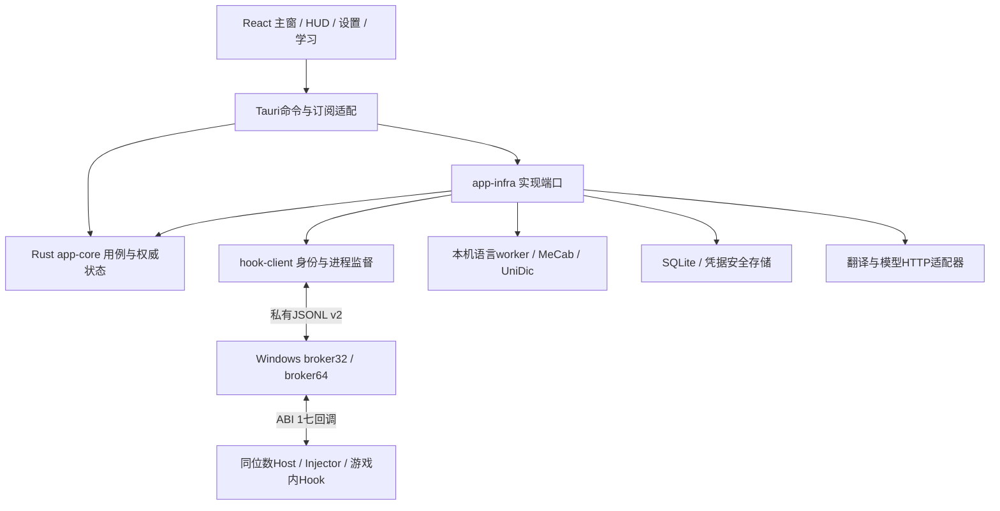

# 首版研发架构与工程基线

## 2026-10-31 R74源码核查与当前对齐计划

本节把冻结 `FP1-20261030-R74` / 2087源的实现事实与最新 [guided候选](../design/first-product-v1/candidates/guided-service-reading-20261030/index.html?scenario=reading)目标分开；候选仍 `pending_review`。执行入口为[当前客户端对齐总计划](../development/current-client-alignment-plan.md)，阅读/记录细节见[当前迁移合同](reading-window-session-technical-design.md#2026-10-31-当前源码到-guided-目标的迁移合同)，注册/凭据/资源见[LLM源码差距与依赖](japanese-study-and-llm.md#2026-10-31-服务配置源码差距与实施依赖)。本轮没有修改产品、DTO、DDL、资源、依赖锁或运行包，不把目标文案或文档守卫记作实现完成。

| 领域 | 已核源码现状 | 最新目标差距 |
|---|---|---|
| 阅读/会话 | `ReadingPanel::SessionOverview`已有当前概览；`SessionRecordPanel`与真实Repository已有三数据集查询/固定范围/导出 | 当前卡仍位于单一正文Tab；三个记录区默认折叠、独立保留状态未实现，概览原文尚未复用SourceText；新组合产品 `not_run` |
| 服务与配置 | `ModelConfigScreen`六实体Tab，`ConnectionEditor`及Rust providers集中实现3协议；草稿/应用、scope、独立用途与系统Vault已有 | 用途/品牌/接口必要字段引导、同源注册目录、已保存服务投影、共享浅层选用和细粒度激活未实现；13协议/21预设/4离线为目标 |
| 平台与组件 | `ui/primitives/Select.tsx::Select:56`已有React Aria自绘控件；`SessionPreviewCoordinator:27`已有平台预览监督与只读消费者 | 继续复用已有模块，逐入口验证；新布局的真实UI/原生/最终包通过不由组件存在或旧回执推导 |

### 本轮职责澄清及实现顺序

2026-10-30补充把M11写成提取/诊断属于模块归属错误；本轮明确纠正为下表，不更改那些历史候选/执行事实。具体源码路径、符号与冻结行号见上述两份专项合同和总计划，目标目录不代表实际已建目录。

| 模块 / Owner | 本次权威及允许复用 | 依赖及完成条件 |
|---|---|---|
| M03/AP，M05/AI | 当前unit/revision与raw接收归M03；请求、译文状态、取消/迟到和多引擎归M05 | 当前卡先引用既有投影；细粒度服务切换接M04版本合同后再接调度 |
| M04/AP，M06/AI | M04持保存资源、scope、版本和用途资格；M06持协议/profile/preset真实实现与同源目录 | 先PRD与注册/资格契约，再实现完整13协议/21预设、typed目录及实际服务验证；不在UI添加厂商分支 |
| M10/AP，M11/AP | M10持正文/raw/Hook三数据集与迁移/保留/导出；M11持阅读/全局/游戏偏好 | 当前卡/折叠状态优先复用现有DTO，不需默认改DDL；凭据、离线关系与codec必须另审 |
| M12/PL，M16/PL | M12持窄Tauri/原生多窗/独立预览与资源观察；M16持不可变Vault引用、typed秘密材料和授权生命周期 | 新DTO、OAuth授权/刷新、离线运行路线/平台资源和真实旧库迁移先审；沿既有Core、语言worker及目标翻译worker隔离 |
| M13/UI，M15/QA | M13只做共享选择器、必要字段/高级区及当前卡/记录折叠；M15持脱敏诊断、逐层执行和准出闭包 | PRD→契约→任务→组件/Rust/存储/真实服务或系统→同一最终包及四游戏；设计截图只占设计层 |

现有 `rust-storage-complete-v1`、组件及有限原生执行adapter是可复用的真实验证资产；当前登记范围、工件身份和真实命令回执需逐项绑定。新增服务/认证/离线资源、新UI组合及最终包/四游戏仍需其真实执行；缺adapter与已有adapter尚未覆盖新范围分别登记，不能统称“全无adapter”或据旧通过准出。本轮产品均不提升状态，旧失败、`blocked`、`not_run`继续保留。

## 2026-10-30 必要配置与阅读优先补充

版本：1.6 · [配置第10章](../product/model-configuration-prd.md#guided-service-configuration-prd)、[会话PRD](../product/reading-window-session-prd.md#guided-current-reading-prd)、[主技术稿5.23](japanese-study-and-llm.md#guided-configuration-reading-contract)、[呈现字段目录](service-configuration-presentation.json)及[GD逐层计划](../development/guided-service-reading-tests.md)同步约束[新完整候选](../design/first-product-v1/candidates/guided-service-reading-20261030/index.html?scenario=reading)，`pending_review`。本轮只改文档/设计，不改产品/DDL、技术锁、旧候选或执行状态。

- 目标由M04/AP持21/13/4目录的配置/资格合同，M06持协议目录、M16持typed凭据；这些扩展尚待实现（2026-10-31源码澄清）；M13只按用途→品牌→明确接口呈现必要字段，固定协议/签名/格式版本不作用户输入，自定义必要地址/认证/模型不能隐藏。秘密masked输入及不透明引用不改变安全存储边界。
- 目标由M03持当前unit/revision、M05持译文及来源，M13呈现首屏独立阅读卡；M10三数据集查询与M15诊断投影在后方默认折叠（模块归属于2026-10-31澄清），查询/页/跟随/计数及全量审计独立保持，警告/缺口摘要可见。M12同一会话预览不因折叠或滚动重建，Core/语言worker/离线worker隔离不变。
- 高级设置、密钥池与精读/查词能力保留但按需展开；保存/测试不选用，已保存服务资格、不可变版本、范围和启停保持。新GD计划全部`not_run`，真实组件/Rust/存储/系统/服务及最终包四游戏仍需后续实测。200%入口可达不代表整窗无裁剪。

## 2026-10-30 服务配置与当前会话同页呈现补充

版本：1.5 · 本轮仅文档、完整候选与设计验证；[配置PRD第9章](../product/model-configuration-prd.md#flat-service-management-prd)、[会话PRD](../product/reading-window-session-prd.md#flat-current-session-prd)、[主技术稿5.22](japanese-study-and-llm.md#flat-service-session-contract)及[FL逐层计划和功能审计](../development/flat-service-session-tests.md)同步约束[新完整候选](../design/first-product-v1/candidates/flat-service-session-20261030/index.html?scenario=reading)，状态`pending_review`。原服务选择与本机候选、批准图/token和历史结果保持，产品状态不提升。

- 目标由M04/AP持连接/模型/用途、独立离线资源、版本与资格权威，独立离线配置仍未实现（2026-10-31源码澄清）；M13/UI在统一已添加服务列表同页编辑，类型标签和条件字段取代family导航及五个实体Tab。精读/语境查词独立用途区、适用高级参数/密钥池与保存/测试/选用分离保留。
- M10继续提供三份明确数据集，M15负责诊断脱敏与验证（2026-10-31模块归属澄清）；当前会话正文历史、原始提取和Hook诊断同页显示摘要/入口，详情可按需展开，各自查询/筛选/页/跟随/计数互不覆盖。全量、搜索、导出、序号、缺口与脱敏原生事实保持；M12的同一会话预览常驻，不因折叠/滚动重启。
- 仅移除重复导航、重复日常选用、不适用字段和错置的演示控制，不删除能力。复用C04/C26及现有共享组件，Rust业务权威、窄Tauri、Core/词法/翻译worker边界、技术锁、DDL与正式包均不改变。
- FL-01～10在机器目录独立登记为`not_run`；本轮设计/静态回执只证明候选，后续真实组件、Rust/存储、系统/服务与最终同包四游戏分别留运行证据。旧13/21/4、PA/OT/SS、MC/RW及153组合状态保持。

## 2026-10-30 翻译服务日常选用设计补充

版本：1.4 · 用户已确定“配置管理与日常选择分开、统一浅层选服务、没配好不能选”的任务模型。[PRD第8章](../product/model-configuration-prd.md#translation-service-selection-prd)、[主技术稿5.19～5.21](japanese-study-and-llm.md#translation-service-selection-contract)、[机器目录service_selection_design/selection_acceptance](model-service-registry-design.json)与[逐层测试合同](../development/translation-service-selection-tests.md)为同一增量入口。最新[完整候选](../design/first-product-v1/candidates/translation-service-selection-20261030/index.html?scenario=reading)pending_review；此前R71本机候选与证据留存，新增控件/契约/字段与产品实测不因任务方向确认而自动通过。

- M04/AP持配置目录、已保存资源、用途资格与版本权威；M05/AI复用现有翻译调度、取消、缓存和历史归属；M06保留协议与本机健康门禁；M12只做平台薄适配；M13/UI复用当前会话/HUD的同一选择器和application-port。
- 配置目录只用于添加服务；日常列表从当前配置档已添加、已保存的不可变资源版本产生。LLM按显式templatePurpose/translation能力筛选，精读-only不列入；本机仍过资源/语言/运行route健康门禁。HTTP合法未测试可以明确选用且标未验证，未配置、字段缺失或当前版本已知失败不可选并解释。
- 保存/检查/样句不改current服务；显式activate BindingCommand仅创建并激活新的用途绑定，冻结资源revision并保持启停。它是本轮候选细粒度契约，现有命令不因此被宣称已实现该能力。只对后续句生效，当前句重译独立；全局/游戏覆盖、恢复继承、主/对照去重及配置往返保留上下文。
- Rust继续作为唯一业务状态源，窄Tauri转接只读投影/命令；UI不直接HTTP/SQL/FFI。旧绑定取消与迟到结果按代次隔离，历史保留原来源。新DTO或持久化若确需扩展须另审，本轮不新增DDL、改技术锁或批准字段候选。
- SS-01～12独立计划全部not_run。设计guard/Playwright只证明候选；真实Rust/组件/存储/服务/本机/正式包四游戏另留run记录。既有HTTP13/21、离线4、PA12、OT16、原MC/矩阵及153组合与旧not_run保持。

## 2026-10-30 本机非大模型翻译设计补充

版本：1.3 · 本轮按用户要求同步PRD、独立完整候选交互、技术与测试规划；原稳定性重构和历史运行证据保留。新增内容见本文末节、[主技术稿5.13～5.18](japanese-study-and-llm.md#offline-translation-backends)、[模型配置PRD第7章](../product/model-configuration-prd.md#offline-translation-prd)、[机器目录](model-service-registry-design.json)及[OpenSpec](../../openspec/changes/design-local-offline-translation/proposal.md)。新增[完整候选稿](../design/first-product-v1/candidates/local-offline-20261030/index.html?scenario=settings)待评审；不修改批准PNG/token、Core、产品源码、依赖锁、DDL或运行包，不提升新字段/技术栈/产品实测。

## 2026-10-26 当前执行阶段：稳定性重构优先

用户已明确先重构及相关文档，解决本批交叉影响后再补产品内容。当前入口：[阶段登记](../development/current-phase.json)、[技术合同](runtime-lifecycle-refactor.md)、[执行/回归计划](../development/stability-refactor-plan.md)。SR0仅文档，后续按窄子change实施，技术栈/Core/DB/公开行为保持。

以下2026-10-20实现核查、dist及历次候选执行段是带日期历史证据，不证明当前包通过；既定技术/职责规范继续适用。新合同拟新增文件尚未实现，原产品视觉/实机失败未因本次文档更新解除。

版本：1.2 · 日期：2026-10-20 · 阶段：既有首版实施中的技术设计修订。用户已授权既有首版研发，并确认本轮六项交互稿（含常用操作前置与Select间距修正）；本轮仅同步技术设计，不修改产品源码、依赖、数据库契约或正式包，不提交或推送。

本文件统一当前首版的功能、技术栈、模块职责、组件、设计规范和复用方式；目标目录见[工程组织规范](engineering-layout.md)。它替代旧重建架构中首版范围、HUD尺寸、视觉依据及尚未定下的存储/组件选型；Core ABI 与进程边界继续遵循 [ADR-003](ADR-003-client-rebuild-on-core.md)。技术方案选定不等于实现或产品验收完成。

## 当前实现与未对齐内容（2026-10-20核查）

本节保留当时源码/工件的核查；其中待补组件及局部结果的旧时态不描述全部R74现状。最新实现/目标差距与Owner以前方2026-10-31合同及总计划为准，旧通过不覆盖新增范围。

当前状态入口：[实现现状与差距清单](implementation-status.md)；[机器清单](implementation-status.json)。它逐项覆盖16个模块、36个组件、12项首版功能及14项细分能力，附实际源码位置、文件hash、当前行为、差距、Owner和下一步。模块/组件表的 `implementation_status` 已由统一planned更正为本次源码核对状态；目标职责与实际实现不再混用。

三轴独立：**已实现/部分/未实现**描述代码；**已对上/部分/不一致/未核定**仅描述已核查的源码语义；**历史通过/历史失败/仅源码/未执行**描述证据范围。所有原生实效和新设计视觉本轮未重测；已实现不等于产品验收，未重测也不等于没有实现。

明确的已有能力包括独立Core/七回调broker、三类翻译渠道（OpenAI兼容、Anthropic、Microsoft Translator Text v3）、本机语言worker与辞书、按需精读任务、历史/真实SQLite适配、macOS Keychain及多数共享组件。主要差距是实际窗口截图、偏好驱动全局快捷键、HUD位置恢复和新工具栏、自绘Select、会话三数据集、暂停raw与保留策略、独立注音，以及仍保留的具体语言质量历史失败。

旧9a7包四游戏确实通过取文/翻译样本验证；当前dist为f38包，本轮没有重新跑游戏/模型。旧包通过、具体历史失败与新RW未执行分别保留，不能互相覆盖。

## 1. 依据与当前事实

- 产品依据：[首版12项范围](../product/first-product-scope.md)、[入库与窗口PRD](../product/game-library-window-prd.md)、[AI阅读PRD](../product/ai-reading-prd.md)、[模型配置16项需求](../product/model-configuration-prd.md)和[阅读窗口与会话PRD](../product/reading-window-session-prd.md)。原56项需求及100文件快照保持不变。
- 视觉与交互依据：[当前高保真整稿](../design/first-product-v1/index.html)、[材质规范](../design/first-product-v1/style-guide.md)、[截图画廊](../design/first-product-v1/gallery.html)及[本轮交互修订](../design/first-product-v1/interaction-review.html)。用户本轮确认设计review无问题；31项设计检查/37张截图属于设计证据，不自动提升产品实机、字段迁移或正式发布状态。
- 当前 Reader 0.2.0 开发候选已通过 `native/core-runtime.lock.json` 消费独立 `luna-hooks-core`，提交 `e9242ebac32a09e911f306b7c90714891c217302`、ABI 1七回调、私有JSONL 2；实际FFI见 `crates/lunahook-host/src/abi.rs`。旧十回调运行时是历史对照，不是现行接入。包身份与分发状态见 `dist/build-manifest.json`，不据构建成功宣称本轮RW行为已实现。
- 当前工作区已有 `app-core`、`app-infra`、独立 `language-worker` 和真实存储adapter。历史统一开发门禁回执 `.build/quality/20261019T121014.101158Z.json` 为51/51；它仅约束当时源码/包及登记范围，不覆盖新增RW-01～34，也不等于完整产品发布通过。历史未完成草稿不因留在旧文档而成为新实现依据。

规范顺序为：首版范围决定交付集合；各专项PRD决定业务语义；当前整稿决定交互和外观；本基线决定技术与职责。出现冲突时更新相关规范并记录变更，不让两份文档并行定义不同实现。

## 2. 确定的首版功能

| 范围 | 首版必须完成的用户任务 | 主要窗口 | 主责模块 |
| --- | --- | --- | --- |
| FP-01 | 首启空库；恢复已有记录；关闭主窗后能恢复，退出才结束应用 | 主窗、菜单栏 | library、windows |
| FP-02 | 从文件/拖入建库；核对环境、Bottle、启动及目标路径；编辑与移出不删除游戏 | 游戏库、资料面板 | library、platform |
| FP-03 | 从窗口/进程选择目标，一次“关联并接入”自动启动Hook；候选到达后显式选正文 | 目标面板、选流面板 | capture、hook-client |
| FP-04 | 原文先到，译文随后；独立HUD持续阅读，长文、注音及非日语均可读 | 会话、HUD | reading、translation、language |
| FP-05 | 同目标复用；不同目标确认切换；失败重试；解除关联保留取文；显隐/暂停/断开分开 | 会话、HUD、菜单栏 | capture、windows |
| FP-06 | 传统翻译、LLM及用户已运行的本机服务；连接/模型/用途独立；草稿、测试、应用、启用分开 | 设置 | model-config、translation |
| FP-07 | 包内置分词及基础释义，断网首启可用；点词查词面、词元、读音、词性与来源 | HUD词卡、学习窗 | language、dictionary |
| FP-08 | 用户主动精读原句或解释选词；固定对象，配置往返不丢句；失败、取消和歧义可辨 | 独立学习、设置 | study、model-config |
| FP-09 | 按游戏/会话查看原文、译文与来源；重译、人工修正、旧句精读；保存失败保留编辑 | 历史 | history、reading |
| FP-10 | 无游戏也能手动输入、翻译、查词、精读并形成独立历史 | 手动翻译 | manual-input、reading |
| FP-11 | 注音/POS、阅读尺寸、暗/浅/减少透明度、快捷键；资源版本与全局/游戏来源可查 | 设置、HUD | preferences、windows |
| FP-12 | 区分资源、接入、无文本、网络、词法worker与数据连续性故障；可定位和恢复 | 诊断及各失败位置 | diagnostics、各域主责 |

首版包含多引擎翻译、版本化模型配置、三态参数、上下文/术语、凭据/密钥池、重试与回退的完整产品语义，不能因接口实现方便而缩为一个模型和一段提示词。实现顺序可分切片，完整首版的验收范围不随之缩小。

本次不交付 OCR、语音、Anki/Yomitan、批量文件翻译、对外Web API、原生macOS游戏取字、内嵌回写、AI译文对照/学习草稿/历史问答。它们保留原路线与需求编号；首版不出现可点击却无实现的入口。设置保留原十类信息架构，后续类别在首版能力导航中隐藏，历史设计仍可用于路线评审。

首批交付环境为 macOS arm64 + CrossOver；Windows原生构建与兼容验证单列，不把CrossOver证据外推为Windows/nativeMac均通过。四款回归样本为SR、MO、Never7及サクラノ詩10th，排除Ever17；SR中文版只提供中文原文证据。

## 3. 确定的框架与技术栈

| 层次 | 本次采用 | 选型边界与当前状态 |
| --- | --- | --- |
| 桌面容器 | Tauri 2；WKWebView/macOS、WebView2/Windows | 复用现有工程；窗口、菜单、托盘、快捷键和权限在原生层 |
| 前端 | React 19 + TypeScript 5.9 strict + Vite 8 + npm lockfile | 沿用现有主版本；不改为另一套UI框架；不需要SSR或运行时Node服务 |
| 基础交互 | React Aria Components + 自有CSS Modules | 已在产品清单安装；只在 `ui/primitives` 封装。R74已有 `Select.tsx::Select:56` 自绘共享控件，后续逐入口核复用及状态覆盖，不把迁移目标误写成尚无组件；不引入其外部主题 |
| UI状态 | React局部reducer；`useSyncExternalStore`读取每窗projection | 首版不增加Redux/Zustand/React Router/Query缓存；跨窗业务状态由Rust持有 |
| 应用核心 | Rust 2024 edition；现有MSRV 1.89作为起点；Tokio 1 | 异步I/O和有界任务；领域对象不依赖Tauri或具体数据库 |
| 原生取文 | 独立精简C++ Core + Windows Rust broker32/broker64 | ABI 1七回调，目标同位数资源集合；私有JSONL v2另定版本 |
| HTTP与流式 | Rust异步reqwest + rustls + eventsource-stream解析SSE | 请求从Rust发出；不采用前轮blocking HTTP草稿，也不让WebView持有Key |
| 模型协议 | OpenAI兼容Chat Completions + Anthropic Messages | 两个独立协议适配器，覆盖完整及流式返回；本机服务按兼容协议接入 |
| 传统翻译 | Azure AI Translator Text REST v3适配器 | 用户自行配置凭据/region/endpoint；不捆绑账号，不依赖网页抓取接口 |
| 本地存储 | SQLite + rusqlite bundled；单写入执行器 | 业务表、版本、历史、缓存统一事务；不把全量历史存成一个JSON文件 |
| 凭据 | `CredentialVault`端口；macOS用security-framework接Keychain，Windows用windows-rs接Credential Manager | 使用薄平台适配，首版不另引跨平台keyring框架；只在Rust层解析引用，不退回明文JSON |
| 分词 | MeCab 0.996 C ABI + 固定现代书面语UniDic | 延续既定方案；本机独立语言worker，随包资源；不以临时Lindera/IPADIC替代已定字段语义 |
| 基础释义 | 中文维基词典日语条目的固定数据快照；JMdict作明确标注的英语补充 | 离线派生索引、来源/归属随包；覆盖、快照及哈希须过资源门禁后锁定 |
| 契约 | Rust Serde DTO + ts-rs生成TypeScript + 协议fixture | TS类型不手抄；DTO与数据库/FFI结构分开，运行期仍做输入校验 |
| 验证 | Rust单元/协议/资源测试；Vitest + Testing Library；Playwright；原生真机回归 | 浏览器截图验外观；真机验材质、焦点、置顶、快捷键和游戏链路 |
| 工程约束 | rustfmt/clippy；TypeScript；AST/Cargo边界；设计token/许可/资源清单检查 | 执行范围以根verify及实际回执为准，不把工具名称等同于全部行为覆盖；本轮不修改lockfile |

现有主版本来自工作区清单，不表示它们是互联网上的最新版。开发开始时使用已审查的lockfile；新增库精确版本、工具链、MeCab构建提交、UniDic/释义快照与每文件哈希在B0门禁中一并冻结。依赖不满足当前MSRV时记录明确升级决策，不能在构建时自动拉最新。

Tauri建议核心进程管理窗口及全局状态，本方案据此把业务权威状态置于Rust；实时数据用Channel，事件只承载少量失效/生命周期通知。[Tauri进程模型](https://v2.tauri.app/concept/process-model/)、[Channel与事件](https://v2.tauri.app/develop/calling-frontend/)。React Aria不附带默认视觉，适合承接现有材质而非引入另一套皮肤。[样式机制](https://react-aria.adobe.com/styling)。

## 4. 分层、进程与依赖方向

这里的箭头是调用/装配及依赖关系；模型与数据库不会穿过取文broker。Windows broker运行在所选Bottle中，语言worker在macOS/Windows本机运行，两个进程有各自的协议、资源和生命周期。Core仓库继续独立维护，客户端只消费锁定产物，不复制Core源码。

领域与用例定义 `HookBackend`、`LibraryRepository`、`HistoryRepository`、`ConfigRepository`、`ModelGateway`、`LexicalAnalyzer`、`DictionaryRepository`、`CredentialVault`、`WindowCoordinator`、`WindowPreviewPort`、`SessionRecordRepository` 等端口；新增端口的正式DTO/版本与权限仍需在实施切片中冻结。`app-infra`实现I/O；Tauri组合根注入实现。领域层禁止依赖Tauri、reqwest、rusqlite、Win32和MeCab裸指针；broker禁止依赖翻译、模型、数据库和UI。

Windows系统调用、文件选择、启动器解析及材质放平台适配；游戏记录、请求归属和模型配置规则不按操作系统复制。暂不引入微服务、Node/Python运行服务或远程应用后端。

## 5. 模块划分与职责归属

职责是逻辑Owner，不是承诺七个人的编制；同一个人可承担多个Owner。每个模块有一名主责，跨域调用经公开端口，评审者负责接口与验收边界。

| Owner | 归属 | 负责决定 | 必须协作评审 |
| --- | --- | --- | --- |
| AP 应用核心 | 领域、用例、配置版本、阅读对象 | 状态转换、输入/结果身份、事务与用例接口 | UI、HK、AI、JA |
| HK 原生接入 | Core消费、broker、Hook会话 | ABI、目标身份、资源完整性、退出及背压 | AP、QA |
| PL 桌面平台 | Tauri组合根、窗口与系统能力 | 焦点/置顶/显隐、材质、权限、原生对话框 | UI、AP、QA |
| AI 翻译与模型 | provider/协议、调度、用途配置 | 请求解析、能力、流式、凭据引用、输出校验 | AP、UI、QA |
| JA 本地语言 | 分词、辞书索引、Unicode对齐 | 词法schema、资源版本、释义来源与离线质量 | AP、UI、QA |
| UI 产品界面 | feature界面、组件库、tokens | 交互、布局、可访问语义、跨窗组件复用 | AP、PL、设计评审 |
| QA 交付 | 构建资源、质量与证据 | 追溯表、门禁、安装包、回归记录 | 对应模块Owner |

| ID / 模块 | 职责与输出 | 不承担 | 主责 |
| --- | --- | --- | --- |
| M01 / library | 稳定游戏记录、路径与环境去重、入库编辑移出 | Hook FFI、HTTP、UI state | AP |
| M02 / capture | 关联接入协调、完整身份、复用切换、显式选流与预览身份租约 | Translation、Dictionary、auto TextOutW selection | AP |
| M03 / reading | 不可变raw事实、阅读单元、源归属、暂停消费与当前句/词法状态投影 | Network、FFI、DOM extraction | AP |
| M04 / model-config | 连接模型用途、草稿应用、覆盖、三态参数与测试身份 | UI-only effective config、plaintext keys | AP |
| M05 / translation | 多引擎调度、上下文术语、缓存、取消与迟到归属 | Hook callback、implicit fallback | AI |
| M06 / providers | OpenAI兼容、Anthropic、Azure协议与流事件错误归一 | Frontend secrets、business profile state | AI |
| M07 / language | MeCab/UniDic词法、Unicode完整span、真实读音、worker资源/失败/迟到隔离 | Hook broker、model HTTP、UI | JA |
| M08 / dictionary | 中文基础释义本地查询、版本、来源及英语补充 | automatic network、fake lexical samples | JA |
| M09 / study | 固定词句、按需文法/语境解释、结构证据及歧义 | auto follow current sentence、agent tools | AI |
| M10 / history-persistence | 多版本译文、会话正文/raw/Hook全量分页检索导出、保留保护、事务迁移与备份 | frontend SQL、diagnostic log as history | AP |
| M11 / preferences | 全局/游戏阅读偏好、分词ruby词性独立显示、快捷键草稿与有效来源、资源只读信息 | model secret ownership | AP |
| M12 / desktop-platform | 原生多窗、HUD拖动/位置恢复、窗口级真实预览/权限、材质、快捷键补偿与IPC作用域 | domain business rules、browser fake desktop | PL |
| M13 / product-ui | 窗口feature组合、统一Select、常用工具栏、会话三数据集、真实词法投影与可访问组件 | HTTP、SQL、FFI、Keychain reads | UI |
| M14 / native-broker | Core ABI1、同位数资源、回调复制、JSONL v2、完整事件/序号/缺口及退出监督 | Tauri、models、dictionary、SQLite | HK |
| M15 / diagnostics-release | 脱敏诊断、资源锁/许可、构建清单、逐需求分层覆盖与同最终包证据/发布回归 | secret/body default logging、fake runtime pass | QA |
| M16 / credentials | 不可变安全引用、版本/池成员、撤销、系统秘密生命周期 | plaintext JSON、CLI argv secrets、UI key readback | PL |

机器可读清单见[模块与职责矩阵](engineering-modules.csv)。矩阵现已逐项记录本次源码实现、语义对齐和历史验证状态；target_paths仍表示目标组织。已实现不等于当前包实机通过，实际差距见implementation-status清单。

## 6. 业务契约与状态模型

### 6.1 关联并接入

`选择候选（可主动开启真实窗口预览） → 核对完整身份 → 关联并接入 → 校验资源/ABI → 监听与注入 → Host连接 → 候选 → 用户选正文 → ReadingUnit`。预览权限和采集是独立能力，不触发注入，拒绝录屏不阻断Hook；详见[窗口与会话技术设计](reading-window-session-technical-design.md#4-运行窗口实时预览)。

TargetIdentity包含执行环境、真实Bottle引用、规范化完整路径、Windows PID、创建时间与架构；SessionIdentity另含broker实例和session_id，窗口身份也单独保存。复用判定和跨档target租约以TargetIdentity为键，不能要求预览目标先有broker实例。确认前不改变当前会话；相同TargetIdentity复用，不同目标由同一核对面板明确“切换并接入”。同名EXE或裸PID不能触发复用。

失败保留仍有效关联并显示具体阶段；重试先fresh核验。解除关联仅清窗口关系。断开与应用退出结束自有broker；不杀游戏或整个Bottle；没有卸载回执就显示未确认，不能把helper退出当DLL已卸载。

### 6.2 原始事件、阅读对象与结果

RawEvent不可变，保存来源实例、完整流标识与单调接收序号；页大小和UI缓存不是保留上限。会话正文、全部提取、Hook阶段事件是三个独立可分页集合，暂停消费和正文合并不能抹去已接收raw事件；新增持久控制事件、完整性和保留字段须另做schema/迁移评审。ReadingUnit含 `unit_id / text_revision / source_hash / session_id / selected_source_refs / processing_revision`。分词、翻译、精读都引用ReadingUnit的固定版本，不能从ruby DOM反读原文。

结果身份至少为 `profile_id + session_id + unit_id + text_revision + task_id + applied_config_revision`，同时保存request_semantics_hash区分配置记录修订与实际请求语义；词法增加资源/schema版本，模型增加模板、术语、上下文及凭据版本。只是推进到新句时，有效旧结果可入所属旧历史；取消、停用、换档或影响请求语义的配置变更使任务失效后，不再写正文/解释历史。显示名或界面偏好变化不取消语义未变的在途任务。人工修正独立存储，不被后来结果覆盖。

字符串按UTF-8字节跨度在Rust校验，投影中显式转换UTF-16位置；64位地址、FILETIME和不安全整数范围的序号通过规范十进制字符串传输。结构化文法必须通过schema、引用、边界、原文hash、拒绝/截断检查；纯文本模式不画精确引用高亮。

### 6.3 多窗状态与通信

Rust应用核心是唯一业务状态源；主窗关闭后，Hook、翻译和历史仍可工作。各窗只有只读projection与本地UI草稿，不能由主窗充当广播服务器。设置草稿由ConfigService版本化保存，切窗/重启可恢复；尚未保存的表单编辑由对应窗口持有，往返不丢失。

读模型通过“建立订阅并在同一服务边界返回snapshot+revision”启动，后续按窗口Channel推送有序delta。每条含 `projection_id / profile_generation / base_revision / revision`；缺口或旧generation触发重取快照，不把Tauri事件当持久消息队列。事件只用于窗口生命周期/数据失效通知；慢窗口有界合并projection并重同步，不能阻塞原文。前端用selector订阅、局部reducer和`useSyncExternalStore`，而不是每150ms整应用轮询。[React外部存储接口](https://react.dev/reference/react/useSyncExternalStore)。

命令统一返回 `Result<CommandReceipt, AppError>`，状态以Rust快照/投影为准；Receipt含request_id与revision，重复点击带幂等operation_id。`AppError`含稳定code、stage、可恢复动作及脱敏detail。UI只能调用已注册用例；不开放任意shell、任意DLL加载或直接SQL。

配置编辑等命令还带expected_revision，跨窗并发冲突保留编辑并返回revision_conflict，不静默最后写入覆盖。订阅包含server_instance_id，应用重启时丢弃旧projection代次。按main/hud/settings/learning分别注册应用命令权限并在Rust复核作用域；仅写窗口capability文件并不会自动给所有自定义命令建立细粒度隔离。

## 7. 并发、隔离与数据存储

| 执行单元 | 采用方式 | 队列/取消与故障规则 |
| --- | --- | --- |
| Core回调 | broker内有界复制+非阻塞入队 | 控制与正文保留独立容量；溢出置粘性integrity_lost及计数，不阻塞游戏 |
| Hook会话 | 一目标一个owner与broker监督 | 有限detach/exit期限；重启换实例并隔离迟到事件 |
| HTTP | Tokio异步reqwest；翻译/精读/语境查词分队列 | 默认每用途并发1、超时60秒、自动重试关闭；多引擎按用途总限额执行，结果独立 |
| 词法 | 独立原生语言worker，持有MeCab实例 | 版本化私有请求协议，输入/输出/队列有界；超时重启自有worker，不用spawn_blocking超时假称已终止 |
| SQLite | 专用写执行器 + 有界请求队列；分页/索引读 | 业务提交事务化；显示/历史落盘分别反馈；失败保留编辑和可恢复状态 |
| UI投影 | 每窗口有界Channel + revision快照 | 可以合并渲染状态，不能悄悄删除业务事件或伪造已落盘 |

数据库选 `rusqlite` 的bundled SQLite，具体版本由发布清单记录；使用单writer、事务、外键、busy timeout。WAL与备份一致性在资源门禁验证，升级选用包含当前SQLite官方修复的版本，不无条件链接系统旧SQLite。选择同步SQLite绑定是为了把事务与线程归属集中到一个执行器，并不允许在Tauri/UI线程直接跑SQL。[rusqlite](https://docs.rs/rusqlite/latest/rusqlite/)、[SQLite WAL](https://sqlite.org/wal.html)。

数据库按配置档独立：`profiles/<profile_id>/reader.sqlite3`。主表包括 `games/sessions/raw_events/reading_units/source_refs/translations/corrections/study_results/config_revisions/connections/models/purpose_bindings/templates/terms/test_records/cache_entries`；查询与保留策略在schema迁移中实现，原始事件按显式保留政策管理，不承诺无限存上游完整剧情；当前会话全部已接收事件不得因页面大小、显示缓存或默认GC静默裁剪，用户清理与容量故障须保留可见范围/缺口。

字段级方案见[数据库设计](database-design.md)、[逐字段字典](database/field-dictionary.md)、[可筛选字段CSV](database/field-dictionary.csv)与[实体关系图](database/relationships.svg)。`database/*.sql` 是字段设计源；当前生产迁移维护于 `crates/app-infra/src/storage/migrations/`，两者由独立schema契约核对，不能直接执行文档DDL冒充迁移。字段、主外键、索引、封存/GC、配置与任务身份、秘密引用、事务、备份及迁移边界由该设计展开；新增字段细节待复核，原总体架构确认不自动覆盖本次新增内容。

字段边界和存储模块验收以[程序化约束](database-design.md#13-字段边界与存储模块的可执行验收)及[存储验收子检查](../development/storage-acceptance.md)为准。独立冻结schema与真实候选库结构逐对象比较；全部字段的适用边界必须实际执行，生产存储变更/发布还须运行真实Rust迁移与Repository测试。当前已注册并实际执行 `rust-storage-complete-v1`，历史回执覆盖22类、431字段与10路线；它不证明本轮新增Hook事件/完整性/保留字段已经定义或通过。本轮不改现有DDL/schema版本，新增字段另做迁移与真实adapter验收。

配置草稿与已应用版本存数据库不可变revision；`profiles.json`只保存配置档索引和启动选择。窗口几何单独保存于平台偏好。资源索引是随包只读辞书SQLite，与可写用户数据库分开。凭据只存系统安全库，业务表保存版本化引用与脱敏身份；缓存/历史/导出不存明文Key。

同配置档采用进程级文件锁，第二实例转向已运行实例或明确拒绝；不同档可以并行，各自DB、任务、broker owner隔离。应用侧profile切换递增generation并取消旧任务；词句对象保留为待用户操作，不自动发给新档。

接入owner不能只靠配置档锁。另以环境/真实Bottle引用/本次Windows目标身份在应用共享的target-locks目录建立跨进程租约，保证不同档也不能争用同一目标；外部Luna/探针冲突由Core检查和明确失败处理，不结束别人的进程。

Keychain和SQLite没有跨存储事务。新增秘密先生成独立pending引用，再事务提交配置引用；失败清理未引用项，崩溃后按可识别pending记录清理。撤销先持久化revoked并停止任务，再删除系统秘密；删除失败显示待清理，不恢复请求权限。macOS签名/升级后的Keychain访问与Windows凭据保护分别实测。[Apple Keychain](https://developer.apple.com/documentation/security/adding-a-password-to-the-keychain)。

## 8. 模型、词典与本地语言的职责细化

2026-10-30模型服务设计修订：本批13协议/21接口预设一次纳入，腾讯TMT/TC3排除、TokenHub两路保留；协议/profile/厂商三层注册、typed凭据/签名/OAuth、目录DTO、候选迁移和逐协议验收统一见[既有主技术稿第5章](japanese-study-and-llm.md#5-翻译引擎与模型服务设计)、[机器目录](model-service-registry-design.json)和[产品详规](../product/model-configuration-prd.md)。这是目标设计增量，当前R68仍只有三种集中协议源码；本轮不改变实现状态、已批准设计或产品验收。协议/profile精确版本冻结到Connection/RequestPlan，目录由Rust产生，UI不直接调用HTTP或处理签名。

模型配置不是一个 `endpoint + model + apiKey` 对象。连接保存协议/位置/网络，模型保存真实ID/能力/默认参数，用途保存翻译引擎序列或单一学习绑定；均有独立ID、版本和引用。复制前说明哪些实体独立、哪些仍共享。

- 全局/游戏参数按“模型默认→全局用途→游戏覆盖”解析；每项为继承、设置、省略。显式0不等于未发送；保留字段禁止扩展参数覆写。
- 保存草稿不发网络、不改变applied；测试采用明确样例并分连接/模型/用途/凭据身份记录。模型列表失败保留手填ID，HTTP200不等于文法用途通过。
- 应用冻结请求语义与凭据版本；输入/路由/凭据/授权/输出契约变化使相关旧任务失效，单纯显示名变化不取消。停用用途/连接、撤销凭据立即阻止相关新请求并取消在途。恢复连接须明确恢复用途，不能仅保存草稿就重发台词。
- 多引擎翻译按配置顺序展示，每个结果独立来源与失败；不把它实现成静默回退。密钥池、重试、退避和回退均为显式策略，默认不开自动换Key/换供应商。
- 同一OpenAI兼容服务可以服务本机或远程，不因此自动拥有枚举、结构化、取消或全部参数能力。Anthropic使用独立请求/流事件转换；本轮不需要Node AI SDK、代理工具链或模型权重。
- 内置通用翻译/精读/语境查词模板均按用途版本化；Hy-MT2、Index-Translate、SakuraLLM/GalTransl等专用模板保留适配档、来源版本和模型能力匹配。未完成适配标未支持，不因名称相似自动套用，也不把通用模板当全部专模已经支持。
- 中文基础释义使用固定中文词条快照构建本地索引；逐条保存来源、必要归属及许可。MeCab/UniDic只给词法，JMdict英语条目只作英语补充；都不能冒称中文释义。未收录时保留词元并说明，不请求模型伪造基础词典。

UniDic采用官方提供的现代书面语自由许可版本，不选标为非商业限制的资源；包内保留其指定许可与作者文件。维基词典派生数据、JMdict及MeCab分别记录许可与归属，不把主项目GPL当作所有数据的许可。[UniDic说明](https://clrd.ninjal.ac.jp/unidic/faq.html)、[MeCab](https://taku910.github.io/mecab/)、[EDRDG许可](https://www.edrdg.org/edrdg/licence.html)。现有资源已由 `resources/language/manifest.json` 记录MeCab/UniDic、中文基础释义与英语补充的版本/来源/hash，包内只读索引已经存在。本轮不重新验证资源或提升语言质量结论；真实worker到HUD的新组合仍须随包执行，不能用手写token补通过。

## 9. 组件划分与复用

采用四级：`tokens → ui/primitives → ui/patterns → features/screens + windows`。数据模型与状态机在Rust；前端feature负责用例编排、校验提示与展示。公共组件不导入业务feature或Tauri IPC，feature不直接访问数据库和HTTP。

| 组件层 | 组件族 | 复用位置 |
| --- | --- | --- |
| 基础材质与交互 | MaterialSurface、Button/IconButton、TextField、Select、Switch、Tabs、Dialog、Popover、Menu、Disclosure | 全窗口 |
| 分组布局 | AppSidebar、SettingsSidebar、GroupForm、FormRow、PersistentFooter、EmptyState、ErrorState、StatusLabel | 主窗、设置、目标核对、学习 |
| 阅读 | SourceText/RubyToken、TranslationStack、ReadingToolbar、UnitIdentity、FrozenSentenceNotice | 会话、HUD、历史详情、手动、学习 |
| 游戏与接入 | GameCard/Grid、GameMetadataForm、TargetList、TargetReview、ConnectionProgress、StreamPicker、WindowPreview | 入库、关联、重试、重新选流、当前会话实时预览 |
| 模型配置 | ConnectionEditor、ModelProfileEditor、PurposeBindingEditor、ParameterEditor、ContextPreview、CredentialPicker、ScopedTestResult | 全局设置与游戏覆盖复用同一编辑器 |
| 查词与精读 | WordCard、DictionaryEntryList、GrammarSkeleton、EvidenceReference、StudyTaskState | HUD浮卡、独立学习、旧句学习 |
| 历史与手动 | HistoryList/Detail、SessionRecordPanel、CorrectionEditor、ManualInputEditor | 主窗历史/会话三数据集与手动feature；分页框架复用，行数据分别typed |

详细文件、事件与状态归属见[组件矩阵](engineering-components.csv)。HUD和会话复用阅读内容组件，但不复用主窗侧栏；设置和游戏覆盖复用编辑器，但有效值按各自scope读取；独立学习复用原文/词卡渲染，但固定自己的ReadingUnitRef，不持有“全局当前句”引用。

## 10. 设计规范与实现约束

1. **材质**：以连续暗蓝灰窗体、较厚中性灰内面为基准。macOS由原生visual effect提供背景采样，WebView透明并用共享token叠层；CSS blur仅表达DOM内层，不能把假壁纸贴图当原生毛玻璃。减少透明度时用同色实底。Windows按同语义token适配，不据浏览器截图承诺相同合成效果。
2. **颜色**：主要文字 `#e9e9ef`、次要 `#b0b2c0`、辅助 `#9495a5`、强调 `#c4c5cf`。主按钮与选中用灰阶；不新增彩色分类底块、亮蓝默认按钮或紫色强调。警告/错误颜色只用于必要小面积状态。
3. **token**：以当前 `material-tokens.css` 为迁移输入；研发时建立单一 `ui/tokens/tokens.json`，生成CSS变量和原生窗口参数。设计稿与产品从同一来源生成，不长期手工维护两份色值。
4. **图标**：迁移现有SVG路径，24×24 viewBox、1.65圆头描边、常规18px，使用currentColor；保留各图标来源/许可。首版不另引一套图标族，也不使用Unicode符号替代图标。
5. **尺寸**：窗体圆角16、内面13、控件7；设置正文13pt、标题23pt。HUD舒适宽560pt、原文18/译文24；紧凑500pt、原文16/译文22；控制行32pt。注音增加独立上方空间，长文正文滚动，200%字号保持操作可达。pt在设计中对应逻辑尺寸，不直接乘设备scale。
6. **窗口**：主窗/HUD/设置/学习为真实独立窗口；词卡是锚定浮层，关联与选流是主窗附属面板。设置左上使用轻量透明“← 返回主界面”，保留草稿；长目标核对的确认操作固定底部。
7. **状态**：每个数据面板定义空、加载、可用、部分失败、失败、取消/过期和禁用；“未配置”不同于“失败”，“已关联”不同于“已收到原文”。文案统一通过字典/key管理，稳定错误码不直接显示为主标题。
8. **可访问性**：键盘能选流、点词、关弹层与返回；焦点可见、标签完整。词性用文本说明，不能只靠颜色；模型说明文本不渲染未经净化HTML。
9. **验证**：Playwright在相同视口/字体/scale/主题/数据/状态下对照已确认参考；原稿、补充对照及本轮新增状态分别可追溯，不以固定旧图片数量判断新需求完整覆盖。全组件入口、Select几何/键鼠状态、八种词法显示组合必须有适用检查；WKWebView/原生材质、焦点、多屏、置顶、全屏、快捷键和权限另用同一最终包验证。截图相似不代替真实功能。

10. **Select**：所有产品有限选择复用C04，活动项由键鼠共用唯一activeKey；选项间2px、不压缩，选中勾记与导航高亮分离，禁用项不高亮，列表仅内部滚动。
11. **HUD**：顶部常用窗口操作与拖动区、底栏阅读操作直接可达；更多仅低频，不重复常用动作。真实拖动/位置恢复/全局快捷键由平台有效态证明，原文、译文、分词、ruby与词性按各自偏好组合呈现。

React Aria仅承接无样式交互，UI仍由以上token和组件契约决定。产品不引入原型的评审栏、模拟桌面/Dock、场景参数、假窗口列表、假测试结果、自动生成的样例译文或演示词典。

## 11. 复用、改造与移除规则

| 现有资产 | 决策 | 复用方式 |
| --- | --- | --- |
| PRD原始快照、REQ/SCR、许可与来源 | 保留原字节 | 当前专项规范覆盖首版细化；不删原始需求冒充收敛 |
| 高保真稿材质、图标、布局与交互 | 迁移为组件与token | 通过组件矩阵追踪；不把HTML全局状态和fixture搬进产品 |
| hook-contracts | 演进为明确v1/v2 profile | v1留技术对照；新Core只走经验证v2，不自动回落 |
| lunahook-host | 保留进程监督、复制/排队与日志的有效模式 | FFI/资源/注入器按新ABI重建，同位数双broker分别验证 |
| hook-client | 复用完整身份、取消、复用/切换与清理经验 | 提取HookBackend适配，资源锁与状态分层补齐；不带UI规则 |
| WindowBindingPanel及旧App | 复用交互契约和实机证据 | 重构为feature组件；移除单页PoC重复入口及自动抢选流规则 |
| 临时JSON store、页面、Lindera等未完成草稿 | 不直接纳入基线 | 研发B0先隔离/审查，只有符合本方案并过测试的部分才采用 |
| Core和语言资源 | 消费锁定发行集合 | 目标包清单校验版本、架构、大小、hash、ABI/schema及许可 |
| 旧设计专题与旧报告 | 保留归档 | 当前入口不再引用其为现行规范；不篡改旧截图证据 |

复用以同一个实现与明确契约为目标：公共组件消费DTO，不复制条件分支；同一用例由Tauri和未来API适配，不在Web API中重新实现业务；平台差异集中adapter，不复制整页；译文、词法和AI解释共享ReadingUnit身份，结果模型各自独立。

## 12. 文件组织、命名和依赖守则

完整目录树见[工程组织规范](engineering-layout.md)；本轮增量节点见[阅读窗口与会话技术设计](reading-window-session-technical-design.md#9-拟增量目录与接口归属)。已有crate以当前源码为准，新增节点只在对应实施切片创建，不用空目录伪装已完成。核心原则：

- Rust按domain/application/ports与infra分层；TypeScript按feature收敛，通用UI在ui层；Tauri仅组合根、IPC与窗口平台能力。
- 组件PascalCase、hook以use开头、Rust文件snake_case、目录kebab-case；DTO wire字段遵循Rust Serde声明并由ts-rs生成，当前桌面DTO使用camelCase、相关枚举按契约声明snake_case；不手抄另一份类型。
- 每feature仅暴露 `index.ts` 公共接口，跨feature不深引内部文件；禁止宽泛 `utils.ts/services.ts/store.ts` 承载整个应用；数据与I/O逻辑不塞进App.tsx/main.rs。
- 边界由ESLint导入限制、Cargo依赖与架构测试检查；TS生成物只由Rust契约导出，CI检查无漂移。领域层用可控假端口测试，正式包不能启用fixture分支。
- `tests/fixtures`只放合成或授权数据；游戏截图/完整台词/密钥不作为默认公开fixture。`.build`、`dist`、诊断和资源缓存不参与源码组织；release从干净staging生成。

## 13. 实施顺序与完成条件

| 门禁 | 应形成的结果 | 对应当前阶段 |
| --- | --- | --- |
| B0 工程与资源冻结 | 本基线评审；依赖版本、SQLite、MeCab/UniDic/中文释义快照及许可/hash冻结；补齐任务/回归映射 | 当前已有锁定资源与实现；本轮新增契约和政策需增量评审 |
| B1 Core原文垂直闭环 | v2契约、双broker、正式包取文、关联接入/复用/切换/失败恢复/选流 | 对应原M1，技术门禁，不是完整首版 |
| B2 阅读与数据闭环 | 真多窗、SQLite、资料/历史/修正、显示/焦点、手动输入 | 对应M2的应用基础 |
| B3 翻译与配置闭环 | 传统+双LLM协议+本机真实请求，多引擎、草稿/应用、Key/池、参数/上下文/缓存/取消与用途测试 | 对应M2及AI-CFG-01～16 |
| B4 本地学习闭环 | 包内资源断网首启、token/span、中文词卡、按需精读/语境查词、固定旧句与质量样本 | 对应M2-L |
| B5 首版产品回归 | 同一个最终包逐款四游戏、历史/配置/学习/故障/长文/原生窗口回归；全部证据绑定包hash | 首版FP-01～12发布门禁 |

任务重排不删除原55任务/111用例或22条MC/20条GL。本轮RW-01～34必须补入逐项/逐层/逐状态覆盖与发布执行闭包；新增接口/schema实施前先冻结对应契约，不把旧任务数或已有51/51计数当作新增细节已覆盖。真实凭据或本机服务不可用时，用例标blocked并保留原因，不能用模型fixture补通过。

本轮交付技术设计与离线HTML架构说明；不修改产品源码、不安装依赖、不产生新正式包或实机通过。既有首版实施授权保留，本轮设计确认与新增技术契约/schema评审、完整产品回归分别记录。

## 14. 官方依据与证据边界

技术能力在2026-10-18按官方资料核对；以下支持选型，不证明本项目已经完成相应集成。

- [Tauri进程与状态](https://v2.tauri.app/concept/process-model/)、[IPC/Channel](https://v2.tauri.app/develop/calling-frontend/)、[Capabilities](https://v2.tauri.app/security/capabilities/)。
- [React useSyncExternalStore](https://react.dev/reference/react/useSyncExternalStore)、[React Aria无默认样式](https://react-aria.adobe.com/styling)。
- [Tokio spawn_blocking取消边界](https://docs.rs/tokio/latest/tokio/task/fn.spawn_blocking.html)、[reqwest](https://docs.rs/reqwest/latest/reqwest/)、[rusqlite](https://docs.rs/rusqlite/latest/rusqlite/)、[SQLite WAL](https://sqlite.org/wal.html)。
- [MeCab API](https://taku910.github.io/mecab/libmecab.html)、[UniDic下载](https://clrd.ninjal.ac.jp/unidic/download.html)与[字段/许可说明](https://clrd.ninjal.ac.jp/unidic/faq.html)。
- [中文维基词典数据入口](https://kaikki.org/zhwiktionary/rawdata.html)、[Wikimedia使用条款](https://foundation.wikimedia.org/wiki/Policy:Terms_of_Use)、[JMdict与EDRDG许可](https://www.edrdg.org/edrdg/licence.html)。
- [Anthropic Messages](https://platform.claude.com/docs/en/api/messages)、[Azure Translator Text](https://learn.microsoft.com/azure/ai-services/translator/text-translation/reference/v3/translate)、[llama.cpp服务](https://github.com/ggml-org/llama.cpp/tree/master/tools/server)。兼容OpenAI协议按具体服务与测试记录声明能力，不据接口名作概括承诺。

## 15. 本轮阅读窗口与会话技术增量

[完整技术设计](reading-window-session-technical-design.md)将RW-01～34落到预览端口、WindowCoordinator、快捷键补偿事务、Select复用、会话三数据集、真实词法投影与原生材质，并给出目录树、数据流、Owner、候选契约、资源约束和分层验收。用户确认本轮交互稿不自动批准新增字段方案；现有DDL、schema合同、Core ABI、资源锁和设计token均保持原有身份。设计稿/技术文档更新不自动刷新旧验收回执，真实能力仍按当前正式包运行。

## 2026-10-24 独立采集进程修订（R39-A，实施中）

当前candidate16运行事实：窗口采集仍在Luna主进程；窗口核验轮询与采集共享同步资源，ReadingPanel把暂态读取错误清成无绑定，导致画面/过期/无窗口周期切换。R38的105项与57/58工程项没有证明真实订阅隔离，本缺陷仍为失败。

目标：Rust应用权威仅控制被授权目标；独立常驻collector进程自己持AppKit RunLoop、系统singleWindow picker、原SCContentFilter、完整Windows/Native proof与有界采集。主窗、关联面板与封面消费状态/最新帧，卸载或慢消费者不启动、停止或重新核验producer。Hook/语言/翻译/SQLite不进入collector；真实身份失效和许可撤销仍停止对应目标帧，不能以隔离为由降低核验。

第一部署验证使用同一签名可执行文件最早`--capture-worker`分派的真实第二PID，无新框架/依赖/独立bundle；同exe/cert/DR只能减少变量，TCC与picker行为仍待实证。原filter没有公开跨进程编码合同，picker/filter/capture必须在同一worker持有，不把CGID重建称原授权。主App最终不再每5秒主动probe；读取collector快照只供展示，不能替代下一帧强校验。

A仅技术PoC，8源授权和未执行测试见[OpenSpec](../../openspec/changes/isolate-window-preview-collector/iteration-card.md)；A通过后另登记B正式集成。当前产品未完成进程隔离，不将此设计标记为已实现，也不提升视觉、全局8MiB或游戏/发布验收。

## 2026-10-24：独立采集器正式订阅接入（实施中）

当前依据为 `openspec/changes/integrate-window-preview-subscribers/`。候选18仅验证独立子进程、权限预检、系统选窗和超时回收；两次独立选窗未产生有效帧，正式界面仍使用旧采集路径，用户选中后仍过期，不属于修复完成。

本次在R40精确快照上实施B：App监督唯一持久采集worker，worker持有原始单窗授权与身份核验；主窗、选窗面板及封面只消费其投影。React订阅使用独立取消令牌，挂卸载不控制producer；窗口选择、重试、暂停、取消及解除才是控制意图。保持可信自动映射与已有权限自动预览，不新增挂载时自动弹系统选择器。超时可在同一App明确重试。主窗绑定读取使用只读已提交投影，封面新鲜核验仍委托同worker明确请求，不以缓存时间冒充新证明。

因独立PoC和旧界面并存造成操作错路，本次明确调整内部实施顺序：先统一正式入口，再完成真实独立变化帧与消费者隔离硬验收。原A失败保留，不改帧核验、许可或身份要求。实际代码、编译、独立审阅、最终签名包及适用游戏回归尚待执行；全局8MiB、4秒SLO和既有视觉源漂移仍是缺口，不提升发布状态。具体模块、精确路径、协议与测试职责见本次迭代卡与design。

### B源码实现与验收分界（2026-10-24）

本次已在原模块实现默认App监督collector、控制与精确订阅分离、主窗只读绑定缓存、候选向会话同filter移交、封面fresh委托及有界退出协议；React只订阅共享latest、每个监听独立取消。实现候选正在独立审阅，不能据此称安装中的candidate18已改变。Windows已提交关联和Native预览就绪分开：待系统选窗、许可拒绝或不可采集不抹掉可信关联，真实Windows身份失效另行处理，显示的核验时间不伪造。元数据不替旧图推进画面时间，降级缓存及许可拒绝后的迟到帧不作为实时恢复证据。

测试发现及修正按OpenSpec迭代卡保留原始失败，覆盖同会话多订阅、旧请求阻塞新会话、旧finally/回调、元数据假实时、首次选择入口、typed busy释放与控制背压；最终源码与实际回执待精确采用后绑定。签名正式包的系统选择、持续变化帧、切页/无慢消费者隔离与同包适用游戏仍为not_run；两次PoC零帧、视觉源指纹漂移失败、全局8MiB与4秒SLO未验收保持。无Git的preB完整UI字节仅找回3/8且旧runner原文缺失，不声称已完成全部preB逐字差异审计。

B最终源码候选04与UI v6已停止修改：桌面139项、infra51项、编译/Clippy/ObjC/私有Native生命周期8项实际通过；真实React/Tauri adapter及Rust/SQLite投影fixture完整97项、1687断言通过，独立许可/首次入口复测33检查通过。对应运行记录分别在`.build/window-preview-sakura-20261023/native-fix/subscribers-B/candidate-04/`、`.build/quality/reading-components/15e72f01811b49fb824d95efd8a371b3/`及`.build/window-preview-sakura-20261024-subscription-qa/`。Root仍须精确采用经独审的新权威映射并执行统一verify，候选19签名包尚未运行；不能把上述层级通过改写为当前安装包效果或发布通过。

### 2026-10-24上午现场修订：首帧与故障证据

candidate20已在原签名/DR与固定路径正常运行，Main3750/独立worker4683持续存活；统一verify实际57/58，五类负例通过，设计app.js被冻结来源漂移失败保留（并非图像比较已执行）。实机当前Hook已连接并收到日文正文，运行窗口预览依旧没有成功画面，不能认定窗口缺陷已修复。

本轮已复现生产Tauri adapter首帧错误：Native初始projection的targetIdentityHash尚为空，合法首帧同时补全hash，四字段全等错误地拒绝该正常解析。当前增量限定修复同lease/generation/consumer的单向解析，已知目标变化/错身份/迟到null与旧序号继续拒绝；补真实C35/adapter测试，而非始终给fixture预填hash。

同时补可靠有界Native阶段证据，由原采集worker私有Status传到既有PreviewProjection.detail；额外仅macos/mod.rs承担薄FFI适配，不改公开Core/Tauri DTO、数据库、依赖或producer职责，不扩大采集预算或fallback。系统picker超时、SCK调用、Hook正文成功彼此独立；只有最终同源签名包实际变化帧与消费者隔离才关闭实机缺陷。当前修复/测试仍进行中，原零帧和发布缺口不提升。

本轮最终源码点：Native21精确5源增量（授权输入11），146桌面/51infra/诊断19以及编译/Clippy/格式实际通过；UI首帧生产adapter与新React98–100聚焦已执行，Root补同位置安全诊断可见性后冻结candidate02，完整100项/最终包仍由后续统一verify与实机执行决定。原两次Clippy失败及中间request归属缺口回执保留。

final02随后仅在同一service让consumer_update与latest_update共用安全投影formatter，防止3秒元数据读覆盖诊断。新增两永久用例，10项诊断聚焦/编译/Clippy/格式已通过；此前146/51是原冻结源的实际执行，新源完整148及UI100由统一verify实际决定，不继承旧结果。

### R43完整门禁实际拦截与R44窄修

21包构建115.829秒exit0、独立85文件/54License与原证书/DR静态审计通过，但未安装。完整verify421.782秒为56/58，Native148实际通过，React100为99通过/1763断言；原视觉来源漂移保留，另有RBC94在selection_failed时要求原独立友好提示可定位，Root将友好说明和detail拼成一个p造成count0!=1。不是权限断言改预期，也不能用静态包成功替代该失败。

R44仅恢复C35原独立说明p，将已有安全diagnostic detail另p呈现；runner所有原100断言字节保持，Native11源不变。先独立实跑原RBC94及98–100，再新源完整verify与新candidate22包；21原证据不改绿。Main3750/worker4683和原游戏持续保留，尚未发生本轮客户端替换或真实22预览验收。

### 2026-10-24 R45：已共享窗口的休眠恢复增量

本次23候选以当前R44/22为父；22正式包实际显示过游戏预览及8条新日文，随后用户说明休眠唤醒，Hook继续至14条但预览末帧15:01:19.778、Native操作114停止。真实回调收到1/处理1，不能再标为未共享。Native单窗口已持原filter时仍因isOnScreen=false在SCK调用前拒绝，兼容后备的最终AppError却未被诊断展示；当前实际最终错误码尚未取得，不能根据Native4猜定具体终止原因。22源码检查100组件/1802断言、148原生通过，完整57/58原视觉来源失败保留；22实机连续/唤醒恢复仍失败，不提升首版发布状态。

R45只在原独立worker/窄Native薄适配中修正原filter路径的可见性早退，以及编码/同窗口尺寸暂态的有界恢复；每轮仍完整核对权限、Windows及Native身份/前后proof、目标epoch与所有预算。自动无filter路径保留原可见性规则；兼容采集仍仅4/9，不更换目标、不自动弹选窗、不重启任何主/子/Hook/游戏进程。真实身份/权限失效和预算失败保持拒绝；最终失败码固定白名单且不携内容/路径/token。UI8、QA2、公开DTO、技术锁、DB/Core和批准视觉均保持。精确实现与新增原生红绿回执由本B卡登记，R45采用与23签名新包回归均须另执行，不能继承22通过。

## 2026-10-26 窗口查询线程的坐标约束

M02 的 Windows target probe 在自己的当前查询线程使用 PMv2 scope，统一覆盖窗口枚举 callback 及点击选窗的 GetCursorPos → WindowFromPoint → GetAncestor → inspect_window 链；退出前恢复保存的原 context，缺 API、设置失败或恢复失败走既有明确错误通道，恢复前不输出成功。该 scope 不修改游戏或全局 DPI、窗口宽度/位置或容器配置。合法负坐标保留，反向/空矩形和完整身份校验继续拒绝；无坐标的绑定核对、激活和标题证明不新增几何门槛。没有公共 JSON/IPC、框架、依赖或模块职责变更。

变更为 `repair-window-probe-dpi-context`。2026-10-26 现场严格 ABA 与双架构新旧 probe 对照分别记录；host 共用算法测试、Windows ABI 编译和实际 Wine 查询是不同验证层。最终同源签名包的窗口列表、绑定、Native 首帧/变化帧、Hook/词法及睡眠恢复仍按各自运行记录验收；本段不提升当前整稿视觉、完整产品或发布状态。

## 2026-10-30：本机非大模型翻译的候选执行边界

既有13个HTTP协议/21个预设（腾讯TMT/TC3排除）保持原ID/count/语义，新增独立offline_engines目录包含apple_translation、argos_translate、jbeijing、kingsoft_fastait四候选；不增加HTTP协议条目。执行方式按http/platform_native/local_worker区分，四离线引擎硬限制为translation，不升级grammar/context_word。专用NMT可需要语言模型包，但不依赖部署通用LLM；本机HTTP大模型服务与本机非大模型翻译分别表达。

本节是拟定架构增量，不改变上述历史源码/包/测试事实，也不将候选目录当成已实现模块。现行Tauri2/React/Rust/SQLite/MeCab技术锁与分层保持；Argos上游Python只作为流水线/语言包参考，生产Python、LibreTranslate、其他新运行框架/推理依赖均未批准。CTranslate2不能直接冒充Argos分句、分词、翻译、合并和中转全链路；新增运行路线先PoC，再单独技术锁/许可审阅。

| 归属 | 本轮候选职责 | 保持的边界 |
|---|---|---|
| M04 / AP、AI | OfflineEngineConfig及EngineTarget目标联合、草稿/应用、有效用途与同源目录 | HTTP Connection/Model不伪造离线URL/模型ID/Key；UI只消费Rust DTO |
| M05 / AI、AP | 复用排队/并发/超时/取消/回退/缓存/历史归属 | 不为离线复制调度器，不隐式转云或自动pivot |
| M06 / AI | OfflineEngineRegistry、资源校验与gateway分派、独立翻译worker监督 | 不调用UI/SQL，不将翻译引擎放入Hook host、Core、collector或language-worker |
| M12 / PL | Apple窄系统翻译adapter、Windows进程/本机定位薄适配 | Rust继续持业务权威；平台adapter不决定用途/结果归属；新bridge路线另过技术锁 |
| M10 / AP | 资源快照、安装观察、EngineTarget关系与新codec候选 | 当前不改DDL/用户库/旧seal；后续新迁移和真实adapter独立评审 |
| UI / QA | 原设置内翻译引擎入口、条件字段、准备/测试/应用/启用与失败恢复 | 新完整候选独立目录待评审；复用现有Select/材质，不覆盖原批准图 |

    React → 窄Tauri → app-core业务/版本/权限/任务
                      → ModelGateway按精确EngineTarget分派
                        ├ HTTP既有protocol/profile/preset注册
                        ├ 注入系统端口 → Apple Translation
                        └ 独立翻译worker监督器 → 同位数引擎/语言包
    app-infra实现I/O；app-core不依赖Apple/Win32/推理/SQL库。
    Hook broker、capture collector、language-worker各自协议与生命周期继续独立。

Apple基础TranslationSession/prepareTranslation从macOS15起、已安装语言headless初始化与cancel从26起、显式传统lowLatency策略从26.4起，分别availability核对；不能把26/26.4符号当15已有。highFidelity/Apple Intelligence不在本轮非大模型路线；旧OS/SDK传统行为须PoC实证。系统包准备单独请求许可，已安装/可下载/不支持分开；系统不公开版本时保留未知及观察代次，不伪造包hash。最小原生桥接和旧版host生命周期仍待验证，不能凭官方SwiftUI示例批准新增生产UI框架。官方依据与版本表见主技术稿5.15。

J北京/金山由合法用户安装提供DLL/数据；只能由与引擎DLL同位数的独立worker加载，worker位数不由游戏位数决定，不装入UI/主业务进程/Hook host/游戏。Windows原机和CrossOver分别冻结环境和实测，不能互相继承；不随发行包/配置导出商业DLL或词库。上游集成代码只证明参考路线，不证明授权、免费或兼容。

worker的私有translation-worker-v1、资源manifest、初始化/线程/内存所有权、消息容量/超时/回收预算均为候选合同；卡死只回收自己拥有且身份匹配的worker。停止本地提交与引擎物理取消分开，旧task/attempt/epoch/profile/worker/resource回包不能写成功/缓存。UI挂卸载不决定引擎生命周期，不阻塞原文/Hook/本地词法。

请求/测试/缓存固定backend、engine contract/config、worker build/协议、资源/逐跳route与语言/处理规则；更换同名包或移动安装不会静默重解释旧已应用配置。默认direct_only，缺ja→zh直达包明确报缺资源；用户明确应用pivot后才可执行冻结路径，不调用上游自动pivot冒充直达。保存/导入不下载、不翻译、不启用；探测、真实样句、应用和启用各有对象/版本与独立结果。

持久化采用独立离线配置与资源/观察关系的[候选字段方案](database-design.md#offline-translation-db-candidate)，EngineTarget目标XOR、新旧codec/seal与真实迁移必须独立审阅。文档同意不批准字段或生产运行栈；现行技术锁和迭代基线指纹不自动刷新。

新增OT-01～16在原机器目录offline_acceptance独立登记，全为not_run。设计Playwright/截图只验候选交互；Rust协议/调度、真实系统/worker、合法资源/离线译文/人工质量、存储迁移、Windows/CrossOver和最终同包四游戏分层验收，不以探测成功、上游代码、文档守卫或旧包结果替代。原AI-CFG/MC/FP及旧计划CSV/153组合保留；后续产品实现需另建精确change、真实执行adapter和独立运行记录。
