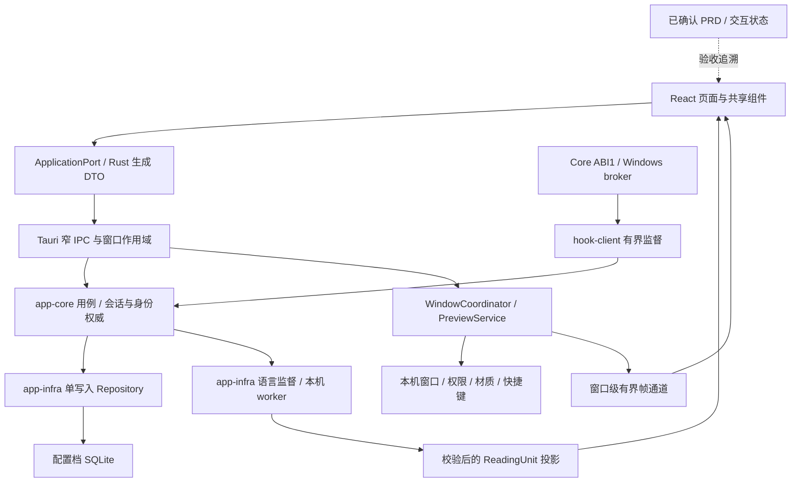
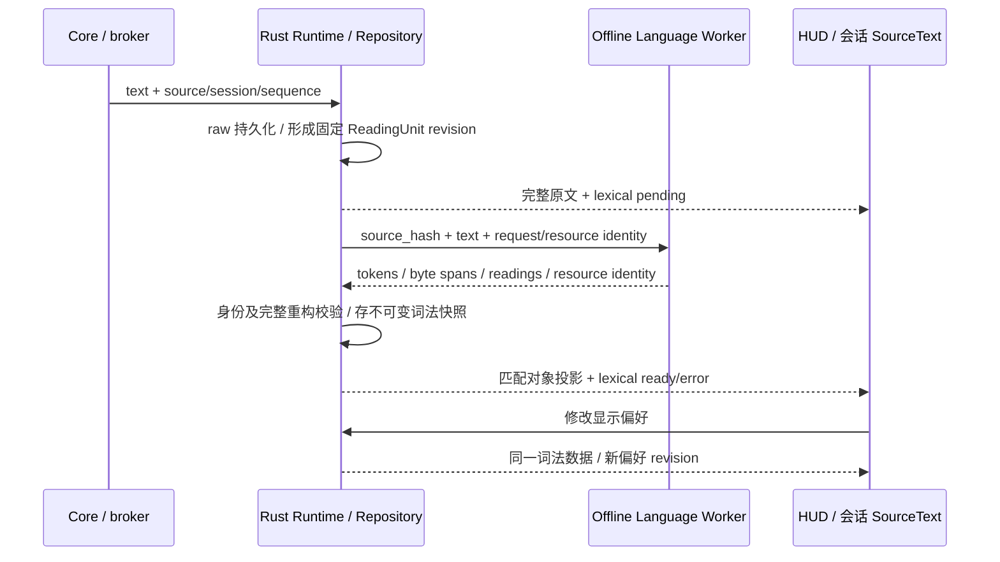

# 阅读窗口、运行预览与会话可追溯：技术设计

## 2026-10-31 当前源码到 guided 目标的迁移合同

本节以冻结的 `FP1-20261030-R74` / 2087源为当前源码依据，目标是 [guided-service-reading-20261030](../design/first-product-v1/candidates/guided-service-reading-20261030/index.html?scenario=reading)，状态仍为 `pending_review`。本轮只更新技术/产品/测试规划，不实现以下差距。统一任务、需求映射与准出闭包见[当前客户端对齐总计划](../development/current-client-alignment-plan.md)。下文带日期的候选、局部实机与旧三页签说明保留其历史身份；最新呈现目标由本节及最新PRD约束，旧回执不覆盖新目标。

### 当前已有与仍须迁移

| 需求/目标 | R74实际源码、符号与行号 | 当前状态与迁移责任 |
|---|---|---|
| FP-04 / GD当前阅读独立首屏 | [ReadingPanel.tsx](../../apps/desktop/src/features/reading/ReadingPanel.tsx) `ReadingPanel:21`、`SessionOverview:166`；`dataset:23`及条件渲染`:127-154` | **部分**。当前概览只在正文历史Tab内，切至提取/Hook会消失；M13/UI把当前卡移到记录区外，保留M03/AP选择的精确unit/revision及M05/AI翻译状态 |
| FP-07/11 / 原文词法与固定对象 | 同文件 `SessionOverview:178`当前直接输出原文p；`ReadingContent:185`已有 `SourceText`、查词、复制与固定对象学习 | **部分**。复用现有词法/词卡与身份链补当前卡，不能复制业务或因重排丢分词、ruby、失败恢复和当前句操作 |
| FP-09/12 / 三独立默认折叠区域 | 同文件 `ReadingPanel:121-154`为一个dataset状态与条件挂卸载；[SessionRecordPanel.tsx](../../apps/desktop/src/features/reading/SessionRecordPanel.tsx) `SessionRecordPanel:45`持有filter、loadedPages、follow、anchor、export，`:174-183`挂载查询/定时刷新 | **未实现新呈现**。M13为正文历史、全部提取、Hook分别保持实例/状态，折叠仅改可见性；三份计数、警告/缺口和恢复入口持续可见，不把折叠当暂停、断开或清理 |
| RW-17～23 / 全集、分页与导出 | [ApplicationPort](../../apps/desktop/src/bridge/application-port.ts) `sessionRecords:23`、导出`:24-26`；[Rust查询](../../crates/app-infra/src/storage/queries/session_records.rs) `page:281`、`prepare_export:444`；面板刷新已加载页`:108-148` | **已实现既有管线，新布局未验收**。M03/AP维护接收事实，M10/AP维护三数据集、固定水位/游标/保留与导出；展示页大小不代替全集，M15/QA核完整性、脱敏和准出 |
| RW预览 / 同会话独立生命周期 | [预览协调器](../../apps/desktop/src-tauri/src/platform/session_preview_coordinator.rs) `SessionPreviewCoordinator:27`、`session_projection:492`、`binding_projection:524`；[预览端口](../../apps/desktop/src/bridge/application-port.ts) `previewSession:17`及独立监听`:18` | **已实现监督与消费者边界，新组合未验收**。M12/PL持资源、epoch与生命周期；展开/折叠、记录滚动和当前卡刷新不得重新选择窗口、重建采集或伪造新帧时间 |
| FP-06 / 当前会话与HUD同一浅层服务选择 | [应用端口](../../apps/desktop/src/bridge/application-port.ts) `ApplicationPort:4`尚无已保存服务列表/细粒度activate；[HUD](../../apps/desktop/src/windows/hud/HudWindow.tsx) `HudWindow`的设置菜单`:86-92`与工具栏`:134`仍为现有阅读控制 | **未实现**。沿LLM技术稿5.19～5.23由M04/AP产资格与绑定投影，M13共享控件，M05/AI处理后续句、取消与迟到隔离；不在两个窗口分别保存current |

上表的“已实现”仅指冻结源码可核，不表示本轮组件、存储、原生、服务或正式包已执行。新目标产品执行均为 `not_run`；实际开跑后外部前置缺失记 `blocked`，保留旧失败及有限回执。

### 契约、任务与门禁依赖

1. 先将最新阅读PRD、GD及GUI缺陷回归逐项映射至当前卡、三记录区、预览与操作身份。M03负责正文对象，M05负责翻译，M10负责正文/raw/Hook持久查询，M11仅负责偏好，M15负责脱敏诊断与验证；2026-10-30补充中把M11当诊断的写法在本轮澄清。
2. 当前卡与三个折叠容器先复用现有 `ReadingUnitProjection`、`SessionRecordQuery/Page`、预览端口和共享C04。仅迁移UI局部状态所有权时不需要DDL；若新摘要无法由已有查询表达，先记录缺口并审窄typed query，不把客户端临时计数当全量事实。
3. 浅层服务选择依赖M04的已保存资源资格/版本合同和细粒度激活，再接M13共享选择器；25项服务注册、typed凭据和离线资源另依LLM主稿完成DTO/codec/迁移评审。不能把记录重排与尚未批准的新存储字段捆绑默认放行。
4. 逐层验真实组件的折叠保留/键盘/长文与200%适配；Rust身份、旧代次拒绝与取消；真实Repository超过多页、筛选、重开和导出；原生预览不重建及同包持续游戏。既有组件runner、SQLite adapter和部分原生adapter可以复用，但它们的旧范围不能代替新场景和最终签名包实测。

## 2026-10-21 五项修复与实机后续状态

| 修复 | 当前状态 | 已核对现状与未完成验证 |
|---|---|---|
| 真实封面资产链 | source_implemented; final_package_pending | 本机Steam/游戏资源发现、安全托管读取及首帧CAS已接通；candidate10实机可见SR/MO本机图。正式关联game_id缺口已在源码补齐，最终包首帧归属仍须实测 |
| 单面板一次关联立即Hook | source_implemented; final_package_pending | 同面板可见已有库/新资料/仅本次归属；typed保存回执后才接入，失败重试复用真实ID；Rust在原生前核完整目标，短SQL成功后才发布归属；候选仍显式选正文 |
| 首版仅连接已运行游戏 | source_implemented; runtime_subset_verified | 页头统一入口，详情三重复按钮及游戏启动UI已移除；candidate10实机已核对入口，最终包仍须回归。不影响broker/helper管理 |
| 自动常驻窗口预览 | source_implemented; runtime_subset_verified | candidate10有权自动显示真实SR画面；暂停切页往返保留同一帧和原03:13:11.131时间。session租约独立于React，最终包权限/身份恢复仍须回归 |
| 保真排障日志与默认降噪 | source_implemented; runtime_subset_verified | 原生message、资源/DLL身份、ABI/引擎/地址/返回码及正确Warning级别已保留，diagnostics只滤正常raw通知；candidate10可见native事实，不据注入请求宣称收到正文 |

历史原09 source为`ee266096a78a703c2c07f8ff48d66c2c6a399da131e266ba3878e624472a0d81`；candidate10 source为`808366a7e108d44b45f6e883c16eed04ecf66d8d943382726695aebe2219de5f`，完整工程门禁54/59的失败原件保留。candidate10本次新SR会话尚无正文候选，不继承旧09部分中文取文；0日文revision/0词法快照不能证明分词/ruby。新修复组件已实跑50/50、908断言，真实SQLite/原生适配器精准测试通过，但均不等同最终包及SR/MO/Never7/サクラノ詩10th回归。R31原档与批准PNG/token保留，R32须逐项独审采用；旧视觉冻结源与当前设计不符仍明确失败，不能自动更新批准图或降低阈值。

### 实机后续的内部职责与存储边界

- `CaptureSheet`只编辑候选及资料草稿，复用`SaveGames`的动态itemId/gameId/rowRevision与原四字段`AssociateRequest`；不得用第一款游戏或Bottle显示名代替真实完整身份。初扫独立scanning/ready/empty/error及epoch；Tauri每实例仅共享进行中的targets请求，settle后可重新扫描。 导入文件的launch PE位数仅在actual canonical未知时是启动程序提示；首次核验实际EXE以candidate位数为准，已有非空实际路径及其架构则严格匹配，环境/Bottle始终核对，不静默覆盖另一实际目标。
- `ApplicationRuntime::associate`先核库记录与已签发candidate；`CoreHookBackend::with_associated_session_commit`按capture_lock→lease→active→短SQL顺序核实当前会话，SQL成功后才将空归属发布。SQL actor不回调native；回调克隆active后释放锁。相同SID补归属不重注入，失败保留原有效连接；不同非空归属拒绝。
- `sessions.game_id`可从NULL补齐；原schema的ReadingUnit.gameId/sourceSummary.gameId由sessions JOIN投影，旧句投影随之显示所属游戏。原revision、原文、语言、hash、processing_snapshot、tokens和translations保持不变；不新增unit字段或改写语言快照。迁移DDL/版本不变，运行SQL增加身份核对及空归属事务。
- SQLite profile租约改为记录获取进程PID的RAII guard：连接先关闭，父所有者显式unlock；fork子进程只close，不能误解锁父进程。原互斥/迁移/关闭断言保留，确定性真实Store fork红绿及双独审已留证；完整并行测试和最终工件存储adapter仍须执行。

执行范围与Owner见[实机后续工作卡](../development/iterations/FP1-20261021-runtime-followup/plan.md)，逐次真实回执见`.build/runtime-followup-implementation/`、`.build/runtime-followup-rbc48-50/`及`.build/storage-contract-followup/`。这些源码证据不提升发布状态。


版本：1.3 · 日期：2026-10-21 · 类型：已授权RW实施的源码对照；最终同包验收单独记录。

本设计承接用户已确认的[六项交互修订](../design/first-product-v1/interaction-review.html)、[PRD](../product/reading-window-session-prd.md)和[RW-01～34 验收定义](../product/reading-window-session-acceptance.csv)。用户已授权下一批实施及SR、MO、Never7、サクラノ詩10th回归。当前已落地平台预览、原生HUD控制、自绘Select、三数据集与词法显示；原批准图、token、原始快照及schema1保持不变；本轮当前PRD/设计源按用户明确覆盖同步，不能把旧批准指纹自动刷新为新批准。下文目标契约与已经编译的接口分别理解，实际字段以[Rust DTO](../../crates/app-core/src/contracts/mod.rs)及其生成TS为准；并发和补偿增量见[本批契约审阅](../../openspec/changes/implement-reviewed-reading-session-batch/scope-and-activation-review.md)。

## 当前实现与未对齐内容（2026-10-20核查）

本节保留2026-10-20的核查与后续增量来源；当前R74与guided目标差距以前方2026-10-31迁移合同为准，不能用本节旧时态提升或否认当前实现。

当前状态入口：[实现现状与差距清单](implementation-status.md)；[机器清单](implementation-status.json)。它逐项覆盖16个模块、36个组件、12项首版功能及14项细分能力，附实际源码位置、文件hash、当前行为、差距、Owner和下一步。模块/组件表的 `implementation_status` 已由统一planned更正为本次源码核对状态；目标职责与实际实现不再混用。

三轴独立：**已实现/部分/未实现**描述代码；**已对上/部分/不一致/未核定**仅描述已核查的源码语义；**历史通过/历史失败/仅源码/未执行**描述证据范围。本批已执行实际组件、SQLite、原生系统预检及独立审阅；具体源码快照、最终包和四游戏状态查[本批运行记录](../../.build/next-batch-20261020/execution.json)，不由本页文字自动提升为通过。

明确的已有能力包括独立Core/七回调broker、三类翻译渠道（OpenAI兼容、Anthropic、Microsoft Translator Text v3）、本机语言worker与辞书、按需精读任务、历史/真实SQLite适配、macOS Keychain及多数共享组件。本批已接入实际窗口帧、偏好驱动快捷键、HUD几何恢复、新工具栏、Select、三数据集、暂停raw及保留、独立注音。完整视觉对照和最终包运行需独立通过；具体语言质量历史失败、多屏实机及其他未涉及的旧缺口仍保留。

旧9a7包四游戏取文/翻译结果与dist保留的f38包均为历史身份。本批新包输出到独立.build目录，具体身份与回归在运行记录中维护；模型直连预检也不等于客户端翻译通过。旧包、具体历史失败与本批执行结果不能互相覆盖。

## 1. 阅读路径与结论

产品与设计评审先读第 2、5、6、8 节；应用与平台开发读第 3～9 节；QA 与发布负责人读第 10～12 节。已有分层、框架、Core ABI 和数据库程序化约束继续生效，详见[研发基线](first-product-engineering-baseline.md)、[目录组织](engineering-layout.md)和[数据库设计](database-design.md)。

本次修订不更换框架，而是补齐此前从设计到运行之间缺失的端口与证据边界：

1. 运行预览由原生 `WindowPreviewPort` 提供真实目标帧，不借用封面或浏览器桌面图片。
2. HUD 拖动、几何恢复、全局快捷键和材质归平台协调；Rust 发布实际生效状态，UI 不能靠本地开关宣布成功。
3. 会话正文历史、全部提取和 Hook 事件使用独立、持久、可分页的数据集。页面大小、渲染缓存和诊断环形缓冲不决定数据保留量。
4. 语言 worker 的真实结果经过 Rust 身份与 span 校验，投影给所有阅读窗口；分析是否需要、分词边界是否显示、注音是否显示分开决定。
5. 设计原型、真实 React 页面、真实语言链路、原生窗口与游戏运行分层验收。某一层通过不能替代其他适用层。

## 2. 当前事实与本批实施对照

### 2.1 已有工程事实

| 事实 | 可核对依据 | 证据边界 |
| --- | --- | --- |
| 客户端已消费独立新 Core | `native/core-runtime.lock.json`；`crates/lunahook-host/src/abi.rs`；`crates/app-infra/src/hook_backend.rs` | Core ABI 1、cdecl 七回调、私有 JSONL 2；不是运行原版完整 Python/Qt 客户端 |
| 已有 app-core、app-infra 与独立本机语言 worker | 根 `Cargo.toml`；`crates/app-infra/src/language_services.rs` | 模块存在和编译不证明本轮交互全部已接通 |
| dist保留历史 Reader 0.2.0，新候选独立封包 | `dist/build-manifest.json`；本批运行记录的candidate字段 | 新包须校验源码封印、EXE、ZIP、Core及语言资源，不以修改外部JSON重标旧包 |
| 当前真实存储 adapter 已存在且上次开发门禁通过 | `.build/quality/20261019T121014.101158Z.json`；`docs/development/storage-acceptance.md` | 历史 51/51 属于当时源码和范围，不覆盖本轮 RW 新增行为 |

Core 锁定提交为 `e9242ebac32a09e911f306b7c90714891c217302`，客户端经同位数 Windows broker 消费 Hook/Host/Injector。运行预览、原生快捷键、词法和会话查询均不加入游戏 DLL 或 broker。旧 ADR 中“尚未接入”的叙述是形成决策时的历史上下文，当前事实以本节和实际文件为准。

### 2.2 本批源码与尚待验收边界

| 当前源码行为 | 对应要求 | 仍须验证的边界 |
| --- | --- | --- |
| `WindowCoordinator`、`window_geometry.rs`、`shortcuts.rs`与`window_preview.rs`已接线；macOS采用Carbon/AppKit/ScreenCaptureKit | RW-01～12、24～25 | 实际游戏前台快捷键、拖动、权限/旧帧及同包窗口生命周期；单屏不能冒充多屏验收 |
| `ui/primitives/Select.tsx`复用React Aria，实现自绘列表与2px间隔 | RW-13～16、31～32 | 全状态键盘/焦点/滚动和整窗同态对照；浏览器不替代原生窗口实测 |
| `SessionRecordPanel`与Rust查询提供正文、全部提取、Hook事件、固定水位分页/搜索/导出 | RW-17～23 | 完整存储adapter、正式包全量记录及实际游戏事件归属 |
| raw持久化先于暂停正文消费判断；独立Hook journal和操作身份入库 | RW-17～18、20、23 | accepted事件关闭FIFO屏障、丢失/未知范围、错误补偿及真实回调连续性 |
| 原内存诊断继续用于健康提示，新增持久Hook事件不借用100条诊断列表 | RW-19～23 | 各层不能把内存健康提示当全会话日志 |
| retention保护活动会话raw、open正文所引用的raw和导出固定范围；清理水位如实投影 | RW-19～23 | 真SQLite边界、空间不足/恢复、最终包重开与清理策略 |
| `SourceText.tsx`分别控制词法需求、边界、ruby与POS，缺失/失败保留可读原文 | RW-27～28 | 真实worker、语境读音质量、旧句身份及三个日语游戏；8组合受控测试不证明词法语义全对 |

本表为实际源码实施对照；通过状态只来自对应执行回执，不把设计样例、独立系统预检或旧包结果记为最终产品验收。

## 3. 模块与进程边界



图中箭头表示调用或数据流，不代表 UI 可以导入底层实现。业务规则仍在 app-core；平台实效归 M12，原生取文归 M14，持久化归 M10，语言归 M07。预览帧不进入模型网关、不进入 SQLite 正文历史，也不经过 Windows broker。

### 3.1 Owner 与复用

| 领域 | 主责 / 协作 | 复用点 | 新增设计职责 |
| --- | --- | --- | --- |
| 目标与会话 | AP / HK、PL | M02；TargetCandidate、SessionIdentity | 预览身份租约、切换取消，不把预览选择当关联接入 |
| 平台窗口 | PL / AP、UI | M12；window_manager 与菜单恢复 | WindowCoordinator、WindowPreviewPort、几何与快捷键有效态、材质能力 |
| 原始取文与阶段 | HK / AP | M14；JSONL2 NativeEvent 与序号 | 完整事件归一、上游缺口和暂停边界，不扩宽 Core ABI |
| 会话存储 | AP / HK、QA | M03/M10；raw_events、source_refs、HistoryQuery | 三数据集分页、范围与完整性、显式保留、脱敏导出 |
| 语言与正文 | JA / AP、UI | M07/M08；LanguageServices、ReadingUnit | 分词/ruby 独立偏好、词法状态、真实 span 与迟到隔离 |
| 公共界面 | UI / PL、QA | M13；C01/C04/C13/C16/C18/C23/C33/C34 | 共用 Select、预览、会话记录面板与 HUD 工具栏；不复制业务命令 |
| 证据与发布 | QA / 各 Owner | M15；现有 runner 和证据身份 | RW 全量覆盖、层级能力、真实执行与缺项阻断 |

## 4. 运行窗口实时预览

**当前标记：源码已接入；最终包实效单独验收。** C35、原生预览Service、显式权限、nonce窗口身份核验和有界最新帧拉取已实现；SR的独立Wine/原生预检已有两帧，不能继承为最终Luna包的预览通过。下文为目标责任契约，实际编译类型见window_capabilities.rs与窄IPC reading.rs，见CAP-PREVIEW。

### 4.1 端口与身份

`WindowPreviewPort` 是业务所需的平台能力接口。app-core 只处理可比较的身份和生命周期，不持有 `CGWindowID`、`SCWindow`、原生句柄或图像指针。Tauri 平台适配在当前进程内解析已验证目标，返回不可由前端伪造任意窗口的预览引用。

拟议身份为 `profile_generation + consumer_id + preview_generation + target_identity_hash + host_window_instance`。其中窗口实例须关联宿主 PID 及创建身份、宿主窗口 ID、Bottle 和 Windows 目标完整身份；相同标题、重用 PID/窗口编号不得命中旧引用。仅有进程候选而没有可验证窗口时返回 `no_capture_window`，不改采整个屏幕。

```rust
// 契约草图；不是已存在类型或编译通过的代码。
trait WindowPreviewPort {
    fn permission(&self) -> PreviewPermission;
    fn start(&self, request: VerifiedPreviewRequest) -> PreviewLease;
    fn pause(&self, lease: PreviewLeaseId) -> PreviewReceipt;
    fn resume(&self, lease: PreviewLeaseId) -> PreviewReceipt;
    fn stop(&self, lease: PreviewLeaseId) -> PreviewReceipt;
}
```

命令只接受服务签发的候选/绑定引用，不接受任意文件路径、屏幕 ID 或调用方提供的裸句柄。列表、核对和当前会话复用 C35 `WindowPreview`，显示清晰来源；候选预览与当前绑定预览使用不同 consumer，取消核对只释放候选租约，不影响原会话。

macOS已采用ScreenCaptureKit窗口级过滤和完整nonce身份核验，预览最低macOS14；原应用最低macOS11不变，旧系统明确不支持预览。权限查询不提示；用户明确选定有效目标后按系统需要申请，已有权限自动预览；不用全屏裁剪替代窗口隔离。[Apple 窗口捕获示例](https://developer.apple.com/documentation/screencapturekit/capturing-screen-content-in-macos)、[窗口过滤器](https://developer.apple.com/documentation/screencapturekit/sccontentfilter/init%28desktopindependentwindow%3A%29)。

### 4.2 权限与状态机

`off → requesting_permission → starting → live`；另外有 `paused / stale / minimized / target_closed / permission_denied / permission_revoked / unavailable / stopped`。权限已授予不等于本次目标可采集。采集权限、帧可用性和 Hook 连接状态是三个独立投影字段。

用户明确选择有效目标后可进入权限申请/系统设置/重新检查；已有权限自动开始，授权返回后自动恢复该有效对象，不再每次点击开启。空库列举或接收台词不无目标触发录屏授权。拒绝不改变取文会话；系统设置入口和重新检查由平台提供受限 intent，不允许 UI 任意启动 URL/shell。候选面板取消/切换时仅释放候选租约；正式关联后session持有预览，切换正文/全部提取/Hook日志页签不释放。解除窗口关联、目标退出、退出配置档或应用时释放对应session租约；停止后到达的帧因 generation 不符被丢弃。

新目标确认生效时先提升 preview_generation 并清除旧目标画面，再启动新租约。旧目标原生回调、编码任务或 Channel 迟到均不能更改新画面的状态或时间。调用 stop 成功前不能宣称底层资源已经释放；错误保留可恢复状态。

### 4.3 帧、时间与资源预算

拟议帧信封包含 `preview_id / generation / frame_sequence / target_identity_hash / captured_at / width / height / content_hash / encoding / payload_ref`。64 位序号以规范十进制字符串跨 IPC；时间来自平台本次有效采集回调，UI 的 render/heartbeat、重复发送同一帧或封面替换都不更新时间。复用旧帧时保留其原采集时间；实际新帧与旧帧内容相同也不能声称“画面发生变化”。尝试时间、最后有效采集时间、上次内容变化时间和权限检查时间分别记录：静态游戏可以仍在正常采集，stale依据真实采集健康/期限判断，不依据“内容没有变化”误报。真实变化验收仍须观察至少两次可识别内容变化，不能只比较采集时间或frame_sequence。

帧传输使用独立、按窗口授权的有界通道或受限临时内存资源，不塞进全应用快照，也不把每帧 base64 写入事件总线或正文数据库。只保留待显示的最新帧；慢窗口允许丢弃中间帧，但必须保留最新帧身份与实际时间。帧丢弃策略不用于 raw Hook 业务事件。

本批已编码限额为最多2个租约、全局1次在途采集、1000ms采样、960×540/JPEG512KiB上限，采集启动/停止期限5/3秒；身份核验有独立有界期限。实际采集timeout/busy会投影stale并保留原帧时间；独立的固定4秒过期判定仍为规划缺口。帧走最新槽和每租约单飞pull，不走全局图像事件总线。候选关闭取消候选租约，session租约不随页签或临时候选卸载；列表只对用户明确选中且身份有效的目标自动预览。8MiB为规划内存预算，目前没有全局内存硬预算检查，不能将现有尺寸/并发限额当作该预算已验收；最终包仍需资源、时序、窗口隔离实测，并保留该缺口。

不启用音频，不持续录制或连续保存帧，不传翻译/AI服务、不写诊断包。用户本轮明确允许的唯一静态封面回退为：本机封面缺失、正式关联有效目标、录屏已授权时保存首张有效帧到托管assets并绑定game；临时候选/旧generation/错绑目标不存帧，已有封面不覆盖。用户明确导出当前帧时使用系统保存面板并标注帧时间与来源；预览故障日志只含脱敏状态、尺寸与错误码。窗口被遮挡但平台不能独立采集时明确 unavailable；不抬起目标、不抢焦点，也不混入遮挡应用的内容。

## 5. HUD：原生窗口与常用操作

**当前标记：源码已接入，原生交互须同包验收。** 常用工具栏、局部滚动、原生拖动、几何持久/恢复、偏好快捷键prepare/commit/rollback和菜单恢复已实现；平台返回实际effective组合，desired不是生效证据。见CAP-HUD-CONTROLS／DRAG／SCROLL-MENU／SHORTCUT。

### 5.1 工具栏与命令复用

C18 只拥有可见布局与瞬时展开状态。顶部固定置顶、紧凑/舒适、隐藏；空白和独立手柄为拖动区。底栏直接提供分词、注音、词性、原译模式、自动翻译、暂停/继续、重译、复制、精读。更多菜单仅保留设置、选择/更换窗口、适用时解除关联、恢复位置、断开取文；不得再次复制常用动作。

`560pt` 舒适与 `500pt` 紧凑均要保留全部入口和 tooltip/可访问名称；允许按确认稿分组组织固定工具区，不以缩到不可点、横向滚动或移回更多解决拥挤。正文是唯一滚动容器，外窗/根文档 overflow 锁定，工具区与弹层不随正文滚动。弹层采用 click/toggle 状态；pointerup 不关闭，外点或 Escape 按焦点规则关闭。

显隐、暂停、自动翻译、显示模式四个状态独立。菜单栏、快捷键和工具栏调用同一个 Rust intent；复制、重译和精读捕获点击时 `ReadingUnitRef`，不能等异步执行时再读取可变 current。复制来自 `source_text`，不从 ruby DOM 提取。仅译文但当前句没有译文时保留原文及等待/错误提示，不显示空白。

### 5.2 拖动与几何

`WindowCoordinator` 是 M12 的协调职责，不另建业务数据库服务。HUD 的有效 `pointerdown` 由受控 application-port 转到原生窗口移动能力；窗口角色必须为 hud、来源为真实用户操作、按键和控件命中合法。UI 只发开始拖动意图，不能用 CSS transform/前端坐标制造“窗口已移动”。Tauri 具有窗口拖动及 moved/scale 事件能力，实际封装须使用锁定版本 API 并保持权限最小。[Tauri Window API](https://v2.tauri.app/reference/javascript/api/namespacewindow/)。

按钮、词语、文本选择、菜单、Select 和正文滚动不作为拖动来源。释放鼠标结束原生拖动；移动事件仅报告实际 bounds。几何以逻辑单位保存，附显示器标识、工作区、当时 scale 和几何版本；保存的是窗口偏好，不保存游戏句柄或重用旧窗口身份。

窗口几何存平台用户数据文件，按 schema 版本校验并原子替换；不写进配置 revision、不增加 reader.sqlite3 高频写负载。移动期间合并/debounce 写入，拖动结束、退出前刷新；磁盘失败提示“本次位置未保存”，不影响窗口本次位置和取文。

恢复时重新枚举工作区：先匹配显示器，再将实际 bounds 约束到可见范围；找不到旧屏幕则定位当前可用屏幕。多屏坐标可为负，不能按单屏 origin=0 裁剪；物理像素与逻辑 pt 显式转换。拔屏、scale/分辨率变化、全屏和 Spaces 后重新校验顶部操作区可达。菜单栏始终提供恢复 HUD 与重置位置，隐藏 HUD 不取消当前会话。

### 5.3 快捷键事务与有效状态

三个 typed action 为 `toggle_hud / toggle_capture_pause / cycle_reading_display_mode`。`⌥⌘H` 与 `⌥⌘P` 沿用设计默认候选；显示模式未设置。默认组合与全局/游戏 scope 由实施卡冻结，不因设计监听可响应就认定原生组合可注册。

`ShortcutCoordinator` 管理 `draft / validating / registering / active / failed / cleanup_pending`。设置草稿、数据库偏好头和系统注册是不同对象；投影同时给出 desired bindings、effective bindings、scope 来源、registration generation 和每项错误。菜单与 tooltip 只显示 effective，不把保存成功当已启用。

原生注册和 SQLite 没有跨系统事务，采用可补偿的 apply：由进程内唯一 coordinator 串行化所有有效绑定变更（scope用于解析来源，不开并行系统注册）→ 校验组合/应用内重复/权限与 expected_revision → 复用未变化的自有注册，为新增组合注册候选且暂不派发 → 全部准备成功后提交偏好并切换唯一派发 generation → 清理旧注册。准备或持久提交失败时清理候选并保持/恢复旧 effective；若平台要求先释放旧组合，需在受控窗口内回滚并验证旧注册。切换后的旧注册清理失败标 cleanup_pending，旧 generation 不再派发，不能倒退已提交偏好而假称回滚完成。回滚也失败时明确部分失效和恢复动作，不能显示原子成功。其他应用占用最终以系统注册结果为准，不用本应用的isRegistered推断全系统空闲。进程崩溃后由已应用持久偏好重新注册并报告实际结果，不根据“之前是 active”推断系统仍持有绑定。

只响应预定的按下边沿，避免按住重复与按下/释放各触发一次。菜单录入/快捷键录制时抑制产品派发；无会话时暂停项 disabled，显示/隐藏与重置仍可用。切换游戏、配置档、应用退出清理自有注册，不注销其他进程的组合。本批macOS采用Carbon原生桥接，不引入快捷键插件或新运行依赖。仅增加macOS条件编译的已锁cc=1.8.0直接build依赖边，495个包身份/版本/来源校验均保持，技术锁变更已有独立审阅。

## 6. Select 与公共组件契约

**当前标记：自绘Select已实现。** C04复用已有React Aria，原生select仅作不可见表单语义；可见trigger/listbox/option、单一活动态、2px间隔、键盘与长列表已有真实组件测试。整窗零差异与最终包仍分别核对，见C04／CAP-SELECT。

沿用已安装 `react-aria-components`，在 C04 建立一个不带外部主题的 `Select` 封装；无限选项或搜索输入另用 ComboBox，不强迫自由模型 ID 改成有限列表。现有 `Controls.tsx` 的导出可作为迁移兼容入口，业务页面仍只提供 options、value 和 onChange。

| 状态维度 | 不变量 | 必测组合 |
| --- | --- | --- |
| selectedKey | 只表示已确认值，勾记可与导航位置不同 | 方向键移动但不确认、Escape/外点取消不改值 |
| activeKey | hover 与键盘共享唯一活动项，不同时叠加两种背景 | 鼠标从 A 移到 B、键盘后鼠标、鼠标后键盘 |
| 行布局 | 垂直 gap=2px；option 不 flex-shrink；独立圆角背景 | 多行长名、200%字号、长列表、禁用邻项 |
| 不可选 | disabled 不成为活动目标，不触发 onChange | 键鼠跳过、全禁用、空列表 Enter |
| 弹层 | 边界定位、内部滚动、不推动父文档 | HUD 窄宽、屏幕底部、列表最大高度 |
| 焦点 | Enter/Space 打开；方向键导航；Enter 确认；Escape 归还触发器 | 原值非首项、Tab 离开、加载/失败重试 |

selected 是数据状态，active 是一个可导航高亮；选中勾记不会额外产生另一块 hover 背景。高亮背景不得以负 margin、box-shadow 外扩覆盖 2px 间隔。视觉规则来源于本轮已确认 CSS/样例，实施时在产品组件复现，不把原型隐藏 `<select>` 的实现方式直接移入产品。

应用层不扫描 DOM 临时套皮。所有产品有限选择入口须有登记：设置服务/用途/语言/主题/scope，正文流、会话筛选等；逐项验证真实使用的是共享 C04。新错误成功恢复时清除 error 投影；加载、空态和禁用不可用一个假的第一选项混同。

## 7. 当前会话的三类全量数据

**当前标记：三数据集及Rust管线已实现，真实持久验收单独执行。** 暂停先保存raw，typed Hook事件与接入操作入库；C36复用固定水位查询/分页/全量筛选/JSONL导出，宽序号按字符串跨IPC；关闭等待producer停止、FIFO屏障及writer确认，未知缺失不伪造计数。见CAP-RAW／SESSION-UI／HOOK-LOG／RETENTION。

### 7.1 权威集合与暂停语义

| 数据集 | 内容 | 权威来源 | 不等同于 |
| --- | --- | --- | --- |
| body | 本会话形成的 ReadingUnit、修订、译文/状态和源引用 | 现有阅读事务与历史 Repository | 每个原始回调 |
| extraction | 本会话所有已接收候选流 text 事件、原文、序号、未选原因和正文归属 | raw_events/raw_event_payloads + source_refs | 每流最新样本、已选流正文 |
| hook_events | 资源/身份核验、注入、回调握手、发现流、选流、重试、断开与错误 | 归一化控制事件的持久存储 | 最近 100 条诊断健康提示 |

从接入操作开始建操作身份；session 尚未创建的资源/映射失败先关联 operation，成功后明确关联会话，不能将全过程开头丢掉。原始回调借用内存仍在 broker 返回前复制，队列仍有界，禁止同步写盘或翻译阻塞游戏线程。

收到的原始事件先形成有序持久事实，再按当前选流、暂停与合并规则决定是否产生/更新正文和衍生任务。暂停期间已经接收的 raw 仍需保留，正文消费/翻译派发保持暂停；若某平台实际停止上游接收，记录暂停区间并标示该范围没有采集，不能称为上游剧情完整。恢复不自动为暂停区间补造台词或补发模型请求。

合并/去重只影响 ReadingUnit；raw event 仍保留，source_refs 或派生归属说明它参与了哪个正文版本、被合并或为何未选。丢包、背压、序号缺口、写盘失败分开记录；未知数量写 unknown，不用当前数据库行数推导“没有丢”。

### 7.1.1 本轮诊断保真与降噪增量

沿既有HookUpdate→HookEventInput→repository→sessionRecords投影，保留Ready的ABI/commit/arch、Error具体code/message、Log有界脱敏原生内容、HookInserted pid/address/hookcode、InjectionFinished arch/exitcode与真实资源DLL选择。复用既有message/metadata容器；typed facts或公共DTO变更须单独审阅，不通过任意JSON绕过可编译合同。u64保持既有安全表示，未知事实不根据游戏名或任意字符串猜造。

Core HOSTINFO映射固定为Console=0、Warning=1、EmuWarning=2、EmuConnected=3、EngineType=4；不能仅用kind<0判断warning。原生message需要长度/Unicode边界、去NUL/控制符与凭据/私人路径脱敏；保留有用引擎/扫描范围/安装地址，不用通用“收到日志”抹掉内容，也不把游戏全文重新混进默认诊断。保留原既有安全测试目的并新增保真正例。

默认Hook视图为“接入与故障”，压低正常raw已保存/text_unselected等处置噪声；全部事件/全部提取保留原始数据、计数、序列和分页搜索导出。warning/error/丢失/存储失败始终可见，不能用聚合吞首末消息或隐藏错误次数。helper接受/退出0、进程连接、候选出现、正文已选分别显示，不互相推断成功。

### 7.2 分页与范围契约

2026-10-31源码澄清：`ApplicationPort.sessionRecords(query)` 已存在（`apps/desktop/src/bridge/application-port.ts:23`），app-core的 `session_records::validate_query` 校验输入，再由单一 Repository 读取；下列示意保留目标语义，实际编译字段以Rust生成DTO为准。`HistoryQuery` 可复用正文视图，但 raw 和 hook 返回各自 typed row，不把三类内容拼成任意 JSON 文本。UI 不传 SQL，不从 diagnostics 数组反推全量。

```ts
// 逻辑契约示意；正式类型须从 Rust Serde/ts-rs 生成。
type SessionRecordQuery = {
  sessionId: string;
  dataset: 'body' | 'extraction' | 'hook_events';
  filter: SessionRecordFilter;
  cursor: string | null;
  pageSize: number;
};
type SessionRecordPage = {
  records: SessionRecord[];
  nextCursor: string | null;
  snapshot: SessionRangeSnapshot;
  loadedRange: SequenceRange;
  completeness: SessionCompleteness;
};
```

游标为不透明、版本化且服务端校验的值，绑定 profile/session/dataset/filter hash/排序方向/固定 high-watermark/最后稳定序号。跨会话、改筛选后复用、无效编码或已清理的游标明确失败，不退回第一页假装成功。排序依靠每个数据集的单调接收序列，时间仅用于展示；不能把系统墙钟当唯一顺序。

第一次查询冻结当前 high-watermark，后续页限定在这个范围，新的事件以单独计数/增量提示到达，避免分页过程中插入导致遗漏或重复。页面大小仅控制本页返回条数，不是会话容量或export/search范围。实际查询实施有界页长、checked SQLite整数范围与规范十进制字符串DTO；到达存储序号边界明确拒绝并记录错误，不承诺无界增长，不经JS Number传宽序号。

固定范围冻结记录集合、原文版本与排序，不冻结已有正文行的译文或人工修正。Rust每次正文页查询按固定unit/textRevision读取当前持久化内容；`databaseRevision`为范围建立时的revision，不能据其未变化认定译文未变化。R25修复目标为：UI轮询及刷新重试读取全部已加载页的不透明游标，校验同一generation、会话/数据集/快照/高水位和稳定行来源身份，成功后原子更新既有行内容，保留集合、顺序及尾页游标。任一页失败保留整批最后成功内容；不得以当前句结果填充历史，或仅刷新首50条。此合同的源码、组件及新包实测结果分别记录，不由文档提升验收。

`SessionRangeSnapshot` 至少表达首次可用/最后收到/最后确认持久位置、匹配总数的范围、保留起点、已知丢失区间、未知区间、清理状态与数据库 revision。`complete` 只能表示已接收范围内持久且无已知缺口，不宣称 Core 未发送的内容全部存在。加载更多累计到总范围末端，不能拿内存缓存最后 N 条作为结果终点。

### 7.3 跟随、检索与导出

C36 `SessionRecordPanel` 复用于正文、全部提取与 Hook 页签的框架，但 row 与 filter 分别 typed。自动跟随是局部浏览状态，不改变取文状态。用户上翻/搜索/选旧项时固定当前浏览锚点与 high-watermark，后台继续接收并显示新增数量；只有“回到最新”移动视口。验证需比较序号和 scrollTop，不只比较条数。

旧行译文导致高度变化时，暂停跟随的浏览位置按首个可见稳定行及像素偏移恢复；单独保持旧scrollTop不足以保证同一内容仍可见。刷新与加载更多须串行，同一范围旧响应以及已切换会话/数据集/筛选的迟到响应均不得覆盖更新的行内容、游标或状态。重译等待、失败及取消保留已有完成译文；新译文和修正只更新准确unit/textRevision，不改变固定精读对象。

搜索与筛选在整个权威集合执行，返回命中的稳定序列与游标，不局限已加载页；请求带 query generation，旧搜索结果不能覆盖新条件。现有字段/index 能否承载正文全文与原始 BLOB 搜索，在存储切片中先测方案；不要先承诺 FTS、新依赖或任意性能指标。

导出先冻结 `session + dataset + filter + high-watermark + completeness`，让用户确认全会话或当前筛选结果及隐私范围。Repository 分页流式读取，临时文件成功完成后原子交付；失败留下明确未完成状态，不将半份文件命名为完整。取消/目标磁盘满不清理会话数据库。正文/全部提取可能包含完整台词，Hook 信息可能含路径/目标身份；用户导出和默认脱敏诊断为不同入口，任何自动报告均不夹带台词、帧、Key 或认证头。

### 7.4 保留、恢复与 schema 评审

当前会话全量数据不能被短期缓存、默认跨会话GC或重启静默裁掉。本批已在open-unit引用保护之外增加活动会话和固定导出范围保护；已结束正文的历史source_refs不因此获得永久保留保证；历史会话采用可见保留政策，清理前说明数据集、范围及不可恢复性。资源有限时拒绝新写入并报告已确认范围/缺口，而非自动删前段维持“完整”。

schema1原始DDL、001迁移和431字段契约保持不变。本批schema2追加4表29字段，独立设计、关系、类型与边界登记在[database/v2](database/v2/README.md)，实际迁移嵌入database.rs；原字段不改。设计审阅覆盖：

- Hook/control 事件的持久列、级别/阶段/代码/operation/session/stream 关联，考虑扩展现有 raw event_kind 与独立 typed 控制表的取舍。
- 单调序号、首次/末次确认位置、缺口与未知范围、显式清理证据及分页必要索引。
- raw 保留与 session 生命周期的保护关系，payload 已清理但摘要仍在时的可见语义。
- 偏好显示/快捷键有效态与窗口几何边界，避免把系统有效状态当作静态数据库已生效字段。

schema2已有独立DDL/结构契约、29字段字典、生产Rust类型与关系、备份迁移/恢复及边界负例。实际存储adapter固定为storage_product_acceptance_v2，保留原完整目标并强制新增scope和解绑语义case；最终包需真实运行并核对12817个必需检查，登记存在和旧431字段通过不替代这次执行。

## 8. 分词、ruby、偏好与原生材质

**当前标记：独立词法显示已实现；历史语境质量失败保留。** 关闭分词不再一并清空ruby载体，八组合/迟到/失败/原文重构已有组件与Rust检查。真实worker和MO/Sakura语境读音仍需最终包实测；材质创建参数不等于实际合成通过。见CAP-RUBY／LANGUAGE-QUALITY／C01。

### 8.1 真实语言数据流



词法结果身份沿用 `profile_generation + session_id + unit_id + text_revision + source_hash + analysis_revision + language_resource_version`。worker 返回的是本机 MeCab/UniDic 结果，Rust 校验 UTF-8 边界、UTF-16 转换、顺序、完整表面重构和资源身份；UI 可防御检查但不是校验权威。空格和标点按原文保留，组合符号/补充平面字符不能被索引错配。

当前已有 LanguageClient 的输入/帧上限、超时、进程 kill 与重启，继续复用；不引入 UI 分词、第二份浏览器词典或模型推断 ruby。无匹配有效快照时呈现原文与 `pending / resource_unavailable / worker_failed / alignment_invalid / reading_unavailable` 的不同状态。错误不能只藏在诊断页，让用户看到“开启但没效果”。

### 8.2 显示偏好与当前句即时重绘

分析需求与呈现偏好分开：分词边界、注音、词性任意需要词法信息时可调本地分析；已有效结果优先复用。开关更改立即作用于当前同一 ReadingUnit，不等下句，不重新注入、不触发模型。分词关闭而注音开启时仍使用 token/span 为汉字绘制真实 ruby，但没有分词边界/可点击单元的突出样式；词性依已确认规则只在可点分词开启且词性偏好开启时显示。偏好值本身独立保存，重新开启分词时恢复用户原词性选择。

SourceText/对应渲染器必须覆盖 2³ 八种偏好组合，而不仅“全开/全关”；同一句逐字重构保持一致。无真实读音、纯假名和标点不补造 ruby。当前句切换使旧结果只能归所属旧记录，不贴到新句；取消/换档/资源换代使不匹配任务失效。

HUD、历史、手动和学习的词法阅读复用C16；当前会话概览与C36审计列表沿批准的纯文布局，固定句的学习和复制通过同一ReadingUnitRef处理，不把每条raw payload都当正文分词。学习/词卡不跟随当前句替换，复制始终取不可变source_text。ruby行高、禁则分组与词法token身份分离，长文/200%字号/标点换行不合并词义或错用点击索引。

当前阅读对象由Rust统一选择：存在opening/active Hook会话时，`AppSnapshot.current`只能是该会话最新可见正文，没有正文则为None；暂停保留同会话末句。该查询按会话在数据库中执行，不能从已截断的全局history首屏过滤。没有运行中的Hook时保留原有全局末句恢复和新手动输入行为。Hook运行期间的手动输入在手动页按自身receipt呈现，不抢占游戏HUD；显式固定的历史学习对象独立保留。无当前句时HUD不展示旧句/旧译文，复制、重译、精读入口不可触发旧对象。

候选02实机已发现首句前跨会话旧句缺陷，该包不合格，保留现场与中止回执。修复须有真实SQLite/runtime对象选择及四态组件回归；原28项组件检查扩为32项，79行为、37状态77变体与原批准设计保持。源码修复、重新封包和四游戏实测分别记录，不由本段文字提升通过状态。

### 8.3 原生半透明材质

既有窗口已配置 transparent 和 macOS HudWindow effect，但这只表明创建参数，不能证明实际背景透入。M12 投影 `material_requested / material_effective / reduced_transparency_source / platform_error`；C01 根据实际能力显示，字体 alpha 不随底板 opacity 改变。

macOS 由原生窗口合成效果采样窗口后方内容；WKWebView、html/body/root 和外层容器须透明，正文表面使用已确认 token 的半透明叠层。CSS backdrop-filter 只能处理其可见合成内容，不代替系统窗口采样；不把固定游戏壁纸贴在产品里制造玻璃。系统减少透明度或用户不透明模式优先采用实色回退，保留对比与明确生效来源。

验收在同一个最终包、相同 HUD bounds 下切换实际明/暗/多彩背景，分别记录外部背景与内部底板采样、文字可读性和回退状态；预先声明采样点与政策，不能事后遮罩失败区域。浏览器截图只验已确认 DOM 布局与样例材质，不据此宣称系统合成已通过。

## 9. 本批增量目录与接口归属

**当前标记：下列为本批实际增量路径。** 文件存在只说明源码组织，不说明对应产品行为通过。实际哈希、Owner及未涉及的旧缺口见统一实现清单；没有另建空架构或复制业务实现。

以下列出已有文件复用和本批新增。目录树不改变`luna-hooks-core`独立仓库边界。

```text
apps/desktop/
├── src/
│   ├── bridge/application-port.ts           # typed commands/queries/subscriptions
│   ├── ui/primitives/                       # C04 统一 Select / ListBox / Popover
│   ├── features/capture/                    # C13/C14 + C35 WindowPreview（已新增）
│   ├── features/reading/                    # C18 工具栏；C36 SessionRecordPanel（已新增）
│   ├── features/language/SourceText.tsx      # C16 共享 token/ruby 渲染
│   └── windows/hud/                         # 角色外壳与拖动区，不持有业务权威
└── src-tauri/src/
    ├── ipc/{commands,queries,subscriptions,reading}.rs
    └── platform/
        ├── window_manager.rs               # 复用；WindowCoordinator 的装配入口
        ├── window_preview.rs               # 已新增：租约/最新帧拉取/授权
        ├── shortcuts.rs                    # 已新增：Carbon注册/补偿/清理
        ├── window_geometry.rs              # 已新增：工作区约束/原子几何
        └── macos/                          # 已新增：窗口采集/材质窄平台适配
crates/
├── app-core/src/
│   ├── contracts/                          # DTO 权威，生成 TS；新增需协议审阅
│   ├── ports/                              # 业务端口/会话查询；平台预览由窄IPC适配
│   └── application/                        # 会话范围/控制/查询/并发身份
├── app-infra/src/
│   ├── hook_backend.rs                     # 完整事件映射，沿 JSONL2 复用
│   ├── storage/queries/                    # 会话三数据集、保留与流式导出
│   └── language_services.rs                # 现有 worker 监督，不复制 MeCab
└── language-worker/                        # 本机词法；不知窗口/模型/SQL
```

| 接口类别 | 拟议操作/数据 | 权威与权限 |
| --- | --- | --- |
| 预览 command/query/channel | start/pause/resume/stop；permission/capability；PreviewFrame | main 的候选/会话拥有者；只有原生服务可解析目标窗口 |
| 窗口 intent | begin_hud_drag / reset_hud_position / set_hud_visibility | hud/菜单受控入口；不开放任意窗口句柄和任意位置写入 |
| 快捷键 apply/query | apply_shortcuts(expected_revision)；EffectiveShortcutProjection | settings/main 编辑，系统 action 派发经同一个应用用例 |
| 会话 query/subscription | session_records / session_range / newer_count | main 当前档与明确 session，游标绑定过滤和范围 |
| 导出 command | prepare_export / confirm_export / cancel_export | 用户确认的数据范围和系统保存目标，不接受任意写盘路径 |
| 阅读 command/projection | reading_preferences / lexical_state / ReadingUnit | 多窗同一已应用偏好和不可变对象身份 |

正式 wire 名称、枚举、权限表、错误码与版本兼容由实施 OpenSpec 冻结，TS 从 Rust 生成；此表不能作为临时手抄 DTO 的理由。现有 IPC 与 ApplicationPort 统一扩展，不在页面新增直接 Tauri/SQL/HTTP 调用。

## 10. 资源、并发与隐私规则

| 通道 | 队列与取消 | 失败可观察性 |
| --- | --- | --- |
| Hook 回调 | 原有非阻塞复制/有界队列；raw 事实不得用投影合并替代 | overflow/未知缺口粘性显示，不假称全量 |
| 会话 writer | 单 writer；正文、raw、控制事件和范围更新在规定事务边界内 | 最后确认位置、失败范围、未保存可复制文本 |
| 预览 | 最新帧有界；暂停/切目标/关窗取消采集和编码 | 最后帧及时间，权限/目标/资源错误分开 |
| 搜索与导出 | query generation；固定 high-watermark；有界分页流式写 | 取消、部分文件、已清理范围和无法恢复明确 |
| 快捷键 | 进程唯一coordinator串行apply；scope解析、generation派发与补偿清理 | desired/effective 差异和回滚失败明确 |
| 语言 | 复用独立 worker 截止期限与输出上限；对象身份校验 | 原文保留；错误状态和重试；旧结果不得覆盖新句 |
| UI 投影 | 每窗有限快照/delta；缺 revision 重同步 | UI 慢不阻塞游戏与数据库；重同步不能静默漏 raw |

数据库、凭据库、原生注册均没有一体化系统事务，必须分别记录 durable intent、effect receipt 和补偿状态。避免“先写已成功再尝试系统操作”。操作幂等性沿用 operation_id；跨窗修改带 expected_revision，冲突保留编辑。

正常系统退出与应用内退出必须经过同一个受控收尾：停止接收并排空Core/relay、等待writer FIFO确认、持久化Disconnect及最终快照、释放预览和导出后才结束进程。macOS的AppleEvent/Cmd-Q不得只依赖`ExitRequested`或在`applicationWillTerminate`同步等待；通过`applicationShouldTerminate`延后答复，主线程只投递退出请求，异步完成后批准退出，失败则拒绝并恢复可重试状态。不得覆盖delegate已有实现或更换Tao/Wry。候选02的AppleEvent已实证绕过原收尾并留下active会话；原生修复、受控Cocoa测试与新包真实退出的DB/broker核对必须分别通过，不能把“进程已消失”记作正常收尾成功。

原生请求与最终答复均排到主RunLoop的common modes；Tauri主线程Task只排队，必须返回并释放框架回调锁后，才实际答复AppKit，避免YES同步触发终止时重入同一锁。NO答复和Rust重试状态恢复在同一个RunLoop块内完成。受控Cocoa用例须验证答复延后及重试；最终Tauri包仍须另验真实收尾。

敏感边界分三类：持续预览帧为内存瞬时，用户明确授权的单张封面以独立托管静态资产保存；原文属于用户本地阅读数据；Hook 路径/身份属于诊断敏感信息。三者均不默认上传。模型请求仅使用用户已启用用途按既有请求计划发送的文本，不能顺带发送预览或全量 Hook 历史。默认错误/崩溃日志只记录稳定错误码与脱敏摘要。

## 11. 分层验收与完成条件

**当前标记：本批组件/存储/编译门禁已补接，执行结果按层记录。** 32个RBC场景由固定真实组件adapter执行并逐项核nonce/实际断言/源身份；执行器先实际运行Cargo中的SQLite/runtime四态生产者，再将本次nonce、源码与payload哈希绑定的完整DTO交给Node，禁止用手造快照或旧28项替代。守卫正反例与产品组件执行分别记录；存储v2核schema2与scope/解绑case；原生与四游戏仍需最终同包。原91个真实层组合/153个发布组合没有因工具接线自动变为通过。

| RW | 设计/组件证据 | 必需真实链路 | Owner |
| --- | --- | --- | --- |
| 01～06 | 入口、权限、时间/失效和切目标状态 | 原生真实窗口变化帧、权限撤销、同名/PID复用、最小化/退出 | PL/HK/UI |
| 07～12 | 拖动区排除控件、工具栏状态、快捷键草稿/错误 | 原生 bounds、游戏前台全局动作、冲突补偿、重启/拔屏/scale | PL/AP/UI |
| 13～16 | 所有 Select 入口与完整状态；2px间隔、单活动项、内部滚动 | 正式页面/最终 WebView 中同组件交互；不需要凭空发明游戏依赖 | UI |
| 17～23 | 历史三页签；最新目标为独立当前卡与三默认折叠区，保留暂停跟随、新到计数、全量搜索/导出界面 | Core 多流/选前/暂停期 raw、持久化、超过多页、GC、重启与磁盘失败 | AP/HK/QA |
| 24～25 | 明/暗/彩背景样例、不透明回退、底板独立 opacity | 同最终包原生背景采样与系统减少透明度 | PL/UI |
| 26～30 | 同句八组合、ruby/换行/200%字号、故障与迟到 | 随包真实 worker/词典→Rust投影→HUD，断网首启、Unicode与旧结果隔离 | JA/AP/UI |
| 31～34 | 原稿组件清单、常用前置与更多去重、所有状态 | 按适用层真实候选/最终包/游戏及覆盖闭包，不继承旧通过 | QA/各 Owner |

具体测试维护与执行器改进由[门禁差距分析](../development/design-review-gap-analysis.md)、[分层测试计划](../development/first-product-test-plan.md)及本轮 OpenSpec 约束。产品项以 RW CSV 为权威身份，不在测试里复制另一份 34 项名单充当规范；原 153 个组合不被新增设计 QA 自动提升。

完成条件为：每个 RW 有设计状态、实现组件/平台能力、适用层、检查与实际结果；真实层缺 adapter 为 not_run，外部条件不足为 blocked。负例至少实际拒绝：仅 prototype 拖动替代 native；fixture token 替代真实 worker；50 条缓存冒充全部会话；暂停期 raw 消失；GC 删除当前会话前段；同名目标串帧；高亮重叠；仅注音无 ruby；背景图模糊替代原生材质；旧包回执冒充新包。守卫自测通过只证明拒绝逻辑，不能关闭真实产品待办。

## 12. 实施切片与技术决策检查点

1. **契约与数据决策**：冻结预览资源政策、快捷键 scope/默认组合和系统补偿策略、会话事件/序号/保留 schema 差异。先完成字段关系与迁移评审，不直接改旧 schema 哈希。
2. **公共界面与阅读投影**：复用 C04/C16/C18/C34，补全 Select、工具栏、ruby 独立偏好与明确错误；真实语言链路在同一切片接入，不以预置 tokens 作为完成条件。
3. **平台窗口**：先拖动/恢复/快捷键有效态，再真实窗口采集与权限；任何平台不支持项明确约束，不用浏览器模拟掩盖。
4. **会话可追溯**：原始接收与正文消费解耦，Hook 全阶段持久化，三数据集查询/检索/导出/保留；含暂停、切流、背压、GC 和恢复的跨层真实组合。
5. **同包收口**：冻结所有产品代码和资源后生成候选，执行完整组件/语言/原生/四游戏适用回归，核对最终包 SHA、源身份与设计基线。Windows 原生和原生 macOS 游戏取字不沿用 CrossOver 结论。

本轮用户已确认交互设计，不需要重复请求其确认相同外观；新增技术政策、字段迁移和实现结果保留各自评审与验收。无新依赖安装、无新正式包、无产品实测、无提交或推送记录由本文产生。


## 13. R27：慢分行正文的有界续写 V2

**当前标记：缺陷修复契约与规范接线；源码采用、统一门禁和新候选实机回归分别留证。** SR 候选06b的五屏对照中，两屏完整、三屏长句只显示尾段；完整 raw 已收到，但同源后行间隔约2.6秒，超过原1500ms idle，仓储先永久封口、再建新正文，Main/HUD 的 latest 投影因此只显示后一段。不能把这个结果归为游戏未传正文，也不能在 UI 拼接历史行掩盖领域边界错误。原06包、失败截图、raw 和报告保留。

工作项：[R27 续写修复](../../openspec/changes/implement-reviewed-reading-session-batch/r27-capture-continuation-work-item.md)。需求追溯 FP-04/05/09/12、RW-20/23/29；正文规则归 M03，单 writer 持久化归 M10，精确版本任务沿 M05，Main/HUD 由 M13 只读呈现，M15 验证。Core ABI1/JSONL2、模型网关、UI、DTO、schema、词典资源和依赖不由本修复改变。

### 13.1 原 LunaTranslator 对照及复用边界

本轮读取精简前 fork 的 `src/LunaTranslator/textio/textsource/texthook.py`、派发和翻译结果归属，以及 Core 的 TextThread 缓冲实现。原客户端把游戏级 `textthreaddelay` 传给 Host（默认500ms）；单选流收到 output 后直接派发。多选流 collector 以至多约100ms近邻窗口按选流顺序组合，UUID 区分旧派发结果。Core 的 idle flush 是捕获块刷新，不是已验证的游戏整页信号，FULL_STRING 也不能生成尚未被该来源捕获的其他行。

可参考的是捕获块与客户端派发分层、同源有界缓冲、来源顺序及结果身份隔离。原版没有已经证明可以跨本次2.6秒间隔完整恢复SR整屏的第二层聚合，不能照搬其延时值并宣称已解决。新客户端继续直接消费独立精简 Core，不能重接完整 Python/Qt 客户端；本修复不改 Host flush、不按游戏名或台词特判。

对照与架构审阅原件分别保存在 `.build/next-batch-20261020/aggregation-fix/original-client-comparison.{md,json}` 与 `architecture-proposal.md`；它们说明研究和方案依据，不能作为新包实测通过。

### 13.2 具名政策、不可变版本与单一权威

保留具名 V1 及原1600ms应拆段等领域断言，不用同名规则静默改写历史证明。新生产入口显式统一采用有界续写 V2，`processing_revision` 为 `hook-bounded-continuation-v2`；对应 `processing_snapshot_json` 必须如实描述政策名称、完成形态、legacy idle 的含义、绝对硬上限、容量及拼接规则。历史 V1 unit、revision 和 snapshot 原样保留。遇到旧政策的 open 正文，按已存政策判断或先封口，不在同一个 unit 混入两种政策的 revisions。

| 条件 | V2 责任契约 | 必须保持的证明 |
| --- | --- | --- |
| 未完成片段1500ms静默 | 不单凭 idle 永久封口，原文立即投影；同身份后行在硬限内续为同 unit 新 revision | 原 V1 的 idle 拆段断言仍以 V1 原义执行；V2 另验证1600ms、2～3秒和边界值 |
| unit 创建起6000ms | 保留原绝对硬上限；不能每次新行到来都续命 | ingest 和 timer 均在同一政策下只封口一次；后续片段新建正文 |
| 尾部句末标点 | 仅在支持的日中引号/括号配对正确、且满足既有句末形态时立即封口 | 未闭合引号内的句号或省略号不早封；嵌套、错序和尾空白实测；任意闭引号不是新的结束保证 |
| 容量和身份 | UTF-8不超过65536字节，revision及source refs各不超过128；不跨session/source/selection续写 | 不截断Unicode、不制造分隔符；同事件重放幂等，异事件同文仍保留；前缀增长/回退原义不变 |
| 生命周期及版本 | 换流、暂停、断开、退出和既有异常/容量屏障仍结束 open；不重新打开 finalized | 同一writer、原事务/CAS和raw先持久顺序；旧版本/旧会话隔离 |

完成形态是明确列举并测试的词法启发式，不能称为语义句子解析。ASCII apostrophe 不能无条件当作开引号；ASCII双引号的配对规则和支持的日中符号集随领域实现显式登记。ingest 折叠、句末立即 seal 和无输入 timer 三处调用同一领域政策，SQL/UI 不分别复制另一套判断。

Append 必须由有序原始事件和 source refs 重构为精确全文；新 revision 更新可见正文，旧 revision 的原文与引用不得修改。完整快照增长仍遵循原有前缀/回退规则。前端只消费 Rust 给出的当前 unit/revision，不能从 ruby DOM 反读或拼接历史正文。

### 13.3 自动任务资格和有限保证

保留 finalized 且为当前有效最新 revision 才能自动发起翻译的 writer 资格检查，不为 open 新增模型调用。原文更新可以立即发布；词法、译文、精读与历史分别引用固定 unit/text_revision/task/config 身份。迟到旧结果只能归于其原对象，不能贴到新修订或下一句。若未来需要未完成正文先翻译，须另立 stable-ready 与永久 finalized 的契约及原子检查点，本修复不暗增该状态。

V2 的目标是在既有硬限内修复本次慢分行过早拆段，**不提供任意 GDI 回调的可靠游戏整页识别**：同源两段无标点文本既可能是同屏续写，也可能是用户快速翻过两屏，当前协议无法区分。6000ms内的快速无标点换页仍可能合并，超过6000ms的慢输出仍可能被硬拆。无尾标点且没有新输入时，自动翻译可能由原idle约1.5秒延后至unit创建起约6秒，原文显示不等待。该代价和歧义必须进入报告与回归，不能继续增加超时或捏造点击/reset信号掩盖。

可靠分页若成为必需目标，应先找到真实完整逻辑文本来源，或由实际 Core 生产者提供经实测验证的 append/snapshot/reset/dialogue epoch，再独立评审协议与状态机。预览画面、焦点和鼠标点击不能悄悄升级为正文页边界。

### 13.4 验证与采用

真实 SQLite 验证 idle 后仍 open、2～3秒后同 unit 精确全文、旧revision不变、有序refs重构、6000ms及生命周期只结束一次。runtime 测试冻结逻辑时钟，等待真实watch/任务，不得借测试等待器自动推进时钟跨过硬限；验证open零网络、完整revision只发一次、旧结果不覆盖。旧无标点idle产品用例明确迁移为hard-age前提并保留业务断言，不能改名不改语义或削弱断言。

只有独立核对实际源码/测试差异、状态引用与精确身份后才采用R27；R26按原字节归档，保护原PRD/License、批准16源37图、既有schema/类型/关系、资源与旧失败记录。现有存储迁移pin指向未改动的database.rs时保持原字节，不因字段预期改变就刷新迁移身份。

新候选07须重新封印源码、签名、EXE与ZIP并完整执行统一门禁。SR先至少五屏含慢分行，逐屏核对Game/Main/HUD全文、raw/revision及译文来源；再以同一最终包完成MO、Never7、サクラノ詩10th，排除Ever17。受控测试、原版研究及旧包结果不使新包自动通过；未执行记not_run，缺外部条件记blocked，失败原件保留。


## 14. R28：保留前缀的引号内增长快照 V3

**当前标记：V3五文件源码候选及规范接线；独立代码/身份审阅、新包和实机结果分别留证，候选不等于产品通过。** 第13节保留R27的V2规则与有限保证；本节是新增结构增长分支，不追溯改写V1/V2或07工程/实机记录。

候选07已实际完成61/61工程门禁，但SR实机第8屏仍发生原文重复：旧片段带姓名等前缀和未闭合引号，下一次回调只从引号起点重给增长文本，V2仅识别整个旧文本的前缀增长，遂把已有引号内文字再次Append。原始回调、不可变修订与来源均完整；模型恰好消除译文重复不能掩盖原文不符合游戏。07工程绿与该实机失败同时保留，不以其中一项改写另一项。

工作项：[R28 引号增长修复](../../openspec/changes/implement-reviewed-reading-session-batch/r28-quoted-prefix-growth-work-item.md)；依据为本轮 `.build/next-batch-20261020/aggregation-fix-r28/architecture-review.{md,json}` 的Medium条件架构审阅。需求仍属FP-04/09/12、RW-20/23/29；M03决定纯领域fold，M10按原单writer事务保存真实来源，M05保留任务资格，M13只投影，M15负责边界验证。UI、Core ABI1/JSONL2、DTO、DDL、依赖、原生窗口与批准设计不扩大。

### 14.1 窄结构增长条件

V3新增保留prefix的局部增长fold，依然不是通用去重或可靠游戏分页。先核原age/revision/容量与生命周期边界，完整文本的既有GrowingSnapshot优先；只有同session/source/selection、政策一致且仍open的正文，才考虑局部增长。

旧正文在唯一支持的未闭合引号之前必须正确配对，扫描中不得出现错序/不匹配闭符号；首轮只接受一个明确剩余引号，括号本身不作为增长锚点。该引号到旧文末尾的**整个后缀**至少含一个非空白内容字符，incoming必须以该后缀为严格前缀且包含新增字节。不能trim、normalize、最长公共子串、任意suffix/prefix overlap、吞重复或按游戏/姓名/台词判断。支持引号及ASCII转义规则由具名领域实现和测试明确锁定，不能在仓储复制另一套语法。

Domain返回相对聚合正文的UTF8 `prefix_bytes`；新正文精确为`old[..prefix_bytes] + incoming`。prefix=0且incoming增长整个旧文时沿原完整GrowingSnapshot。仅见一个开引号、相同后缀、回退、非严格增长、无引号重叠、多anchor、嵌套歧义或错配不走新分支，按原有明确行为处理；不同event的合法同文不能被删除，event identity重放仍幂等。

### 14.2 按真实来源重建新修订

`prefix_bytes`不是某个raw payload的绝对offset。仓储按旧revision的`ref_ordinal`顺序逐段消费保留字节：完整保留先前refs，切口落在某段时用该段真实`byte_start + remaining`截断，再停止；同时支持跨多个refs及非零raw起点。新revision连续排列这些prefix refs，再追加incoming实际的`[start,end)`来源span，不能引用整段未参与正文的payload，不能把不相邻span压成一个伪来源。

旧revision、旧source_refs和raw payload均不UPDATE/DELETE；新原文与新refs在原单writer/raw-first事务及CAS内提交。每个切口必须是对应UTF8字符串字符边界；长度、offset、累计字节及ordinal转换使用checked计算。生产实现应证明`concat(new refs slices) == new_text.as_bytes()`，而不是仅依赖DDL中的span长度CHECK。

如果旧prefix refs/payload缺失、字节不足、切口非法、算术溢出或重构不相等，应明确拒绝本次正文成功，并通过现有有效错误/marker路径记录未确认完整性。当前候选复用`storage_failure`，由未修改的database.rs中`needs_capture_marker`消费，`note_capture_unconfirmed`在下一次完整性flush或断开时保存`storage_unconfirmed`及`integrity=unknown`；真实SQLite损坏来源测试另行核验此链。不能只抛错而悄悄丢失完整性事实。

### 14.3 政策、容量与自动任务保持

稳定源码候选的V3 `processing_revision`为`hook-bounded-quoted-growth-v3`，新增`CAPTURE_PROCESSING_REVISION_V3`；原`CAPTURE_PROCESSING_REVISION`仍为V2历史身份。快照`policy=bounded-quoted-growth-v3`、`quotedGrowth=unique-open-quote-prefix-growth-v1`、`join=exact-ref-concatenation`，明确表示新refs按序精确拼接；`fold=GrowingQuotedSnapshot`时`prefixBytes`为数字，其余fold为null，完成规则仍为`balanced-terminal-v2`。这些是待独审的源码候选身份，不改写旧缓存、旧processing snapshot或旧正文；字段验收以独立字面预期同步新生产身份，DDL保持不变。

旧V1/V2或未知策略open按既有版本处理或先封口，不能在一个unit混入V3修订。V3沿用V2完成形态和unit创建起6000ms绝对硬上限，增长不重置创建时间；ingest、立即完成seal和timer使用同一具名政策。UTF8新长度按`prefix_bytes + incoming.len()`核≤65536，实际retained refs加incoming核≤128，revision仍≤128；不能按旧文加incoming误拒，也不能只检查incoming而放过prefix容量。领域可保守拒绝ref上界，writer仍须核实际新refs，不扩大任何上限。

finalized不重新打开；选流、暂停、断开、重连、shutdown及既有异常屏障保持。自动模型请求仍由writer核finalized+最新revision+活跃会话+当前选流，open零网络；原文立即可见，迟到词法/译文/精读仅归属原固定对象，不覆盖新修订。模型输出不参与原文正确性判断。

### 14.4 有限保证、验证与采用

严格引号后缀增长是有界启发式：相同输入可能是局部重绘，也可能是快速翻到有相同引述开头的新页，当前来源没有page/reset/snapshot信号，无法普遍区分。相同后缀重绘、无引号局部重绘、正文中间变化快照不在本规则保证内；不为失败继续叠加模糊去重、人名表或无限重试。第13节的快速无标点换页歧义、超过6秒硬拆与无标点翻译延迟代价继续有效。

先用合成中日文、emoji/组合符通过真实SQLite入口保留V2红测；V1/V2旧断言原义不变，V3另验证保留prefix、同unit不可变新修订、旧refs原字节与独立SQL重构。重点包括跨2/127/128refs、非零raw offset、切口在span中间或边界、UTF8切口、prefix接近64KiB、零长度遗留ref、缺payload及错配/歧义/非增长拒绝。冻结clock的真实runtime验证open零网络、最终精确全文仅派发一次及迟到隔离，完整系统生命周期原用例保持。

稳定五文件实现须独立核对架构A1/A2/A3阻断条件与A4限制，手工核对状态引用、精确新身份与R27完整来源逆换；R27按原字节归档后经允许才采用R28，数据库/技术锁/旧债务/设计pin不刷新。新候选08必须重建签名、源码seal、EXE和ZIP，完整统一verify及SR逐屏Game/Main/HUD原文/来源/译文重测；先SR至少五屏含姓名前缀+引号增长+后行和慢分行，再以同08包继续MO、Never7、サクラノ詩10th，排除Ever17。无执行not_run、缺外部条件blocked；07工程绿不能继承为08，旧07失败也不得覆盖。


## 附录 A：当前源码入口

这些入口只定位已落地机制，不使相关RW自动通过。逐行引用/hash由统一实现清单维护，避免在本页保留实施前失效行号。

| 源码入口 | 当前机制 |
| --- | --- |
| [Core ABI](../../crates/lunahook-host/src/abi.rs) | 七回调cdecl、复制回调数据；Core ABI/JSONL保持原边界 |
| [业务端口](../../crates/app-core/src/ports/runtime.rs)与[运行时](../../crates/app-core/src/application/runtime.rs) | raw先保存、正文消费与暂停分离；producer/FIFO关闭屏障；窗口激活与可补偿解绑 |
| [Hook适配](../../crates/app-infra/src/hook_backend.rs) | 完整typed事件归一、窗口selection identity、同lease预检/效果/持久提交 |
| [存储writer](../../crates/app-infra/src/storage/database.rs)与[会话查询](../../crates/app-infra/src/storage/queries/session_records.rs) | schema2、scope-head CAS、Hook journal、固定水位查询和导出 |
| [保留策略](../../crates/app-infra/src/storage/queries/retention.rs) | 活动会话、正文来源与固定导出范围保护；清理状态投影 |
| [Select](../../apps/desktop/src/ui/primitives/Select.tsx)与[SourceText](../../apps/desktop/src/features/language/SourceText.tsx) | 自绘选择器及独立segmentation/ruby/POS |
| [平台窗口](../../apps/desktop/src-tauri/src/platform/window_manager.rs)、[预览](../../apps/desktop/src-tauri/src/platform/window_preview.rs)与[快捷键](../../apps/desktop/src-tauri/src/platform/shortcuts.rs) | 原生窗口/geometry/材质、真实有界帧与实际生效快捷键 |
| [窄IPC](../../apps/desktop/src-tauri/src/ipc/reading.rs)与[组件门禁](../../scripts/quality/reading_components.py) | window role、租约generation、导出确认及逐项真实React执行核验 |


## 附录 B：官方资料核查与研究边界

以下记录2026-10-19设计研究时核对的官方资料，只说明当时接口方向。本批已另有真实编译与独立OS/Wine预检，实际执行及支持边界在上文和运行回执中维护；这些链接本身仍不证明最终产品、跨系统版本或四游戏通过：

- [Apple ScreenCaptureKit 采集示例](https://developer.apple.com/documentation/screencapturekit/capturing-screen-content-in-macos)：介绍窗口级内容过滤、采集流与录屏授权；本方案据此优先评估所选窗口采集，实际Wine宿主映射仍须本机验证。
- [Apple desktopIndependentWindow 过滤器](https://developer.apple.com/documentation/screencapturekit/sccontentfilter/init%28desktopindependentwindow%3A%29)：只支持本方案的窗口过滤方向，不证明遮挡/最小化等每种目标状态均可采集。
- [Tauri Window API](https://v2.tauri.app/reference/javascript/api/namespacewindow/)：列有startDragging、位置/缩放事件与窗口效果；产品只使用已锁定Tauri版本实际可用能力，新增方法不能按在线最新文档直接推定兼容。
- [Tauri Global Shortcut](https://v2.tauri.app/plugin/global-shortcut/)：官方提供注册/注销及handler方向；依赖选择、冲突/恢复行为、权限与系统版本须单独锁定和实测，不从文档推导跨SQLite的原子事务。


## 15. ANSI窗口预览的显式原生配对（2026-10-23实施增量）

当前状态：实现中，尚未完成新包实机。OpenSpec为`repair-ansi-window-preview`；基线R35不预先刷新。真实GDI后台/前台8次均失败或纯黑；双侧唯一宿主自动映射也因只读header/Bottle/多窗口无法证明而拒绝。原Core与语言worker保持，不能据此说macOS不能截此游戏。

### 15.1 权威及协议

M12负责macOS系统SCContentSharingPicker单窗口事务，M02继续提供Windows完整身份、候选/会话绑定与既有probe，M13仅发ApplicationPort显式意图并呈现投影。新增唯一窄IPC`application_preview_select_window`复用`PreviewStartRequest`和`PreviewProjection`；无新业务Command、公开DTO、DB或依赖。C13/C14/C35是适用组件。

用户选择是跨命名空间配对的明确来源，不冒称自动归属证明。macOS15.2+允许从filter读取唯一includedWindow；allowedPickerModes精确SingleWindow、style Window、allowsChangingSelectedContent=NO。原SCContentFilter由native opaque token持有，capture与关闭绑定该精确资源；只采该窗口，不接受应用/整屏选择。其余include数组依官方实际语义校验，不凭假设空数组误拒。系统picker仅一个事务ID，冻结candidate/session/preview epoch，主线程不等待；取消/失败/90秒超时/目标替换/迟到回调都不复活旧对象。

### 15.2 关联校验的保证与限制

效果前后重新校验Win PID/EXE/创建FILETIME/架构/HWND/class，native CGWindowID/ownerPID/启动身份。目标PE的真实dev/ino映射仅作错选过滤；当前只有4KiB只读header，不能称执行身份证明。对同Bottle同真实PE的多活跃Win进程拒绝自动推定实例。Windows路径复用`platform/game_launch.rs`既有驱动映射与解析，不复制实现。

若owner初始环境可见WINEPREFIX，核对canonical根且任何矛盾拒绝；本现场helper初始环境并无该值。另可核对实际运行bundle路径/格式、CXHelperAppBottleName/Tag和目标cxbottle.conf BottleID，字段、文件身份/hash前后稳定、重复BottleID拒绝。该分支严格命名`helper_metadata_consistent`，只说明launcher元数据交叉校验，不冒充实际有效prefix attestation。用户在面板查看真实画面并核对目标；辅助窗不可按标题/尺寸自动当主游戏窗。

每帧前后继续校验所需Win绑定、native启动身份/对象、关联证据及租约generation；旧帧/回调不能进入新目标。TCC原门控保持，picker局部授权不替代全局权限。系统不可采集及离屏返回按真实状态处理，保留最后成功帧但不得标实时。

### 15.3 失败控制槽与验证

内部logical slot区分Pending/Failed/Resolved。Failed保留opaque控制句柄/generation/冻结request，但没有native capture资源或成功帧；仅Resolved参与capture与封面。现有resume用于明确重试、stop释放槽；manual-pair-required只由专用显式意图打开picker。session启动失败发布同一typed终态，不只写日志和返回generic pending，不无限重复challenge。UI的无lease失败/IPC异常也终结starting；有lease transport只允许一次有界恢复，权限恢复/目标变化/明确重试可重置。

受控React、Rust策略/lease、实际native picker回调、最终同签名新包画面与游戏取文分层记录。验收至少包含ANSI手动配对后连续不同真实帧、误选/取消/迟到/多实例/目标关闭/权限/超时/预算和封面边界；未执行保持not_run。原批准图、零差异阈值和canonical视觉source drift均不因本文提升通过。


### 15.4 精确单窗口系统工具后备与移交

独立实际实验中，已核对CGWindowID的ScreenCaptureKit离屏采集返回-3811，而Apple `/usr/sbin/screencapture` 的同一单窗口输出取得完整真实游戏画面。该实验只证明可行性，未使正式包通过。生产保持SC优先，仅保留了用户明确选定filter的目标遇到特定兼容/离屏错误时进入窄后备；TCC、身份、取消与目标失效不降级，不使用桌面截图或矩形裁剪。

M12私有`macos/window_capture.rs`用绝对系统路径与结构化参数，无shell；单在途、源像素/输入字节/输出字节/时间均有界。由于系统工具不支持stdout或已unlink文件描述符输出，后备使用独占0700目录，child的umask077使输出保持0600。Apple工具实际会原子替换预建文件，故在child完成后O_NOFOLLOW打开新regular文件，核对uid/dev/nlink、父目录身份及读取前后新inode稳定，拒绝symlink和读取期间替换；该平台行为已用真实工具实验记录，不能以假写入测试推定。检查退出状态、真实非空JPEG、原始尺寸与像素上界后复用内存codec归一为既有960×540/512KiB输出。finally删除；异常退出遗留仅按适配器私有目录及已退出owner限定清理。它不建立截图历史，不证明尚未实现的全局8MiB内存预算。源码预算为源图4,194,304像素、输入2MiB、owned child3秒、输出960×540且524,288字节，一笔在途。25ms轮询仅作cheap native/TCC/代际校验；完整Windows probe在帧前后执行，不在每次轮询创建helper。实际端到端耗时及正式包授权仍需实测。

关联成功回复前由`application_associate`窄调用reading层，把精确同Windows identity的候选配对按generation/CAS移交新session；候选卸载stop只能命中旧generation。移交失败不得伪造实时帧，也不撤销已成功Hook关联。取消候选不改既有session。


## 2026-10-24 独立采集进程修订（R39-A，实施中）

当前candidate16运行事实：窗口采集仍在Luna主进程；窗口核验轮询与采集共享同步资源，ReadingPanel把暂态读取错误清成无绑定，导致画面/过期/无窗口周期切换。R38的105项与57/58工程项没有证明真实订阅隔离，本缺陷仍为失败。

目标：Rust应用权威仅控制被授权目标；独立常驻collector进程自己持AppKit RunLoop、系统singleWindow picker、原SCContentFilter、完整Windows/Native proof与有界采集。主窗、关联面板与封面消费状态/最新帧，卸载或慢消费者不启动、停止或重新核验producer。Hook/语言/翻译/SQLite不进入collector；真实身份失效和许可撤销仍停止对应目标帧，不能以隔离为由降低核验。

第一部署验证使用同一签名可执行文件最早`--capture-worker`分派的真实第二PID，无新框架/依赖/独立bundle；同exe/cert/DR只能减少变量，TCC与picker行为仍待实证。原filter没有公开跨进程编码合同，picker/filter/capture必须在同一worker持有，不把CGID重建称原授权。主App最终不再每5秒主动probe；读取collector快照只供展示，不能替代下一帧强校验。

A仅技术PoC，8源授权和未执行测试见[OpenSpec](../../openspec/changes/isolate-window-preview-collector/iteration-card.md)；A通过后另登记B正式集成。当前产品未完成进程隔离，不将此设计标记为已实现，也不提升视觉、全局8MiB或游戏/发布验收。


## 2026-10-24：独立采集器正式订阅接入（实施中）

当前依据为 `openspec/changes/integrate-window-preview-subscribers/`。候选18仅验证独立子进程、权限预检、系统选窗和超时回收；两次独立选窗未产生有效帧，正式界面仍使用旧采集路径，用户选中后仍过期，不属于修复完成。

本次在R40精确快照上实施B：App监督唯一持久采集worker，worker持有原始单窗授权与身份核验；主窗、选窗面板及封面只消费其投影。React订阅使用独立取消令牌，挂卸载不控制producer；窗口选择、重试、暂停、取消及解除才是控制意图。保持可信自动映射与已有权限自动预览，不新增挂载时自动弹系统选择器。超时可在同一App明确重试。主窗绑定读取使用只读已提交投影，封面新鲜核验仍委托同worker明确请求，不以缓存时间冒充新证明。

因独立PoC和旧界面并存造成操作错路，本次明确调整内部实施顺序：先统一正式入口，再完成真实独立变化帧与消费者隔离硬验收。原A失败保留，不改帧核验、许可或身份要求。实际代码、编译、独立审阅、最终签名包及适用游戏回归尚待执行；全局8MiB、4秒SLO和既有视觉源漂移仍是缺口，不提升发布状态。具体模块、精确路径、协议与测试职责见本次迭代卡与design。


### B源码实现与验收分界（2026-10-24）

本次已在原模块实现默认App监督collector、控制与精确订阅分离、主窗只读绑定缓存、候选向会话同filter移交、封面fresh委托及有界退出协议；React只订阅共享latest、每个监听独立取消。实现候选正在独立审阅，不能据此称安装中的candidate18已改变。Windows已提交关联和Native预览就绪分开：待系统选窗、许可拒绝或不可采集不抹掉可信关联，真实Windows身份失效另行处理，显示的核验时间不伪造。元数据不替旧图推进画面时间，降级缓存及许可拒绝后的迟到帧不作为实时恢复证据。

测试发现及修正按OpenSpec迭代卡保留原始失败，覆盖同会话多订阅、旧请求阻塞新会话、旧finally/回调、元数据假实时、首次选择入口、typed busy释放与控制背压；最终源码与实际回执待精确采用后绑定。签名正式包的系统选择、持续变化帧、切页/无慢消费者隔离与同包适用游戏仍为not_run；两次PoC零帧、视觉源指纹漂移失败、全局8MiB与4秒SLO未验收保持。无Git的preB完整UI字节仅找回3/8且旧runner原文缺失，不声称已完成全部preB逐字差异审计。


B最终源码候选04与UI v6已停止修改：桌面139项、infra51项、编译/Clippy/ObjC/私有Native生命周期8项实际通过；真实React/Tauri adapter及Rust/SQLite投影fixture完整97项、1687断言通过，独立许可/首次入口复测33检查通过。对应运行记录分别在`.build/window-preview-sakura-20261023/native-fix/subscribers-B/candidate-04/`、`.build/quality/reading-components/15e72f01811b49fb824d95efd8a371b3/`及`.build/window-preview-sakura-20261024-subscription-qa/`。Root仍须精确采用经独审的新权威映射并执行统一verify，候选19签名包尚未运行；不能把上述层级通过改写为当前安装包效果或发布通过。


### 2026-10-24上午现场修订：首帧与故障证据

candidate20已在原签名/DR与固定路径正常运行，Main3750/独立worker4683持续存活；统一verify实际57/58，五类负例通过，设计app.js被冻结来源漂移失败保留（并非图像比较已执行）。实机当前Hook已连接并收到日文正文，运行窗口预览依旧没有成功画面，不能认定窗口缺陷已修复。

本轮已复现生产Tauri adapter首帧错误：Native初始projection的targetIdentityHash尚为空，合法首帧同时补全hash，四字段全等错误地拒绝该正常解析。当前增量限定修复同lease/generation/consumer的单向解析，已知目标变化/错身份/迟到null与旧序号继续拒绝；补真实C35/adapter测试，而非始终给fixture预填hash。

同时补可靠有界Native阶段证据，由原采集worker私有Status传到既有PreviewProjection.detail；额外仅macos/mod.rs承担薄FFI适配，不改公开Core/Tauri DTO、数据库、依赖或producer职责，不扩大采集预算或fallback。系统picker超时、SCK调用、Hook正文成功彼此独立；只有最终同源签名包实际变化帧与消费者隔离才关闭实机缺陷。当前修复/测试仍进行中，原零帧和发布缺口不提升。

本轮最终源码点：Native21精确5源增量（授权输入11），146桌面/51infra/诊断19以及编译/Clippy/格式实际通过；UI首帧生产adapter与新React98–100聚焦已执行，Root补同位置安全诊断可见性后冻结candidate02，完整100项/最终包仍由后续统一verify与实机执行决定。原两次Clippy失败及中间request归属缺口回执保留。

final02随后仅在同一service让consumer_update与latest_update共用安全投影formatter，防止3秒元数据读覆盖诊断。新增两永久用例，10项诊断聚焦/编译/Clippy/格式已通过；此前146/51是原冻结源的实际执行，新源完整148及UI100由统一verify实际决定，不继承旧结果。


### R43完整门禁实际拦截与R44窄修

21包构建115.829秒exit0、独立85文件/54License与原证书/DR静态审计通过，但未安装。完整verify421.782秒为56/58，Native148实际通过，React100为99通过/1763断言；原视觉来源漂移保留，另有RBC94在selection_failed时要求原独立友好提示可定位，Root将友好说明和detail拼成一个p造成count0!=1。不是权限断言改预期，也不能用静态包成功替代该失败。

R44仅恢复C35原独立说明p，将已有安全diagnostic detail另p呈现；runner所有原100断言字节保持，Native11源不变。先独立实跑原RBC94及98–100，再新源完整verify与新candidate22包；21原证据不改绿。Main3750/worker4683和原游戏持续保留，尚未发生本轮客户端替换或真实22预览验收。


### R45：休眠恢复时保留原授权窗口与准确失败归因

22的真实共享已成功，14:49曾显示游戏帧；休眠后取文继续225～238而图像时间停在15:01:19.778。现场截图/AX在`.build/game-regression-20261024-candidate22/live-preview/shared-regression/`；其中Native4/window_not_on_screen是SCK调用前可见性分支，不能把它误称为兼容后备最终失败码或未授权。当前GUI无完整projection.errorCode导出，因此真实最终码仍未确认。

已核验原单窗filter路径应尝试实际SCK截图，由系统结果决定可用性；onScreen=false只保留为无filter自动定位的拒绝条件。编码与同窗口尺寸暂变属于可重新完整核验的暂态，在既有单flight/有界重试里保留choice；不改变source/epoch/Native窗口pin，身份/权限失效及时撤销，预算/坏帧不放行。失败保留真实末帧时间，只有新的有效帧才回到Live。私有诊断须区分Native初始返回、后备最终错误和重试/终止结果，以固定码传递，不输出原始stderr或用户内容。

本轮已记录编码前工作卡及delta场景，原生精确独审、23同源构建、统一verify及真实变化帧/订阅/唤醒恢复尚待执行。UI/批准图/token/阈值不变；22完整57/58原视觉来源失败和休眠后实机失败不被改写。
